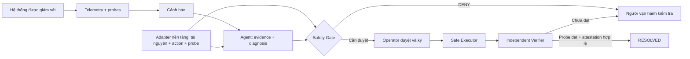

# Nền tảng AI Agent an toàn và có thể kiểm chứng cho vận hành hạ tầng

Nền tảng tiếp nhận cảnh báo hạ tầng, thu thập bằng chứng, đề xuất hành động khôi phục có giới hạn và chỉ xác nhận phục hồi sau khi **Independent Verifier** kiểm tra kết quả. Mục tiêu là áp dụng **Safety Gate, Safe Executor và Independent Verifier** cho nhiều hệ thống và môi trường triển khai thông qua hợp đồng chung và adapter theo nền tảng. Moodle staging trên AWS là môi trường tham chiếu được phát triển và thử nghiệm sâu nhất trong repo; ERPNext là hướng kiểm tra khả năng khái quát hóa.

> **Trạng thái bằng chứng:** Repo có hợp đồng và adapter theo nền tảng, mã chạy, bài kiểm tra, replay offline và kết quả của một số lượt Moodle staging lịch sử. Điều đó chưa chứng minh mức sẵn sàng tương đương trên mọi hạ tầng. README không xác nhận AWS đang được triển khai ở thời điểm đọc. Đường chẩn đoán Moodle hiện dùng luật; AIHS LDA/GBDT mới có prototype và tích hợp shadow/offline, **chưa có model Moodle hoặc action AIHS được duyệt để thực thi live**. Chưa có tỷ lệ cải thiện hợp lệ so với AIHS cơ sở.

## Bắt đầu từ đâu?

| Nhu cầu | Tài liệu |
| --- | --- |
| Hiểu môi trường tham chiếu Moodle trên AWS | [Kiến trúc hạ tầng](docs/BAO_CAO_KIEN_TRUC_HA_TANG.md) và [sơ đồ draw.io](diagram/aws-moodle-current-topology.drawio) |
| Dựng lại, vận hành hoặc gỡ staging | [Hướng dẫn triển khai](docs/BAO_CAO_HUONG_DAN_TRIEN_KHAI.md) |
| Hiểu cơ chế duyệt, thực thi và xác minh | [Báo cáo Safety Gate / Executor / Verifier](docs/BAO_CAO_KIEN_TRUC_AI_AGENT_VA_AN_TOAN.md) |
| Chạy và đối chiếu tình huống lỗi | [Báo cáo kịch bản lỗi](docs/BAO_CAO_KICH_BAN_LOI.md) và [sơ đồ alert](diagram/monitor-alert-flow.drawio) |
| Kiểm tra AIHS và tình trạng dữ liệu | [Báo cáo AIHS](docs/BAO_CAO_AIHS.md) |
| Hoàn thành phép so sánh với AIHS | [Kế hoạch nghiên cứu](docs/PLANNING_UNG_DUNG_LDA_GBDT.md) và [các bước còn lại](docs/PHAN_CONG_LDA_GBDT.md) |
| Làm việc với repo hoặc chạy bộ kiểm tra | [AGENTS.md](AGENTS.md) |

Chạy các lệnh trong README và `automation/` **từ thư mục gốc repository**. Replay offline và bài kiểm tra không cần AWS. Triển khai và fault drill trên staging có thể thay đổi tài nguyên hoặc làm gián đoạn Moodle; trước khi chạy phải xác minh tài khoản AWS, Terraform state có thẩm quyền, baseline và phương án reset theo guide.

## Kiến trúc chung



Hợp đồng chung định nghĩa incident, resource, evidence, typed action và verification; [PlatformAdapter](agent_src/core/platform_adapter.py) cung cấp cách nhận diện alert, tài nguyên và quy tắc riêng của từng hệ thống. Repo có [adapter Moodle](agent_src/core/moodle/adapter.py) và [adapter ERPNext](agent_src/core/erpnext/adapter.py). Tích hợp một hạ tầng mới còn cần catalog hành động, ranh giới quyền, nguồn telemetry, probe độc lập, cách reset và bằng chứng thử nghiệm riêng; việc có adapter không đồng nghĩa đã có đường khôi phục live hoàn chỉnh.

### Môi trường tham chiếu: Moodle staging trên AWS

- **Ứng dụng:** hai EC2 Moodle ở private subnet sau ALB; node A chạy web và cron, node B chỉ chạy web. RDS PostgreSQL lưu dữ liệu nghiệp vụ; EFS lưu `moodledata` dùng chung. Thiết kế RDS hiện mô tả **Single-AZ**, không phải cơ sở dữ liệu HA.
- **Giám sát:** `monitor-ai-01` chạy Prometheus, Alertmanager, Grafana, Blackbox Exporter, synthetic transaction, Agent API, Celery worker và Redis. Node Exporter, cAdvisor và probe trên hai node cung cấp bằng chứng từ nhiều lớp. Monitor cũng là bastion để truy cập các node private.
- **Agent:** Alertmanager gửi alert đến `POST /webhook`; Agent thu bằng chứng, chẩn đoán và ghi ứng viên hành động. Đường nhận alert **không tự gọi Executor**. Alert không được hỗ trợ nằm ngoài đường khôi phục tự động.
- **Kiểm soát sửa lỗi:** Safety Gate kiểm tra policy, action catalog, scope, bằng chứng và chữ ký; Operator duyệt hành động cụ thể qua Telegram; Safe Executor chỉ chạy action trong allowlist trên đúng target và tạo receipt.
- **Kiểm chứng:** Independent Verifier kiểm tra receipt, probe dịch vụ phải hoạt động (*allowed*), đường nguy hiểm phải bị chặn (*forbidden*) và thành phần liên quan (*related*) qua cửa sổ ổn định. Chỉ attestation hợp lệ được Agent chấp nhận mới đưa incident sang `RESOLVED`. Alert hết firing hoặc HTTP health 200 riêng lẻ chưa đủ.

Xem [sơ đồ luồng Agent có thể chỉnh sửa](diagram/ai-agent-current-flow.drawio) và [báo cáo cơ chế an toàn](docs/BAO_CAO_KIEN_TRUC_AI_AGENT_VA_AN_TOAN.md) để biết ranh giới quyền và kết quả đã quan sát trên môi trường tham chiếu.

## Chạy thử trên máy local

### Yêu cầu

- Python 3.11 cho Agent và bộ test; Docker và Docker Compose cho build/kiểm tra image.
- Git, Bash; các công cụ AWS/Terraform/Ansible chỉ cần khi triển khai staging.
- Cài phụ thuộc vào môi trường ảo; không cần credential AWS để chạy replay offline.

```bash
python3.11 -m venv .venv
source .venv/bin/activate
pip install --require-hashes -r agent_src/requirements.txt
pip install pytest ruff 'httpx<0.28'
```

### Kiểm tra mã và replay

```bash
ruff check agent_src --select E9,F63,F7,F82
PYTHONPATH=agent_src pytest -q agent_src/tests
python3 automation/aiops-unified-replay.py all
PYTHONPATH=agent_src python3 automation/moodle-pipeline-replay.py
```

Replay tạo artifact trong `terraform/.artifacts/` (Git bỏ qua). CI kiểm tra kết quả trên **7 fixture** (đúng 7 kịch bản luận văn); `VERIFIED_DRY_RUN` hoặc “accepted” nghĩa là luồng mô phỏng phù hợp kỳ vọng, **không** phải 7 lần sửa thật. `SEC-01` là tình huống chỉ người xử lý và phải bị từ chối ở đường thực thi tự động.

Để chạy đủ bước xác thực như CI, gồm Terraform, automation, build image, ranh giới ground truth và Compose, xem [workflow CI](.github/workflows/ci.yml) cùng [lệnh dành cho agent](AGENTS.md). Image được build trong CI và phát hành qua GHCR theo commit SHA; EC2 chỉ kéo image đã build.

## Triển khai môi trường tham chiếu Moodle staging

1. Đọc [guide triển khai](docs/BAO_CAO_HUONG_DAN_TRIEN_KHAI.md), nhất là phần IAM/MFA, nguồn Terraform state và điều kiện nghiệm thu.
2. Tạo `terraform/deployment.tfvars` từ [template](terraform/deployment.tfvars.example), điền giá trị riêng của môi trường; giữ file này ngoài Git.
3. Dùng đúng AWS profile của môi trường, xác minh account/role, CIDR quản trị và state trước khi `terraform plan`. Review plan đã lưu trước khi apply.
4. Dùng Ansible để cấu hình host, sau đó triển khai image Moodle và Agent theo guide. Secret của Moodle dùng file mount; không đưa mật khẩu vào image hoặc dòng lệnh.
5. Kiểm tra ALB, hai node, RDS, EFS, synthetic transaction, monitoring và khả năng reset. Chỉ sau khi baseline đạt mới chạy fault drill theo [báo cáo kịch bản](docs/BAO_CAO_KICH_BAN_LOI.md).

Terraform quản lý tài nguyên cloud; Ansible quản lý cấu hình bên trong host. Terraform state hiện dùng file local và **không nằm trong Git**: người tiếp nhận cần nhận đúng state có thẩm quyền hoặc kiểm kê/import tài nguyên trước khi apply. Trạng thái trong tài liệu là ảnh chụp theo ngày, không thay thế việc kiểm tra AWS live. CD Moodle staging nằm trong [workflow CD](.github/workflows/cd-staging.yml); workflow này không chạy Terraform.

## Kịch bản và mức độ bằng chứng

Bộ kịch bản luận văn hiện gồm `BIZ-01`, `BIZ-02`, `CON-01`, `DB-01`, `RES-01`, `NET-01` và `SEC-01` (chỉ người). [Báo cáo kịch bản lỗi](docs/BAO_CAO_KICH_BAN_LOI.md) ghi lệnh, kết quả kỳ vọng, lượt đã quan sát và cách reset. Dữ liệu benchmark, fixture, shadow và kết quả live cần được báo riêng:

| Mức bằng chứng | Có thể kết luận |
| --- | --- |
| Unit/contract test và replay offline | Logic xử lý đúng trên dữ liệu thử và không cho phép thực thi live qua replay. |
| Shadow hoặc lab cô lập | Quan sát đề xuất/kiểm soát trong chế độ đã ghi; không tự chứng minh khôi phục AWS staging. |
| Lượt staging có receipt và attestation | Kết quả của **lượt đó** với probe và cửa sổ quan sát đã ghi. |
| Đối chứng AIHS trên Moodle | Chỉ có thể công bố tỷ lệ cải thiện khi cùng dữ liệu, cùng điều kiện, nhãn độc lập và mẫu số hợp lệ; hiện **chưa có**. |

Các lượt DB-01/NET-01 không có Gate/Executor/Verifier trong báo cáo là đối chứng với **Agent theo luật**, không phải AIHS LDA/GBDT. [Báo cáo benchmark](evaluation/benchmark/results/BENCHMARK_REPORT.md) mô tả ranh giới của chỉ số tổng hợp. Không lấy số lượng file artifact làm số incident, và không suy ra tỷ lệ thành công chung từ vài lượt staging đã chọn.

## Hướng tích hợp AIHS LDA/GBDT

Mục tiêu nghiên cứu là chạy **cùng một pipeline AIHS** trên dữ liệu Moodle, rồi đo tác động khi thêm Safety Gate, Operator approval, Safe Executor và Independent Verifier ở phía sau đề xuất. Prototype công khai AIHS dùng dữ liệu tổng hợp; nó không phải mã hoặc trace production của Alibaba. Repo đã lưu manifest nguồn, kết quả tái hiện prototype, schema dữ liệu incident/action, bộ xuất đã lọc, hợp đồng action và bridge shadow. Đầu vào Moodle hiện thiếu snapshot trước quyết định đủ điều kiện và mapping action `live_reviewed`; do đó chưa thể huấn luyện hoặc công bố chỉ số cải thiện so với AIHS cơ sở.

Thứ tự công việc còn lại: thu snapshot và nhãn độc lập → khóa train/validation/test cùng model AIHS → review mapping action Moodle → chốt protocol/scorer → chạy đối chứng có kiểm soát → báo tử số, mẫu số và giới hạn. Chi tiết ở [tài liệu bàn giao AIHS](docs/PHAN_CONG_LDA_GBDT.md). Ground truth và nhãn hậu quyết định chỉ phục vụ chấm điểm, **không** được đưa vào đặc trưng hoặc quyền thực thi live.

## Cấu trúc repository

| Đường dẫn | Vai trò |
| --- | --- |
| `terraform/` | VPC, ALB, EC2, RDS, EFS, security group và tài nguyên AWS liên quan. |
| `ansible/` | Cấu hình host, monitoring, Moodle runtime và các thành phần thực thi an toàn. |
| `moodle/`, `release/moodle/` | Docker image Moodle, endpoint health/synthetic transaction và Compose. |
| `agent_src/` | Hợp đồng và adapter theo nền tảng, FastAPI, Celery, bằng chứng, policy, Gate và hợp đồng Verifier. |
| `automation/` | Script triển khai, probe, fault inject/reset, replay, approval, Executor và Verifier. |
| `evaluation/` | Fixture, ground truth, AIHS prototype study, schema/export và công cụ đánh giá. |
| `release/erpnext/` | Runtime ERPNext để thử khả năng khái quát hóa; chưa có kết quả khôi phục AWS được xác nhận. |
| `diagram/`, `docs/` | Sơ đồ chỉnh sửa được và báo cáo vận hành/nghiên cứu theo ngày. |
| `.github/workflows/` | CI, publish image và CD Moodle staging. |

## Quy tắc an toàn khi đóng góp

- Không commit `.env*`, `terraform.tfstate*`, `terraform/deployment.tfvars`, khóa `*.pem`/`*.pub` hoặc dữ liệu runtime `agent_src/vector_db/`.
- Action lạ hoặc ngoài phạm vi phải **fail closed**. Approval là một quyết định riêng; không đồng nghĩa action đã chạy.
- Executor không nhận shell command tự do từ model hoặc Telegram. Verifier chỉ đọc và là đường duy nhất cho kết luận `RESOLVED`.
- Khi báo kết quả, phân biệt test, replay, shadow, lab và live staging; ghi thời điểm, phiên bản, artifact và giới hạn của từng loại.

Xem [AGENTS.md](AGENTS.md) trước khi sửa mã, chạy kiểm tra hoặc push thay đổi.
