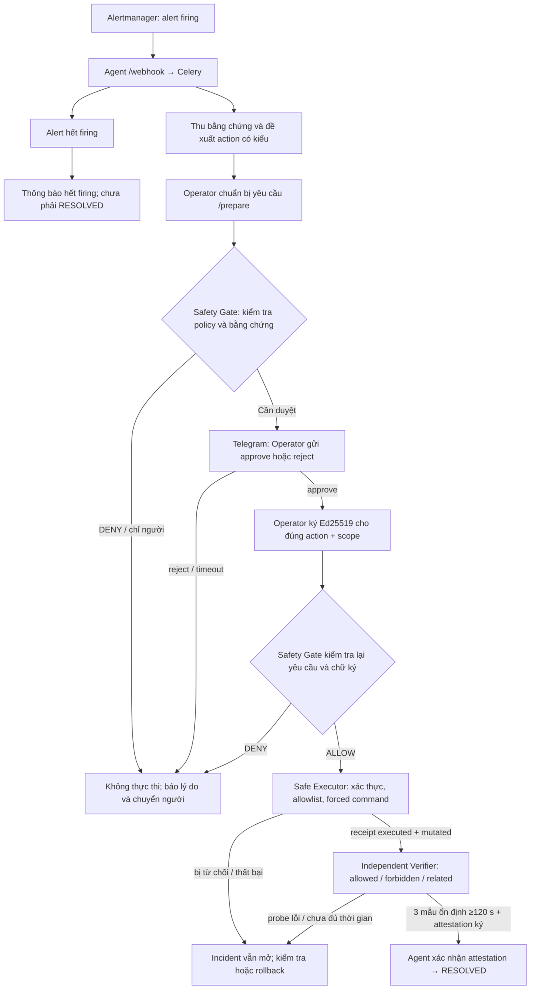

# Báo cáo hệ thống Safety Gate, Safe Executor và Independent Verifier

**Cập nhật:** 15/11/2026 · **Phạm vi:** Moodle staging và các công cụ an toàn trong repo. Báo cáo này mô tả luồng kiểm soát từ đề xuất sửa lỗi đến kết luận khôi phục. Hạ tầng AWS nằm ở [báo cáo kiến trúc hạ tầng](BAO_CAO_KIEN_TRUC_HA_TANG.md); lệnh dựng và vận hành nằm ở [guide triển khai](BAO_CAO_HUONG_DAN_TRIEN_KHAI.md); cách chạy từng lỗi ở [báo cáo kịch bản](BAO_CAO_KICH_BAN_LOI.md).

## 1. Luồng tổng thể

**Điểm quyết định:** alert ngừng firing, Telegram `approve`, Executor trả `executed` và HTTP health 200 **đều chưa đủ** để kết luận đã phục hồi. Chỉ kết quả Verifier có chữ ký, khớp receipt và đủ probe mới cho incident chuyển `RESOLVED`.

## 2. Ba thành phần làm gì?

| Thành phần | Nhận đầu vào | Được quyết định | Không được quyết định |
| --- | --- | --- | --- |
| **Safety Gate** | Action có kiểu, bằng chứng, catalog, scope, môi trường, approval | `DENY`, `REQUIRE_APPROVAL` hoặc `ALLOW` theo policy | Không chạy lệnh và không tuyên bố đã sửa xong |
| **Safe Executor** | Yêu cầu đã được ký và Gate cho phép | Chạy đúng action trong allowlist trên đúng target; ghi receipt | Không tự chọn action khác hoặc tự xác nhận phục hồi |
| **Independent Verifier** | Receipt và trạng thái hệ thống **sau** khi sửa | Chấm probe, ký kết quả; cho hoặc không cho `RESOLVED` | Không sửa hệ thống và không dùng điểm model làm bằng chứng phục hồi |

Nguồn đề xuất hiện tại của Moodle là chẩn đoán theo luật. AIHS LDA/GBDT mới có contract và bridge shadow/offline; **chưa có model Moodle hoặc mapping action live được review**. Khi tích hợp sau này, output AIHS vẫn chỉ là đề xuất không đáng tin cậy và phải qua cùng ba thành phần này. [Báo cáo AIHS](BAO_CAO_AIHS.md) ghi trạng thái chi tiết.

## 3. Safety Gate và phê duyệt Operator

Gate kiểm tra schema yêu cầu, kill switch, bằng chứng mới và đủ, idempotency, action catalog, thời gian chạy, rollback, quyền, phạm vi, môi trường, target, độ tin cậy và chữ ký khi cần. Action lạ, thiếu bằng chứng, sai scope hoặc sai chữ ký đều **fail closed**. Tin Telegram nhóm các kiểm tra thành “8/8” để Operator đọc; đây là kết quả **kiểm tra trước duyệt**, không phải lệnh đã chạy.

| Trạng thái | Ý nghĩa | Tiếp theo |
| --- | --- | --- |
| `DENY` | Điều kiện an toàn không đạt hoặc action ngoài phạm vi | Dừng, ghi lý do; người vận hành kiểm tra bằng chứng/policy |
| `REQUIRE_APPROVAL` | Điều kiện chuẩn bị đạt nhưng cần chữ ký Operator | Chờ người có quyền gửi `approve` hoặc `reject` |
| `ALLOW` | Yêu cầu và approval hợp lệ theo Gate | Chuyển sang Executor; Executor vẫn kiểm tra độc lập |

Bot chỉ chấp nhận tin từ đúng `TELEGRAM_CHAT_ID` và user ID trong `TELEGRAM_ADMIN_USER_IDS`. `approve` có thể là tin nhắn thường trong nhóm; cầu nối sau đó tạo chữ ký **Ed25519 gắn với đúng action, scope và idempotency key** trên máy Operator. Tin chat tự nó không phải chữ ký. `reject` hoặc không có chữ ký thì không thực thi. Công tắc live của Agent và Executor có thể chặn toàn bộ đường sửa. Mã chính: [Safety Gate](../agent_src/core/safety/safe_execution_gate.py), [handoff](../agent_src/core/moodle/live_handoff.py), [cầu nối Telegram](../automation/moodle-telegram-approval.py).

## 4. Safe Executor và receipt

Executor API xác thực Agent bằng HMAC trên request, kiểm tra timestamp/nonce để chống replay, kiểm tra lại chữ ký Operator, action/scope trong allowlist và idempotency bền vững. Node đích do server xác định; node chỉ nhận khóa SSH có **forced command** cho những action đã review. Executor không nhận shell command tự do từ model hoặc Telegram. Khi tắt `EXECUTOR_LIVE_ENABLED`, API từ chối trước khi thay đổi hệ thống.

Receipt phải nối đúng incident, request, action và target, đồng thời ghi có mutation thật hay không. `executed` chỉ chứng minh action đã chạy; nếu action chạy một phần hoặc thất bại, luồng giữ incident mở và xử lý rollback theo hợp đồng. Action `SEC-01` sửa security group RDS là **chỉ người xử lý**, không có đường Executor tự động. Mã chính: [Executor API](../automation/moodle-safe-executor-api.py), [workflow/audit](../agent_src/core/safety/safe_action_live.py), [catalog](../agent_src/core/safety/action_catalog.py).

## 5. Independent Verifier và kết luận phục hồi

Verifier chạy riêng trên máy Operator, không dùng khóa hay credential Executor. Trước khi đo, nó kiểm tra audit và yêu cầu **một receipt đã thực thi, có mutation** khớp incident/request. Nó lấy ít nhất **3 mẫu** trong cửa sổ ổn định **≥120 giây**, sau đó kiểm lại audit và ký attestation Ed25519 gắn với hash receipt. Agent kiểm tra chữ ký, thời gian, các mẫu, probe và receipt trước khi ghi `RESOLVED`.

| Nhóm probe | Câu hỏi cần trả lời | Ví dụ |
| --- | --- | --- |
| **Allowed** | Dịch vụ cần hoạt động đã hoạt động chưa? | Giao dịch Moodle tổng hợp thành công |
| **Forbidden** | Đường nguy hiểm cần bị chặn vẫn bị chặn chứ? | Internet không kết nối được PostgreSQL |
| **Related** | Thành phần liên quan và alert đã ổn chưa? | Hai ALB target khỏe; node B còn phân giải/kết nối DB được |

Nếu một probe thất bại, mẫu chưa đủ hoặc attestation không hợp lệ, incident **chưa `RESOLVED`** dù `/healthz.php` trả HTTP 200. Alertmanager báo “hết firing” chỉ phản ánh rule đã ngừng báo, không thay kết luận Verifier. Với tình huống chỉ người xử lý như SEC-01, không có receipt Executor nên không thể dùng cùng đường attestation tự động. Mã chính: [Verifier](../automation/moodle-independent-verifier.py), [kiểm tra attestation](../agent_src/core/safety/verifier_attestation.py), [state machine](../agent_src/core/verification/state_machine.py).

## 6. Bằng chứng đã có và giới hạn

| Bằng chứng | Điều quan sát được | Giới hạn |
| --- | --- | --- |
| DB-01 ngày 08/11 | Gemini shadow đề xuất `restart` RDS ngoài catalog; Gate `DENY`, không dispatch. Action khác đã review được Operator duyệt, Executor chạy và Verifier xác nhận `RESOLVED`. | Đề xuất Gemini không phải AIHS LDA/GBDT; một ca không cho tỷ lệ chặn nguy hiểm. |
| NET-01 ngày 08/11 | HTTP health 200 nhưng lỗi DNS/DB node B và ALB target liên quan; Verifier trả `collateral_damage`, không cho kết luận phục hồi ở nhánh kiểm tra này. | Lỗi liên quan được cấy có kiểm soát; không suy ra tỷ lệ false recovery ngoài quần thể. |
| Tám lượt staging lịch sử được phân loại | Có receipt và `RESOLVED`; median detect→RESOLVED **521,5 giây**. | Chỉ chọn lượt hoàn chỉnh; đây không phải downtime, tỷ lệ thành công toàn hệ thống hoặc đối chứng AIHS. |
| Mười lượt DB-01/NET-01 ngày 14/11, nhánh bỏ Gate/Executor/Verifier | Agent theo luật đề xuất đúng 10/10; harness reset trực tiếp; tiêu chí là ba synthetic thành công liên tiếp. | Không phải AIHS, không có attestation; mốc phục hồi khác luồng đầy đủ. Số liệu từng lượt ở [báo cáo kịch bản, mục 5.3](BAO_CAO_KICH_BAN_LOI.md). |
| Công cụ AIHS và replay offline | Contract, shadow bridge, kiểm tra fail-closed và công cụ freeze/đo đã có. | Freeze có **0** test record, **0** action AIHS `live_reviewed`, **0** lượt AIHS live mới; chưa đo được mức cải thiện so với AIHS cơ sở. |

Nguồn số liệu và artifact: [báo cáo kịch bản lỗi](BAO_CAO_KICH_BAN_LOI.md) và [báo cáo AIHS](BAO_CAO_AIHS.md). Mốc staging trong tài liệu là lịch sử; trạng thái AWS hiện tại cần xác minh bằng account và Terraform state có thẩm quyền trước khi chạy lại. RTO so sánh, tỷ lệ Gate chặn sai tự nhiên và tỷ lệ false recovery của AIHS hiện **chưa đo được**, không được ghi là 0%.

## 7. Hai bài kiểm tra logic bổ sung

[`moodle-high-risk-safety-demo.py`](../automation/moodle-high-risk-safety-demo.py) phát lại fixture DB-01 và NET-01
qua code Gate/Verifier: **4/4** đề xuất nguy hiểm cố định bị chặn; **2/4** action an toàn bị chặn khi bài thử **cố ý
thay catalog bằng catalog rỗng**; **2/2** ca health xanh nhưng hợp đồng probe sai bị Verifier nhận diện. Các tỷ lệ
này chỉ mô tả fixture, **không** phải tỷ lệ chặn sai tự nhiên hoặc hiệu quả trên staging. Có thể chạy offline từ repo
root bằng `python3 automation/moodle-high-risk-safety-demo.py all`; lệnh không gọi AWS hay Executor.

[`moodle-isolated-live-lab.py`](../automation/moodle-isolated-live-lab.py) tạo dịch vụ loopback `127.0.0.1`, thử
phê duyệt Telegram, Gate, Executor **của lab** và ba mẫu HTTP sau sửa. Nó minh họa luồng nhưng không dùng Agent,
Executor hay attestation của Moodle staging. Đề xuất nguy hiểm ở lab là kịch bản cố định, không do AIHS sinh.
