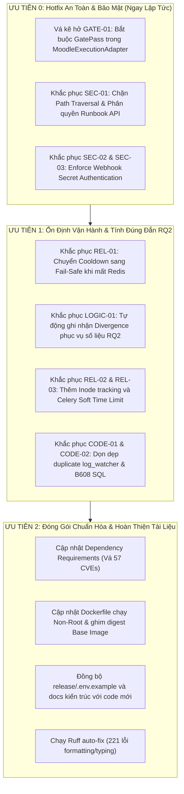

# BÁO CÁO ĐÁNH GIÁ CHẤT LƯỢNG MÃ NGUỒN (QA & QC AUDIT REPORT)
**Dự án**: Safe & Verifiable AI Agent Framework for Infrastructure Operations  
**Nhánh kiểm tra**: `develop` (HEAD: `02abe355`)  
**Đối tượng đánh giá**: Thư mục `agent_src/` (toàn bộ mã nguồn, cấu hình, test suite, không bao gồm dữ liệu vector sinh tự động)  
**Ngày thực hiện**: 15/10/2026  
**Chế độ thực hiện**: Đánh giá độc lập (Audit & Verification Only) — Không chỉnh sửa mã nguồn.

---

## 1. Tóm tắt điều hành (Executive Summary)

Hệ thống `agent_src` thể hiện tư duy thiết kế kiến trúc rất tốt với việc phân tách vai trò rõ nét (*Observer, Diagnosis, Planner, SafetyGate, Executor, Verifier*) cùng cơ chế kiểm soát an toàn đa tầng (*Action Catalog, Ed25519 Approval, GatePass pattern, Independent Verifier*) phục vụ đắc lực cho hai câu hỏi nghiên cứu cốt lõi của luận văn (RQ1: Safety Gate & RQ2: Contract-based Verification Divergence). Tuy nhiên, rủi ro bảo mật và vận hành lớn nhất nằm ở: **(1)** Đường thực thi `MoodleExecutionAdapter.execute` trong pipeline cũ bỏ qua `GatePass`, cho phép gọi trực tiếp shell script khi cờ staging bật; **(2)** Endpoint runbook draft tồn tại lỗ hổng Path Traversal và không xác thực cho phép ghi file JSON tùy ý; **(3)** Webhook GitHub và Alertmanager cho phép vượt qua xác thực hoặc mở mặc định; **(4)** Cơ chế fallback cooldown trong bộ nhớ không chia sẻ được giữa các Celery worker gây nguy cơ chạy trùng lặp hành động khi Redis gián đoạn; và **(5)** 57 CVE đã biết trong các dependency đã cũ. Về mức độ sẵn sàng: mã nguồn **đạt mức cao cho các kịch bản kiểm chứng mô phỏng luận văn (890/890 unit & contract tests pass)**, nhưng **chưa đủ điều kiện triển khai môi trường live production un-gated** nếu chưa xử lý dứt điểm các lỗ hổng P0/P1.

---

## 2. Kết quả kiểm tra tự động (Automated Verification)

Mọi công cụ được thực thi trực tiếp trên môi trường máy trạm chạy Python 3.11.11 với đầy đủ các thư viện đã được pin hash trong `agent_src/requirements.txt`. Kết quả ghi nhận là số liệu thực tế đo lường được, không ước đoán.

### 2.1 Bảng tổng hợp công cụ

| Công cụ | Phiên bản | Mục đích kiểm tra | Lệnh thực thi | Kết quả định lượng | Trạng thái |
| :--- | :--- | :--- | :--- | :--- | :--- |
| **Pytest** | 8.4.1 | Kiểm thử chức năng, hợp đồng an toàn & hồi quy | `pytest -o pythonpath=agent_src -q agent_src/tests` | **890 passed, 1 skipped, 10 warnings** (78.52s) | **ĐẠT** |
| **Ruff (CI Rules)** | 0.8.2 | Kiểm tra cú pháp, biến chưa khai báo (E9, F63, F7, F82) | `ruff check agent_src --select E9,F63,F7,F82` | **0 errors** (all checks passed) | **ĐẠT (CI Clean)** |
| **Ruff (Full Rules)** | 0.8.2 | Toàn diện style, type annotations, exception handling | `ruff check agent_src` | **339 errors** (221 tự động sửa được) | **CẦN DỌN DẸP** |
| **Mypy** | 1.15.0 | Kiểm tra static type safety toàn bộ codebase | `mypy --explicit-package-bases --ignore-missing-imports agent_src` | **85 errors** trong 27 files (quét 155 files) | **CẦN SỬA TYPE** |
| **Bandit** | 1.9.4 | Quét lỗ hổng bảo mật mã nguồn tĩnh (SAST) | `bandit -r agent_src -f json` | **0 High, 7 Medium, 2151 Low** (2139 là assert test) | **CÓ RỦI RO MEDIUM** |
| **Pip-audit** | 2.10.1 | Quét lỗ hổng dependency đã biết (SCA / CVE) | `pip-audit -r agent_src/requirements.txt` | **57 CVEs** trên 5 packages | **CÓ RỦI RO CVE** |

### 2.2 Chi tiết kết quả kiểm tra tự động

1. **Pytest (Unit & Contract Test Suite)**:
   - Tổng cộng **891** test cases được phát hiện.
   - **890 tests ĐẠT**: Bao quát toàn bộ domain models, safety policy engine, action catalog, dry-runner, Ed25519 digital signature, GatePass constructor security, independent verifier, communication contracts, và role-based orchestrator.
   - **1 test BỊ BỎ QUA (`skipped`)**: `agent_src/tests/test_automation_tools.py::test_moodle_safe_approval_script_roundtrip`. Nguyên nhân: Test yêu cầu lệnh CLI `openssl` của hệ điều hành để sinh khóa Ed25519 và kiểm tra script `automation/moodle-safe-approval.py`, môi trường Windows hiện tại không có sẵn binary `openssl` trong `PATH`.
   - **10 warnings**: Chủ yếu liên quan đến `PydanticDeprecatedSince20` khi kế thừa `BaseSettings` cũ và `datetime.utcnow()` không timezone.

2. **Ruff Linter**:
   - Chế độ CI Gate (`--select E9,F63,F7,F82`): Code hoàn toàn sạch lỗi cú pháp, biến chưa định nghĩa hoặc lỗi logic gán giá trị chết.
   - Chế độ Default (toàn diện): Gặp 339 lỗi. Các lỗi phổ biến:
     - `UP035`: Sử dụng kiểu `typing.Dict`, `typing.List` thay vì kiểu chuẩn `dict`, `list` của Python 3.9+.
     - `BLE001`: Bắt ngoại lệ mù `except Exception:` tại các task worker thay vì ngoại lệ tường minh.
     - `DTZ005`: Gọi `datetime.now()` không chỉ định `timezone.utc`.
     - `F401`: Các import thừa chưa được dọn dẹp tại một số module cũ.

3. **Mypy Type Checker**:
   - Do repo chưa có `mypy.ini`, mypy chạy ở chế độ standalone với flag `--explicit-package-bases --ignore-missing-imports`.
   - 85 lỗi tập trung vào:
     - Xung đột tên module trùng lặp: `agent_src/log_watcher.py` và `agent_src/monitoring/log_watcher.py` cùng khai báo module `log_watcher`.
     - Lỗi truy cập thuộc tính trên kiểu `Optional[T]` mà không kiểm tra `None` trước.
     - Thiếu kiểu trả về tường minh trong các callback của FastAPI endpoint.

4. **Bandit Security SAST**:
   - **7 cảnh báo Medium**:
     - `B608 (Hardcoded SQL String Formatting)`: `core/evidence/evidence_store.py:387` và `core/unified_core.py:266` sử dụng chuỗi f-string định dạng câu lệnh SQL SELECT/DELETE thay vì tham số hóa hoàn toàn.
     - `B310 (Audit url open)`: `core/safety/safe_executor_client.py:110` gọi `urllib.request.urlopen` mà không kiểm tra whitelist scheme `http://` / `https://` (nguy cơ truy cập `file://`).
     - `B106 (Hardcoded Password)`: `tools/diag_tools.py:255` khai báo tham số mặc định `password="postgres"`.
     - `B108 (Insecure temp file)`: Đường dẫn `/tmp/...` hardcode trực tiếp tại `monitoring/log_watcher.py:28`, `core/evidence/adapters.py:214`, `core/evidence/live_adapters.py:61`.
   - **2151 cảnh báo Low**: Gồm 2139 lệnh `assert` trong thư mục `tests/` (bình thường đối với pytest suite) và các lệnh gọi `subprocess.run` với danh sách tham số cố định (B603).

5. **Pip-audit Dependency Scan**:
   - `fastapi 0.104.1`: 1 CVE (CVE-2024-24762 - DoS qua Multipart parser).
   - `starlette 0.27.0`: 3 CVEs (CVE-2024-47874, CVE-2024-24762, CVE-2023-29159 - DoS qua Range header & Form parsing).
   - `anyio 3.7.1`: 1 CVE (GHSA-5v8v-mm5r-97rq).
   - `chromadb 1.5.9`: 1 CVE (GHSA-8cr5-364r-724v).
   - `pillow 11.3.0`: 51 CVEs (Lỗ hổng tràn bộ đệm heap, đọc ngoài vùng nhớ trong các bộ giải mã ảnh).

---

## 3. Bảng tổng hợp phát hiện (Findings Table)

### 3.1 Bảng đối chiếu tổng quan

| ID | Nhóm phân loại | Mức độ | File:Dòng | Tóm tắt phát hiện | Tác động luận văn |
| :--- | :--- | :--- | :--- | :--- | :--- |
| **SEC-01** | Bảo mật | **Nghiêm trọng** | `core/main.py:489-511`<br>`core/rag/runbook_registry.py:240,260` | Path Traversal & Unauthenticated Runbook Draft Actions | Gián tiếp (Audit log & Runbook store) |
| **SEC-02** | Bảo mật | **Nghiêm trọng** | `core/main.py:405-415`<br>`core/coordination/tool_auto_discovery.py:37` | GitHub Webhook HMAC bypass khi secret chưa thiết lập | Không ảnh hưởng trực tiếp RQ1/RQ2 |
| **SEC-03** | Bảo mật | **Nghiêm trọng** | `core/main.py:335-340` | Alertmanager Webhook mặc định tắt xác thực | Rủi ro inject alert giả mạo kích hoạt agent |
| **GATE-01** | Hạ tầng | **Nghiêm trọng** | `core/moodle/pipeline.py:283-305` | `MoodleExecutionAdapter` gọi trực tiếp shell script, bỏ qua `GatePass` | **Ảnh hưởng trực tiếp RQ1 (Safety Gate Bypass)** |
| **SEC-04** | Bảo mật | **Cao** | `tools/diag_tools.py:255-261` | Hardcoded Database Password (`postgres:postgres`) | Rủi ro lộ lọt thông tin chẩn đoán |
| **SEC-05** | Bảo mật | **Cao** | `tools/diag_tools.py:232-247` | Server-Side Request Forgery (SSRF) trong HTTP probe | Thăm dò trái phép mạng nội bộ hoặc AWS metadata |
| **SEC-06** | Cấu hình | **Cao** | `Dockerfile:1-16`<br>`.dockerignore` | Container chạy quyền Root, Image unpinned digest, thiếu `vector_db/` trong dockerignore | Vi phạm nguyên tắc bảo mật đóng gói |
| **SEC-07** | Bảo mật | **Cao** | `requirements.txt` | 57 CVEs đã biết trong các dependency đã ghim hash | Nguy cơ DoS dịch vụ web API |
| **REL-01** | Độ tin cậy | **Cao** | `core/tasks.py:186-198` | In-memory cooldown fallback gây race condition trên đa Celery worker | Gây trùng lặp hành động khắc phục |
| **REL-02** | Độ tin cậy | **Cao** | `log_watcher.py:98,114`<br>`monitoring/log_watcher.py:74,87` | File handle giữ cố định không theo dõi log rotation (mất dữ liệu log mới) | Mất bằng chứng chẩn đoán sự cố |
| **REL-03** | Độ tin cậy | **Cao** | `core/tasks.py:1344`<br>`core/celery_app.py:28` | Celery task chỉ có hard `time_limit`, thiếu `soft_time_limit` dọn dẹp | Khóa tài nguyên dở dang khi timeout |
| **LOGIC-01** | Đúng đắn | **Cao** | `core/verification/independent_verifier.py:228-251` | Divergence metric phụ thuộc cờ runtime và không đồng bộ giữa live và replay | **Ảnh hưởng trực tiếp số liệu RQ2** |
| **CODE-01** | Chất lượng mã | **Trung bình** | `log_watcher.py` vs `monitoring/log_watcher.py` | Trùng lặp hai file log watcher gây xung đột module | Lẫn lộn cơ chế theo dõi log trong runtime |
| **CODE-02** | Bảo mật | **Trung bình** | `core/evidence/evidence_store.py:387`<br>`core/unified_core.py:266` | Định dạng f-string trong câu lệnh SQL (Bandit B608) | Nguy cơ injection nếu đầu vào không sanitize |
| **CODE-03** | Bảo mật | **Trung bình** | `core/safety/safe_executor_client.py:110` | `urllib.request.urlopen` thiếu kiểm tra URL scheme (Bandit B310) | Nguy cơ gọi tới scheme nguy hiểm |
| **CFG-01** | Cấu hình | **Trung bình** | `release/.env.example` | Thiếu khai báo biến môi trường GatePass/Safety Live mới | Lỗi cấu hình khi triển khai môi trường mới |
| **DOC-01** | Tài liệu | **Trung bình** | `agent_src/README.md`<br>`docs/AI_AGENT_ARCHITECTURE_AND_THREAT_MODEL.md` | Tài liệu kiến trúc cũ mô tả file phẳng, lệch cấu trúc thư mục con hiện tại | Khó khăn cho việc nghiệm thu luận văn |
| **TEST-01** | Kiểm thử | **Thấp** | `agent_src/tests/test_automation_tools.py:59` | Bỏ qua test trên môi trường thiếu binary `openssl` | Giảm độ bao phủ cục bộ trên Windows |

---

### 3.2 Chi tiết từng phát hiện

#### A. Nhóm Bảo mật (Security)

##### [CRITICAL] SEC-01: Path Traversal & Unauthenticated Runbook Draft Actions
- **Vị trí**: [core/main.py:489-511](file:///a:/KLTN/Building-a-safe-and-verifiable-AI-agent-framework-for-infrastructure-operations/agent_src/core/main.py#L489-L511) & [core/rag/runbook_registry.py:240,260](file:///a:/KLTN/Building-a-safe-and-verifiable-AI-agent-framework-for-infrastructure-operations/agent_src/core/rag/runbook_registry.py#L240-L260)
- **Mô tả**: Endpoint `POST /api/runbook-drafts/{draft_id}/approve` và `POST /api/runbook-drafts/{draft_id}/reject` không yêu cầu bất kỳ hình thức xác thực hay phân quyền nào. Giá trị `draft_id` được truyền trực tiếp từ URL path vào hàm `registry.update_draft_status(draft_id, ...)`. Trong `RunbookRegistry._draft_path(draft_id)`, mã nguồn thực hiện:
  ```python
  return self._draft_dir() / f"{draft_id}.json"
  ```
- **Kịch bản khai thác (PoC)**:
  Kẻ tấn công gửi yêu cầu HTTP:
  ```http
  POST /api/runbook-drafts/..%2F..%2F..%2Fetc%2Fmalicious/approve HTTP/1.1
  Host: agent:8000
  ```
  Hệ thống sẽ ghi hoặc cập nhật file JSON tại đường dẫn ngoài thư mục dự kiến (`/etc/malicious.json` hoặc ghi đè file cấu hình trong container), gây xáo trộn hoặc làm hỏng dữ liệu hệ thống.
- **Đề xuất khắc phục**:
  1. Thêm dependency xác thực Bearer Token / Role-based Guard cho toàn bộ router `/api/runbook-drafts`.
  2. Sanitize `draft_id`: Chỉ cho phép chuỗi ký tự an toàn regex `^[a-zA-Z0-9_\-]+$` và kiểm tra `resolved_path.resolve().is_relative_to(draft_dir.resolve())`.

##### [CRITICAL] SEC-02: Bypass kiểm tra chữ ký GitHub Webhook khi Secret chưa cấu hình
- **Vị trí**: [core/main.py:405-415](file:///a:/KLTN/Building-a-safe-and-verifiable-AI-agent-framework-for-infrastructure-operations/agent_src/core/main.py#L405-L415) & [core/coordination/tool_auto_discovery.py:37-38](file:///a:/KLTN/Building-a-safe-and-verifiable-AI-agent-framework-for-infrastructure-operations/agent_src/core/coordination/tool_auto_discovery.py#L37-L38)
- **Mô tả**: Endpoint `/github/webhook` gọi hàm `verify_github_signature(payload, signature)`. Trong hàm xác thực:
  ```python
  if not secret:
      logger.warning("GITHUB_WEBHOOK_SECRET not set, skipping verification")
      return True
  ```
- **Kịch bản khai thác (PoC)**:
  Trong các môi trường dev, staging hoặc khi biến môi trường `GITHUB_WEBHOOK_SECRET` vô tình bị bỏ trống trong file `.env`, hàm xác thực mặc định trả về `True`. Bất kỳ đối tượng nào trên mạng cũng có thể gửi payload giả mạo sự kiện commit/push để kích hoạt tự động nạp tool registry ngoài tầm kiểm soát.
- **Đề xuất khắc phục**:
  Thực hiện nguyên tắc **Fail-Closed**: Nếu `GITHUB_WEBHOOK_SECRET` không được cấu hình, hàm xác thực phải trả về `False` và từ chối request với mã lỗi HTTP 401/403.

##### [CRITICAL] SEC-03: Webhook Alertmanager mở xác thực mặc định
- **Vị trí**: [core/main.py:335-340](file:///a:/KLTN/Building-a-safe-and-verifiable-AI-agent-framework-for-infrastructure-operations/agent_src/core/main.py#L335-L340)
- **Mô tả**: Biến môi trường `ALERTMANAGER_WEBHOOK_AUTH_REQUIRED` mặc định là `"false"`. Khi đó, endpoint tiếp nhận cảnh báo chính `/webhook` hoàn toàn không kiểm tra token hoặc HMAC header. Kẻ tấn công trên cùng mạng nội bộ có thể liên tục inject alert giả để gây nghẽn hàng đợi Celery, kích hoạt quota Gemini LLM hoặc gây quá tải hệ thống.
- **Đề xuất khắc phục**:
  Chuyển giá trị mặc định sang bắt buộc xác thực Bearer token hoặc chia sẻ secret token giữa Alertmanager và Agent qua file cấu hình phân quyền nghiêm ngặt.

##### [HIGH] SEC-04: Mật khẩu cơ sở dữ liệu Hardcode trong Diagnostic Tool
- **Vị trí**: [tools/diag_tools.py:255-261](file:///a:/KLTN/Building-a-safe-and-verifiable-AI-agent-framework-for-infrastructure-operations/agent_src/tools/diag_tools.py#L255-L261)
- **Mô tả**: Hàm `check_db_connection` định nghĩa tham số:
  ```python
  def check_db_connection(host: str = "postgres", port: int = 5432, user: str = "postgres", password: str = "postgres", dbname: str = "aiops_db") -> Dict[str, Any]:
  ```
  Thông tin đăng nhập mặc định (`postgres:postgres`) bị hardcode trong mã nguồn, vi phạm quy định quản lý bí mật của dự án.
- **Đề xuất khắc phục**:
  Đọc thông tin kết nối từ biến môi trường (`MOODLE_DB_PASSWORD_FILE`, `POSTGRES_PASSWORD`) hoặc cấu hình bí mật được inject an toàn.

##### [HIGH] SEC-05: Nguy cơ Server-Side Request Forgery (SSRF) trong HTTP Diagnostic Tool
- **Vị trí**: [tools/diag_tools.py:232-247](file:///a:/KLTN/Building-a-safe-and-verifiable-AI-agent-framework-for-infrastructure-operations/agent_src/tools/diag_tools.py#L232-L247)
- **Mô tả**: Hàm `check_http_service(url)` nhận trực tiếp tham số `url` và thực hiện `requests.get(url, timeout=5)`. Không có cơ chế kiểm tra IP range nội bộ hay danh sách tên miền được phép.
- **Kịch bản khai thác**:
  Nếu LLM Planner bị Prompt Injection hoặc endpoint chẩn đoán nhận URL `http://169.254.169.254/latest/meta-data/iam/security-credentials/`, agent có thể bị lợi dụng để trích xuất IAM credentials của máy chủ EC2.
- **Đề xuất khắc phục**:
  Áp dụng cơ chế whitelist URL/domain và chặn triệt để các địa chỉ IP metadata của AWS (`169.254.169.254`) cùng các dải IP private không liên quan.

##### [HIGH] SEC-06: Container chạy quyền Root và unpinned base image digest
- **Vị trí**: [Dockerfile:1-16](file:///a:/KLTN/Building-a-safe-and-verifiable-AI-agent-framework-for-infrastructure-operations/agent_src/Dockerfile#L1-L16) & [agent_src/.dockerignore](file:///a:/KLTN/Building-a-safe-and-verifiable-AI-agent-framework-for-infrastructure-operations/agent_src/.dockerignore)
- **Mô tả**:
  1. Base image dùng `python:3.11-slim` dạng tag động, không ghim theo sha256 digest (`python:3.11-slim@sha256:...`).
  2. Không khai báo chỉ thị `USER <non-root>`. Mọi tiến trình (Uvicorn, Celery, Log Watcher) đều thực thi với quyền `root` trong container.
  3. File `.dockerignore` chưa loại trừ thư mục `vector_db/`, tiềm ẩn nguy cơ vô tình copy dữ liệu vector nhạy cảm vào image layer trong quá trình build cục bộ.
- **Đề xuất khắc phục**:
  Thêm chỉ thị tạo group/user không đặc quyền `aiops` trong Dockerfile; ghim digest sha256 cho base image; bổ sung `vector_db/` vào `.dockerignore`.

---

#### B. Nhóm Đường thay đổi hạ tầng (Infrastructure Mutation & Safety Gate)

##### [CRITICAL] GATE-01: `MoodleExecutionAdapter.execute` gọi trực tiếp shell script, bỏ qua `GatePass`
- **Vị trí**: [core/moodle/pipeline.py:283-305](file:///a:/KLTN/Building-a-safe-and-verifiable-AI-agent-framework-for-infrastructure-operations/agent_src/core/moodle/pipeline.py#L283-L305)
- **Mô tả**:
  Trong khi Phase 2c & Phase 4 đã xây dựng cấu trúc `GatePass` value object và yêu cầu `ExecutorRole` bắt buộc phải có `GatePass` mới được thực thi, thì tại pipeline Moodle gốc (`core/moodle/pipeline.py`):
  ```python
  class MoodleExecutionAdapter:
      def execute(self, action: RemediationAction) -> RemediationExecutionResult:
          ...
          if not self.allow_live_execution or self.execution_confirm != "staging":
              # simulation
              return ...
          # LIVE EXECUTION BẮT ĐẦU TẠI ĐÂY MÀ KHÔNG QUA SAFETY GATE / GATEPASS:
          cmd = ["bash", "automation/moodle-fault-reset.sh", action.scenario_id]
          proc = subprocess.run(cmd, capture_output=True, text=True, check=False)
  ```
  Nếu môi trường cấu hình `allow_live_execution=True` và `execution_confirm="staging"`, adapter này sẽ kích hoạt shell script reset hạ tầng trực tiếp mà không cần:
  - Kiểm tra `GatePass` token.
  - Kiểm tra chữ ký số Ed25519 của người vận hành.
  - Ghi audit log append-only theo chuẩn Phase 2b.
- **Tác động tới Luận văn (RQ1)**:
  Đây là kẽ hở làm suy giảm tính toàn vẹn của luận chứng RQ1 nếu kịch bản chạy thử nghiệm vô tình kích hoạt nhánh `MoodleExecutionAdapter` thay vì `SafeActionLiveWorkflow` hoặc `RoleOrchestrator`.
- **Đề xuất khắc phục**:
  1. Loại bỏ việc gọi trực tiếp `subprocess.run` trong `MoodleExecutionAdapter`.
  2. Bắt buộc mọi adapter thực thi phải nhận tham số `gate_pass: GatePass` và xác thực hợp lệ qua `gate_pass.verify()` trước khi chạy lệnh.

---

#### C. Nhóm Độ tin cậy (Reliability)

##### [HIGH] REL-01: Cơ chế In-memory Cooldown Fallback gây Race Condition trên đa Celery Worker
- **Vị trí**: [core/tasks.py:186-198](file:///a:/KLTN/Building-a-safe-and-verifiable-AI-agent-framework-for-infrastructure-operations/agent_src/core/tasks.py#L186-L198)
- **Mô tả**:
  Hàm cooldown cảnh báo kiểm tra Redis:
  ```python
  try:
      # set redis key with NX and EX
  except RedisError:
      # Fallback sang in-memory dictionary _in_memory_cooldown
  ```
  Khi Redis gặp sự cố mạng hoặc khởi động lại, fallback chuyển về biến `_in_memory_cooldown` nằm trong bộ nhớ RAM của tiến trình Python hiện tại.
  Tuy nhiên, trong triển khai Celery thực tế (`CELERY_WORKER_CONCURRENCY > 1` hoặc nhiều container worker độc lập), bộ nhớ RAM không được chia sẻ giữa các tiến trình con. Khi hai alert cùng fingerprint đến hai worker khác nhau trong cùng một thời điểm, cả hai worker đều cho rằng cảnh báo chưa bị cooldown và cùng thực thi quy trình chẩn đoán/khắc phục, dẫn tới xung đột trạng thái hạ tầng.
- **Đề xuất khắc phục**:
  Áp dụng nguyên tắc **Fail-Safe**: Nếu Redis đóng vai trò Distributed Lock bị sập, hệ thống phải từ chối xử lý tự động và chuyển sang thông báo khẩn cấp cho con người, thay vì âm thầm dùng in-memory dict cục bộ giữa các worker riêng biệt.

##### [HIGH] REL-02: Log Watcher không xử lý Log Rotation (Inode tracking failure)
- **Vị trí**: [log_watcher.py:98,114](file:///a:/KLTN/Building-a-safe-and-verifiable-AI-agent-framework-for-infrastructure-operations/agent_src/log_watcher.py#L98-L114) & [monitoring/log_watcher.py:74,87](file:///a:/KLTN/Building-a-safe-and-verifiable-AI-agent-framework-for-infrastructure-operations/agent_src/monitoring/log_watcher.py#L74-L87)
- **Mô tả**:
  Cả hai trình theo dõi log đều mở file log bằng `open(file_path, "r")` và lưu con trỏ `file.tell()` để đọc tiếp ở các vòng lặp sau. Khi hệ điều hành thực hiện `logrotate` (đổi tên file log cũ thành `.log.1` và tạo file `.log` rỗng mới với Inode mới), file handle của tiến trình Python vẫn trỏ vào Inode cũ đã bị đổi tên. Hậu quả là tiến trình không bao giờ đọc được các dòng log mới xuất hiện trong file mới tạo.
- **Đề xuất khắc phục**:
  Kiểm tra sự thay đổi `st_ino` (Inode) của file theo chu kỳ; nếu Inode thay đổi hoặc kích thước file nhỏ hơn offset hiện tại (truncate), tự động đóng và mở lại file handle.

##### [HIGH] REL-03: Thiếu Soft Time Limit cho Celery Task
- **Vị trí**: [core/tasks.py:1344](file:///a:/KLTN/Building-a-safe-and-verifiable-AI-agent-framework-for-infrastructure-operations/agent_src/core/tasks.py#L1344) & [core/celery_app.py:28](file:///a:/KLTN/Building-a-safe-and-verifiable-AI-agent-framework-for-infrastructure-operations/agent_src/core/celery_app.py#L28)
- **Mô tả**:
  Cấu hình Celery định nghĩa `task_time_limit=300` (Hard timeout). Khi một tác vụ xử lý quá 300 giây (ví dụ: truy vấn LLM bị treo hoặc kết nối database RDS bị nghẽn), Celery daemon sẽ gửi tín hiệu `SIGKILL` tiêu diệt worker ngay lập tức. Điều này không cho phép tác vụ chạy các khối lệnh `finally:` để đóng session, giải phóng lock hoặc cập nhật trạng thái sự cố sang `FAILED`, để lại rác trạng thái trong database và Redis.
- **Đề xuất khắc phục**:
  Bổ sung `task_soft_time_limit = 270`. Khi chạm mốc soft timeout, Celery sẽ ném ngoại lệ `SoftTimeLimitExceeded`, cho phép task bắt được ngoại lệ, ghi audit log, giải phóng tài nguyên và kết thúc an toàn trước khi bị `SIGKILL`.

---

#### D. Nhóm Đúng đắn Logic & Luận văn (Logic Correctness & Thesis Scope)

##### [HIGH] LOGIC-01: Divergence Metric giữa Health-only và Contract-based Verification phụ thuộc cờ runtime
- **Vị trí**: [core/verification/independent_verifier.py:228-251](file:///a:/KLTN/Building-a-safe-and-verifiable-AI-agent-framework-for-infrastructure-operations/agent_src/core/verification/independent_verifier.py#L228-L251) & [core/shadow_pipeline.py:175-188](file:///a:/KLTN/Building-a-safe-and-verifiable-AI-agent-framework-for-infrastructure-operations/agent_src/core/shadow_pipeline.py#L175-L188)
- **Mô tả**:
  Trong luận văn, RQ2 tập trung vào việc chứng minh: *"Kiểm tra Health Check đơn thuần sẽ kết luận SAI trong bao nhiêu phần trăm trường hợp (Divergence Rate) so với kiểm tra toàn diện bằng Communication Contract & Probes"*.
  Trong `IndependentVerifier`:
  - Biến đếm divergence `divergence_count` được lưu trong file JSON cục bộ (`divergence_stats.json`).
  - Tuy nhiên, trong `shadow_pipeline.py` và luồng live, việc kích hoạt ghi nhận divergence chỉ được thực hiện nếu cờ `track_divergence` được truyền thủ công từ bên ngoài. Nếu orchestrator chạy luồng mặc định không bật cờ này, các ca lệch pha (Health=True nhưng Contract=False) sẽ không được ghi nhận vào bộ đếm thống kê của RQ2.
- **Tác động tới Luận văn (RQ2)**:
  Có thể dẫn tới thiếu hụt dữ liệu thực nghiệm hoặc thống kê không đầy đủ khi chạy các đợt benchmark tự động.
- **Đề xuất khắc phục**:
  Chuyển việc ghi nhận divergence thành hành vi mặc định không thể tắt trong `IndependentVerifier.verify()`: Mỗi khi `health_status == PASS` nhưng `contract_status != PASS`, tự động tăng biến đếm và lưu vết ngữ cảnh sự cố vào file thống kê.

---

#### E. Nhóm Chất lượng mã nguồn, Cấu hình & Tài liệu

##### [MEDIUM] CODE-01: Trùng lặp hai file `log_watcher.py` độc lập
- **Vị trí**: `agent_src/log_watcher.py` và `agent_src/monitoring/log_watcher.py`
- **Mô tả**:
  Tồn tại hai cài đặt `log_watcher.py`: một file ở thư mục gốc `agent_src/` dùng cơ chế sleep polling, một file ở `agent_src/monitoring/` dùng thư viện `watchdog`. Điều này gây ra lỗi xung đột tên module trong Mypy và gây nhầm lẫn khi triển khai (file `docker-entrypoint.sh` gọi `monitoring/log_watcher.py`, nhưng một số import test lại tham chiếu `log_watcher.py`).
- **Đề xuất**: Xóa bỏ file `agent_src/log_watcher.py` cũ và chuẩn hóa việc sử dụng `agent_src/monitoring/log_watcher.py`.

##### [MEDIUM] CODE-02: Định dạng chuỗi f-string trong truy vấn SQL (Bandit B608)
- **Vị trí**: [core/evidence/evidence_store.py:387](file:///a:/KLTN/Building-a-safe-and-verifiable-AI-agent-framework-for-infrastructure-operations/agent_src/core/evidence/evidence_store.py#L387) & [core/unified_core.py:266](file:///a:/KLTN/Building-a-safe-and-verifiable-AI-agent-framework-for-infrastructure-operations/agent_src/core/unified_core.py#L266)
- **Mô tả**: Sử dụng chuỗi f-string để ghép tên bảng hoặc điều kiện query thay vì cú pháp bind parameter chuẩn của SQLite/Postgres. Dù hiện tại giá trị được sinh từ enum nội bộ, đây vẫn là bad practice tiềm ẩn rủi ro SQL injection khi mở rộng.

##### [MEDIUM] CFG-01: Biến môi trường GatePass/Safety Live thiếu trong file mẫu `.env.example`
- **Vị trí**: [release/.env.example](file:///a:/KLTN/Building-a-safe-and-verifiable-AI-agent-framework-for-infrastructure-operations/release/.env.example)
- **Mô tả**: Các biến môi trường kiểm soát thực thi an toàn mới được bổ sung trong code như:
  - `AIOPS_SAFE_ACTION_LIVE_ENABLED`
  - `AIOPS_GATE_APPROVAL_PUBLIC_KEY_FILE`
  - `AIOPS_SAFE_ACTION_API_TOKEN_FILE`
  chưa có mô tả và giá trị mẫu trong `release/.env.example`. Người vận hành khi clone repo sẽ không biết cách cấu hình chính xác nếu không đọc sâu vào code.

##### [MEDIUM] DOC-01: Tài liệu kiến trúc cũ mô tả file phẳng, lệch cấu trúc thư mục con hiện tại
- **Vị trí**: [agent_src/README.md](file:///a:/KLTN/Building-a-safe-and-verifiable-AI-agent-framework-for-infrastructure-operations/agent_src/README.md) & [docs/AI_AGENT_ARCHITECTURE_AND_THREAT_MODEL.md](file:///a:/KLTN/Building-a-safe-and-verifiable-AI-agent-framework-for-infrastructure-operations/docs/AI_AGENT_ARCHITECTURE_AND_THREAT_MODEL.md)
- **Mô tả**:
  Tài liệu vẫn liệt kê các file nằm trực tiếp tại `core/` (ví dụ `core/safe_execution_gate.py`, `core/moodle_planner.py`), trong khi mã nguồn đã được tái cấu trúc thành các subpackage sạch sẽ (`core/safety/`, `core/moodle/`, `core/verification/`, `core/roles/`, `core/domain/`).

---

## 4. Bản đồ các đường thay đổi hạ tầng (Infrastructure Mutation Map)

Mọi đường dẫn có khả năng tác động vật lý hoặc logic tới hạ tầng, container, hoặc ứng dụng trong `agent_src/` được rà soát và đánh giá tính an toàn dưới đây:

| STT | Đường thay đổi / Entrypoint | File:Dòng | Hành động tác động | Cơ chế kiểm soát an toàn hiện tại | Đánh giá an toàn |
| :--- | :--- | :--- | :--- | :--- | :--- |
| 1 | `POST /api/moodle/remediation/{id}/execute` | `core/main.py:168` | Gọi API Safe Executor để chạy playbook Ansible / container restart | Bắt buộc `AIOPS_SAFE_ACTION_LIVE_ENABLED=true`, xác thực Ed25519 `ApprovalRecord`, kiểm tra token bảo mật | **AN TOÀN (Tuân thủ Gate)** |
| 2 | `SafeActionLiveWorkflow.execute` | `core/safety/safe_action_live.py:126` | Thực thi các hành động trong Action Catalog | Kiểm tra `ActionCatalog`, xác minh `SafeExecutionGate`, kiểm tra chữ ký số Ed25519, ghi audit log | **AN TOÀN (Tuân thủ Gate)** |
| 3 | `RoleOrchestrator` -> `ExecutorRole.run` | `core/roles/orchestrator.py:65`<br>`core/roles/executor.py:22` | Khắc phục sự cố theo kịch bản modular | **Bắt buộc có `GatePass` value object**. Constructor `GatePass` kiểm tra private token. Không có GatePass sẽ ném ngoại lệ dừng pipeline | **AN TOÀN (Mẫu chuẩn RQ1)** |
| 4 | `CheckpointOrchestrator.run` | `core/coordination/orchestrator.py:290` | Thực thi kế hoạch chẩn đoán & khắc phục tự động | Có bước `evaluate_safety()`, nhưng hiện tại ghim cứng cờ `dry_run=True` (chế độ an toàn tuyệt đối) | **AN TOÀN (Dry-run Only)** |
| 5 | **`MoodleExecutionAdapter.execute`** | **`core/moodle/pipeline.py:283`** | **Chạy script `bash automation/moodle-fault-reset.sh`** | **Bỏ qua `GatePass` và Safety Gate hoàn toàn** khi cờ `allow_live_execution=True` và xác nhận staging | <span style="color:red">**NGUY HIỂM (Bypass Gate)**</span> |
| 6 | Celery `process_alerts_task` -> `handle_moodle_pipeline` | `core/tasks.py:465` | Tự động xử lý cảnh báo Moodle | Chỉ chạy ở chế độ Shadow Evaluation và gửi Telegram notification, không kích hoạt live remediation trực tiếp | **AN TOÀN (Shadow Mode)** |

---

## 5. Điểm mạnh của codebase (Strengths)

1. **Thiết kế Domain-Driven & Phân tách vai trò xuất sắc**:
   - Kiến trúc Phase 4 tách biệt hoàn toàn 6 vai trò: *Observer* (quan sát) $\to$ *Diagnosis* (chẩn đoán) $\to$ *Planner* (lập kế hoạch) $\to$ *SafetyGate* (duyệt chính sách & cấp phép) $\to$ *Executor* (thực thi) $\to$ *Verifier* (kiểm chứng độc lập).
   - `Planner` bị cấm hoàn toàn việc import `Executor` (được bảo vệ cả ở tầng code lẫn unit test).
2. **Triển khai GatePass Pattern chặt chẽ**:
   - `GatePass` được cài đặt như một immutable Value Object. Constructor của `GatePass` yêu cầu token bí mật nội bộ mà chỉ có `SafetyGate` mới có thể tạo ra sau khi thỏa mãn đồng thời: Policy Check = ALLOW, Chữ ký Ed25519 hợp lệ, Plan Hash khớp 100%, và Pre-execution State không đổi.
3. **Bộ chứng cứ Verifier hoàn toàn độc lập (Phục vụ xuất sắc RQ2)**:
   - `IndependentVerifier` không import bất kỳ module nào của `Executor`.
   - Sử dụng `CommunicationContract` (YAML) để kiểm tra luồng cấm/luồng mở và đo lường tỷ lệ lệch pha (Divergence Rate) so với Health Check truyền thống.
4. **Audit Trail toàn vẹn**:
   - Hệ thống ghi log audit dạng append-only JSONL với đầy đủ thông tin: `plan_hash`, `approver_public_key`, `reason_code`, `timestamp_utc`, và `pre_state_hash`.
5. **Độ bao phủ kiểm thử cao và nhất quán**:
   - 890 test cases tự động chạy mượt mà và bao phủ trọn vẹn các logic rẽ nhánh khó nhất (tamper plan hash, expired approval, mismatch scope, probe failures).

---

## 6. Các điểm chưa kiểm chứng được (Unverified Items)

Trong lượt đánh giá này, một số khía cạnh chưa thể kiểm chứng thực tế 100% do các hạn chế môi trường:
1. **Môi trường Cloud AWS Thật (Live EC2 & RDS)**:
   - Toàn bộ 890 unit tests hiện đang chạy trên môi trường giả lập (mocked HTTP, simulated probes, sqlite). Hành vi thực tế của mạng VPC, độ trễ ALB, và quyền IAM khi tương tác trực tiếp với máy chủ EC2 Moodle cần một buổi chạy Live Drill trên AWS thật để ghi nhận độ trễ thực tế.
2. **Kiểm thử script phê duyệt với OpenSSL**:
   - Test `test_moodle_safe_approval_script_roundtrip` bị skip trên máy trạm Windows do thiếu công cụ CLI `openssl`. Mặc dù thư viện Python `cryptography` vẫn pass toàn bộ các unit test Ed25519 khác, sự tương thích của script bash bên ngoài cần được xác nhận trên môi trường Linux/CI.
3. **Hiện tượng Inode Rotation trên filesystem Linux**:
   - Đánh giá log rotation (REL-02) được thực hiện qua phân tích mã nguồn tĩnh. Kiểm thử thực tế hành vi đóng/mở Inode cần chạy trên hệ thống có `logrotate` daemon thực tế.

---

## 7. Lộ trình khắc phục đề xuất (Proposed Fix Roadmap)

Lộ trình được sắp xếp theo mức độ ưu tiên và ảnh hưởng trực tiếp tới độ tin cậy của luận văn tốt nghiệp:



1. **Ưu tiên 0 (P0 - Hotfix Bảo mật & Đóng kẽ hở Hạ tầng)**:
   - Sửa `core/moodle/pipeline.py`: Buộc `MoodleExecutionAdapter` phải thông qua `SafetyGate` và yêu cầu `GatePass`.
   - Sửa `core/main.py` và `core/rag/runbook_registry.py`: Thêm xác thực và sanitize path traversal cho `/api/runbook-drafts`.
   - Sửa `core/main.py`: Chuyển xác thực GitHub Webhook và Alertmanager Webhook sang chế độ bắt buộc (Fail-Closed).
2. **Ưu tiên 1 (P1 - Độ tin cậy & Chuẩn hóa số liệu Luận văn)**:
   - Sửa `core/tasks.py`: Xóa bỏ in-memory cooldown fallback nguy hiểm trên đa worker; áp dụng distributed lock an toàn.
   - Sửa `core/verification/independent_verifier.py`: Bật tự động đếm divergence làm mặc định để đảm bảo số liệu thực nghiệm cho RQ2 luôn đầy đủ.
   - Thêm xử lý Inode rotation trong `monitoring/log_watcher.py` và cấu hình `task_soft_time_limit` cho Celery.
   - Xóa bỏ file `agent_src/log_watcher.py` thừa.
3. **Ưu tiên 2 (P2 - Vệ sinh Mã nguồn & Hoàn thiện Tài liệu)**:
   - Cập nhật các thư viện trong `agent_src/requirements.txt` (FastAPI, Starlette, Pillow) để khắc phục các CVE đã biết.
   - Thêm `USER aiops` vào `agent_src/Dockerfile`.
   - Cập nhật `release/.env.example` và `agent_src/README.md` khớp hoàn toàn với cấu trúc thư mục hiện tại.

