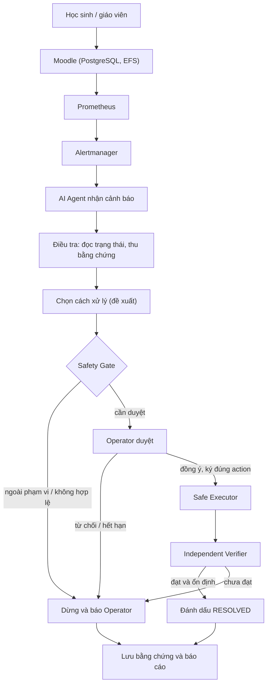

# Chương 1. Tổng quan

Chương này đặt vấn đề cho toàn bộ khoá luận. Trước hết, chương trình bày bối cảnh vận hành hạ tầng, sự phát triển của AIOps và xu hướng giao cho AI tự xử lý sự cố, cùng hai rủi ro làm cho xu hướng đó khó áp dụng trong thực tế: hành động sai phạm vi và báo hồi phục giả. Từ đó chương phát biểu bài toán, nêu câu hỏi nghiên cứu, mục tiêu, đối tượng và phạm vi. Phần cuối giới thiệu phương pháp nghiên cứu, những đóng góp chính (nêu ngắn kết quả, chi tiết ở Chương 5) và bố cục các chương còn lại.

## 1.1. Bối cảnh nghiên cứu

### 1.1.1. Vận hành hạ tầng và bài toán xử lý sự cố

Một dịch vụ trực tuyến ngày nay chạy trên nhiều lớp: bộ cân bằng tải, các máy chủ ứng dụng, cơ sở dữ liệu, lưu trữ dùng chung và hệ thống giám sát. Hệ thống càng phân tán thì càng có nhiều điểm hỏng, và một lỗi ở thành phần này có thể lan sang thành phần khác, thậm chí thành sự cố quy mô lớn [AIOpsLab2025]. Vòng đời của một sự cố thường gồm bốn việc: phát hiện, khoanh vùng (triage), chẩn đoán nguyên nhân gốc và giảm thiểu hoặc khắc phục [AIOpsLab2025]. Đội kỹ sư độ tin cậy (SRE) của Google nhận xét rằng độ phức tạp của hệ thống đang tăng nhanh vì kiến trúc vi dịch vụ, vì tính đa dạng của sản phẩm và vì dòng thay đổi liên tục từ các đường ống triển khai; công cụ sinh mã bằng AI còn làm tăng khối lượng mã mới, tức là tăng cơ hội xuất hiện lỗi về độ tin cậy [GoogleSRE-AI].

Trong thực tế, người vận hành (Operator) phải đọc cảnh báo, thu thập bằng chứng, quyết định cách xử lý, thi hành và kiểm tra lại. Mỗi bước tốn thời gian và dễ sai khi áp lực cao. Hai nhu cầu đo lường đi kèm là thời gian khôi phục (RTO, Recovery Time Objective) và lượng dữ liệu có thể mất (RPO, Recovery Point Objective); định nghĩa và cách khoá luận đo hai đại lượng này nằm ở Mục 2.1.

<!-- nguồn: tài liệu AIOpsLab (mục 1, hình 1), Google SRE AI (phần mở đầu); các định nghĩa RTO/RPO của đề tài ở docs/PLANNING_UNG_DUNG_LDA_GBDT.md §8 -->

### 1.1.2. AIOps và tự chữa lành

AIOps (Artificial Intelligence for IT Operations) nhằm tự động hoá các tác vụ vận hành phức tạp như định vị lỗi và phân tích nguyên nhân gốc, để giảm khối lượng việc cho con người và hạn chế ảnh hưởng tới khách hàng [AIOpsLab2025]. Mục tiêu dài hạn thường được gọi là "tự chữa lành": hệ thống tự phát hiện, định vị và giảm thiểu lỗi với ít can thiệp của con người [AIOpsLab2025].

Một ví dụ tiêu biểu là hệ thống AIHS do Rui Li và cộng sự công bố tại IEEE SRDS 2021, triển khai ở các trung tâm dữ liệu quy mô lớn [AIHS2021]. AIHS dùng ba tầng học máy nối tiếp: một bộ ánh xạ LDA (Latent Dirichlet Allocation) biến dữ liệu giám sát thành vector chủ đề, một bộ dự đoán GBDT (Gradient Boosted Decision Trees) chọn hành động sửa lỗi, và một bộ điều khiển GBDT kiểm tra hành động đó có khả năng thất bại hay không. Theo bài báo, trong 7 tháng vận hành với 33,7 triệu lỗi, tỉ lệ sửa thành công đạt 92,4 % so với 65,3 % của bộ luật cũ [AIHS2021]. Đây là số liệu của môi trường và định nghĩa riêng của bài báo; khoá luận dùng chúng làm bối cảnh, không dùng làm đích so sánh trực tiếp (xem Mục 1.5 và Chương 2).

<!-- nguồn: docs/PLANNING_UNG_DUNG_LDA_GBDT.md §1–§2 (bảng chỉ số AIHS, mục B.3 của bài báo) -->

### 1.1.3. Xu hướng dùng AI agent để tự xử lý sự cố

Sự xuất hiện của mô hình ngôn ngữ lớn (LLM) mở rộng ý tưởng trên. Một AI agent là hệ thống bao quanh LLM bằng vòng lặp suy luận, khả năng gọi công cụ bên ngoài (API, giao diện dòng lệnh, thực thi mã) và bộ nhớ, để diễn giải yêu cầu, ra quyết định và tác động lên môi trường [CloudAgents2025]. Nhóm tác giả AIOpsLab gọi hướng này là AgentOps: các agent quản lý toàn bộ vòng đời sự cố chứ không chỉ một tác vụ riêng lẻ [AIOpsLab2025]. Nhóm của Yang và cộng sự lập luận rằng quản lý hạ tầng đám mây có tính cấu trúc và lặp lại cao, kết quả tương đối dễ kiểm tra so với các bài toán sinh mã, nên rất phù hợp với agent [CloudAgents2025]. Nhiều nghiên cứu đã hiện thực hoá ý tưởng đó, chẳng hạn KubeLLM dùng hai agent (một agent tri thức dùng RAG, một agent công cụ chạy lệnh `kubectl` và sửa tệp) để tự chẩn đoán và sửa lỗi cấu hình Kubernetes [KubeLLM2025]. Ở phía thực hành, Google SRE mô tả việc đưa agent vào điều tra sự cố, giảm thiểu tự động và quản lý cảnh báo, nhưng nhấn mạnh việc dùng AI như một yếu tố nhân hiệu quả (force multiplier) đồng thời vẫn duy trì quyền kiểm soát [GoogleSRE-AI]. Cộng đồng nền tảng (platform engineering) cũng bắt đầu coi agent là một loại "người dùng" của nền tảng, bên cạnh kỹ sư, và đòi hỏi agent phải có danh tính riêng, quyền được giới hạn và vết kiểm toán rõ ràng [PlatformEng-Agentic].

Tuy nhiên, độ tin cậy của agent chưa đủ để giao toàn quyền. Trên bộ đánh giá AIOpsLab gồm 48 bài toán, độ chính xác tổng thể của các agent được thử chỉ nằm trong khoảng 15,25 % đến 59,32 %; bài toán giảm thiểu (mitigation) và phân tích nguyên nhân gốc là khó nhất, và một agent dùng GPT-3.5 không khắc phục được lỗi nào ở tác vụ giảm thiểu [AIOpsLab2025]. Trong KubeLLM, các mô hình nhanh và rẻ có thể thất bại hoàn toàn (độ chính xác 0 %) ở một số loại lỗi, dù độ chính xác trung bình trông chấp nhận được [KubeLLM2025].

<!-- nguồn: PDF AIOpsLab (bảng 3, mục 3.4), PDF KubeLLM (mục IV, bảng II), PDF Cloud Infrastructure Management (mục 1, 3.3), blog Google SRE AI và bài Platform engineering for the agentic enterprise trong A:/KLTN/Brainstorm/ -->

### 1.1.4. Rủi ro khi AI tự thi hành

Khi đầu ra của mô hình được nối thẳng vào công cụ thi hành, hai rủi ro trở nên trung tâm đối với bài toán của khoá luận.

**Hành động sai phạm vi.** Đề xuất của mô hình có thể không nằm trong tập hành động đã được kiểm duyệt, nhắm sai máy hoặc sai thành phần, hoặc dựa trên bằng chứng đã cũ. Nhóm của Yang nhấn mạnh rằng thao tác trên đám mây mang tính an toàn tới hạn: sự lệch giữa ý định của người dùng và hành động của agent có thể gây hư hại hạ tầng nghiêm trọng, ví dụ đổi loại máy ảo trên Azure thực chất đòi hỏi huỷ và tạo lại máy, trong khi người dùng có thể tưởng đó là cập nhật tại chỗ [CloudAgents2025]. Cũng nhóm này cho rằng bản chất ngẫu nhiên của agent bảo đảm sẽ có lúc thất bại, vì vậy cần hàng rào kiểm soát (guardrail), kiểm soát truy cập, vết kiểm toán, cơ chế hoàn tác và leo thang cho con người [CloudAgents2025]. Trong chính hệ thống của đề tài, hiện tượng này đã xuất hiện ở mức thử nghiệm: trong các lượt diễn tập staging tháng 11/2026, một agent Gemini chạy ở chế độ chỉ đề xuất (shadow) đã tự đề xuất khởi động lại cơ sở dữ liệu (kịch bản DB-01) và `RESTART_SERVICE` (kịch bản NET-01), hai hành động nằm ngoài danh mục đã duyệt; Safety Gate đã từ chối cả hai (`DENY`) và không có gì được thi hành. Đó chỉ là một mẫu cho mỗi kịch bản, không đủ để suy ra tần suất.

**Báo hồi phục giả.** Hệ thống có thể tuyên bố "đã sửa xong" trong khi dịch vụ chưa phục hồi hoặc một thành phần liên quan đã bị hỏng. Nguyên nhân thường là tiêu chí thành công quá hẹp. Trong KubeLLM, thành công được xác nhận bằng cách kiểm tra tệp cấu hình cuối cùng và việc pod đạt trạng thái Running [KubeLLM2025]. Trong AIHS, bài báo coi một lần sửa là thành công khi server ổn định hơn 20 phút sau sửa, dựa trên bản ghi sửa lỗi chứ không qua một bên xác minh độc lập [AIHS2021]. AIOpsLab chủ động đánh giá trạng thái của toàn hệ thống sau khi giảm thiểu, vì các dịch vụ hoặc tài nguyên khác có thể bị ảnh hưởng ngoài ý muốn [AIOpsLab2025]. Trong hệ thống của đề tài, một diễn tập NET-01 ngày 08/11/2026 cho thấy điểm kiểm tra sức khoẻ (health check) vẫn trả HTTP 200 trong khi lỗi DNS/kết nối cơ sở dữ liệu ở node B và target liên quan của bộ cân bằng tải vẫn hỏng; chỉ các probe liên quan của bên xác minh (Verifier) mới phát hiện được và trả kết luận `collateral_damage`. Một lần nữa, đây là một ca được cấy có kiểm soát.

Các rủi ro khác, như hiện tượng "ảo giác" khi sinh lệnh hoặc mã [CloudAgents2025], bất định giữa các lần chạy [GoogleSRE-AI] và tấn công nhằm vào agent [CloudAgents2025], làm tăng thêm nhu cầu coi đầu ra của mô hình là đề xuất không đáng tin, không phải quyền thi hành.

**Bảng 1.1.** Hai rủi ro trung tâm và đối sách tương ứng trong khoá luận

| Rủi ro | Biểu hiện | Nguồn minh hoạ | Đối sách trong khoá luận |
|---|---|---|---|
| Hành động sai phạm vi | Hành động ngoài danh mục, sai máy đích/phạm vi, bằng chứng cũ; đổi trạng thái hệ thống ngoài ý muốn | Cloud Infrastructure Management; diễn tập DB-01/NET-01 ngày 08/11/2026 | Safety Gate fail closed; Operator ký đúng action; Safe Executor chỉ chạy allowlist |
| Báo hồi phục giả | Kết luận "đã sửa" dựa trên tiêu chí hẹp (HTTP 200, pod Running, bản ghi sửa) | KubeLLM; AIHS; diễn tập NET-01 ngày 08/11/2026 | Independent Verifier với probe allowed/forbidden/related và cửa sổ ổn định |

<!-- nguồn: docs/PLANNING_UNG_DUNG_LDA_GBDT.md §3.3 (Gate DENY đề xuất Gemini DB-01, NET-01); docs/BAO_CAO_KIEN_TRUC_AI_AGENT_VA_AN_TOAN.md §6 (NET-01: HTTP 200 nhưng collateral_damage); PDF Cloud Infrastructure Management §3.1, §3.3 -->

### 1.1.5. AIHS cơ sở và khoảng trống nghiên cứu

AIHS có ưu điểm là dữ liệu huấn luyện lớn, đầu ra đơn giản (một mã hành động) và quyết định rất nhanh: theo bài báo, thời gian ra quyết định khoảng 7 ms [AIHS2021]. Bài báo cũng thận trọng ở chỗ ở môi trường sản xuất chỉ cho tự chạy ba hành động (NOP, MSR, RB) [AIHS2021]. Nhưng theo phân tích của đề tài, kiến trúc AIHS không có một Safety Gate độc lập kiểm tra phạm vi và bằng chứng trước khi chạy, và cũng không có một bên xác minh độc lập quyết định hệ thống đã phục hồi; "sửa thành công" dựa trên bản ghi sửa lỗi [AIHS2021]. Các chỉ số công bố của AIHS (precision, recall, F1, HitRate, ReverseRate, tỉ lệ sửa thành công) đo chất lượng của mô hình và của việc sửa, chứ không đo việc hành động có nằm trong phạm vi cho phép hay kết luận phục hồi có đáng tin hay không. Đó là khoảng trống mà khoá luận nhắm tới.

<!-- nguồn: docs/PLANNING_UNG_DUNG_LDA_GBDT.md §2 ("Không có Safety Gate độc lập hay Verifier độc lập; 'sửa thành công' dựa trên bản ghi sửa lỗi"; "Ở production chỉ được tự chạy 3 hành động: NOP, MSR, RB"; "Thời gian ra quyết định 7 ms"); docs/BAO_CAO_AIHS.md §3.1 (điều kiện ổn định hơn 20 phút) -->

## 1.2. Phát biểu bài toán

Khoá luận không đề xuất một mô hình dự đoán mới. Bài toán là một bài toán về **lớp điều khiển đặt sau mô hình**. Gọi *s* là ảnh chụp bằng chứng (snapshot) lấy trước thời điểm quyết định của một sự cố trên hệ thống Moodle, và *a = M(s)* là đề xuất hành động do mô hình M, ở đây là pipeline AIHS LDA → GBDT Predictor → GBDT Controller, trả về. Cần thiết kế và hiện thực một khung F bao quanh M sao cho:

1. đề xuất *a* chỉ được coi là **đề xuất không đáng tin**, không bao giờ là quyền thi hành;
2. *a* chỉ được thi hành khi nó thuộc danh mục hành động đã duyệt, đúng máy đích và phạm vi, bằng chứng còn mới, và có một chữ ký của Operator gắn đúng hành động đó (kiểm tra bởi Safety Gate rồi Safe Executor);
3. kết luận "đã phục hồi" (`RESOLVED`) chỉ do một bên xác minh độc lập đưa ra, dựa trên các probe và một cửa sổ ổn định, không dựa trên điểm tự tin của mô hình hay trên việc health check xanh;
4. mọi quyết định, từ chối, thi hành và kiểm chứng đều để lại vết kiểm toán;
5. hệ thống vẫn xử lý được sự cố an toàn, nghĩa là các lớp bảo vệ không được chặn quá mức đến mức vô dụng.

Phần thứ hai của bài toán là **đánh giá**: định lượng tác động riêng của F, tách khỏi chất lượng của M. Vì vậy mô hình, tập dữ liệu, ảnh chụp và đề xuất được giữ nguyên giữa các cấu hình so sánh; chỉ lớp bảo vệ phía sau mô hình thay đổi. Chất lượng dự đoán của M được báo riêng và không được gán cho Gate, Executor hay Verifier.

Năm yêu cầu trên tương ứng với năm bất biến an toàn mà toàn bộ khoá luận giữ nhất quán, trình bày chi tiết ở Chương 3.

<!-- nguồn: AGENTS.md ("Evidence and safety invariants"); docs/PLANNING_UNG_DUNG_LDA_GBDT.md §1, §5 -->

## 1.3. Câu hỏi nghiên cứu

**Câu hỏi nghiên cứu chính.** *Khi thêm Safety Gate, Safe Executor và Independent Verifier vào AIHS LDA/GBDT, hệ thống có an toàn và đáng tin cậy hơn AIHS cơ sở trên Moodle không?*

Câu hỏi chính được tách thành năm câu hỏi thành phần, mỗi câu gắn với một chỉ số đo được và một phép so sánh cụ thể.

**Bảng 1.2.** Câu hỏi thành phần, chỉ số và nơi trình bày kết quả

| Mã | Câu hỏi | Chỉ số chính | Phép so sánh | Chương |
|---|---|---|---|---|
| RQ1 | Safety Gate có chặn được hành động sai/vượt phạm vi không? | Tỉ lệ hành động không an toàn được đi tiếp; tỉ lệ hành động sai bị chặn | C0 so với C1, offline | 5 |
| RQ2 | Safety Gate có chặn nhầm hành động đúng không, và cái giá là gì? | Tỉ lệ chặn nhầm; tỉ lệ chuyển người | C0 so với C1, offline | 5 |
| RQ3 | Operator và Safe Executor có bảo đảm hành động chạy đúng phạm vi đã duyệt không? | Số lượt thi hành đúng action/máy đích/phạm vi; số lần chạy khi chưa ký; mutation ngoài phạm vi | C2/C3, live staging | 5 |
| RQ4 | Independent Verifier có tránh được kết luận hồi phục sai mà health-only bỏ sót không? | Tỉ lệ `RESOLVED` sai; tỉ lệ health-only báo hồi phục sai | C2 so với C3 trên cùng lượt thi hành | 5 |
| RQ5 | Hệ thống còn xử lý được sự cố không và tốn thêm bao nhiêu thời gian? | Tỉ lệ hoàn tất an toàn; trung vị thời gian từ phát hiện đến hồi phục thật; thời gian chờ duyệt; thời gian xác minh | C3 live; offline không đo được | 5 |

Một điểm cần nói rõ từ đầu: câu hỏi được đặt như một giả thuyết cần kiểm định, nhưng câu trả lời không bắt buộc là "có". Nếu các lớp bảo vệ làm tăng chuyển người hoặc kéo dài thời gian, khoá luận báo đúng phần đánh đổi đó. Các chỉ số thiếu mẫu số hợp lệ được ghi là không đo được (`NOT_MEASURABLE`) chứ không được điền 0 %.

<!-- nguồn: docs/BAO_CAO_KET_QUA_C0_C3.md §1 (bảng câu hỏi/kết quả/nguồn bằng chứng); docs/PLANNING_UNG_DUNG_LDA_GBDT.md §1, §4 -->

## 1.4. Mục tiêu nghiên cứu

**Mục tiêu tổng quát.** Xây dựng và đánh giá một khung vận hành an toàn, kiểm chứng được, đặt quanh pipeline AIHS LDA/GBDT, trên môi trường Moodle chạy trên AWS.

**Mục tiêu cụ thể.**

1. Tái hiện phương pháp AIHS trên dữ liệu Moodle thành một baseline có phiên bản và được khoá (C0), ghi rõ những khác biệt so với bài báo và so với mã prototype công khai.
2. Thiết kế và hiện thực ba lớp bảo vệ đặt sau mô hình: Safety Gate, Safe Executor và Independent Verifier, cùng cơ chế phê duyệt của Operator tách biệt với thi hành.
3. Xây dựng bộ đo và protocol so sánh bốn cấu hình C0–C3, đăng ký và khoá trước khi xem kết quả.
4. Đánh giá bằng hai loại thực nghiệm: offline trên dữ liệu lab (C0 so với C1) và live trên môi trường staging thật của AWS (C3, với C2 suy ra từ chính lượt chạy đó).
5. Báo cáo trung thực cả lợi ích, chi phí (chặn nhầm, chuyển người, độ trễ) và các chỉ số chưa đo được.

## 1.5. Đối tượng và phạm vi nghiên cứu

### 1.5.1. Đối tượng

Đối tượng nghiên cứu gồm hai phần. Phần thứ nhất là pipeline AIHS (Mapper LDA, Predictor GBDT, Controller GBDT) được tái hiện trên Moodle như hệ thống nền. Phần thứ hai là khung an toàn gồm Safety Gate, Safe Executor, Independent Verifier và quy trình phê duyệt của Operator.

Môi trường thực nghiệm chính là **Moodle trên AWS EC2**: một bộ cân bằng tải ALB phía trước hai node ứng dụng đặt ở hai Availability Zone, cơ sở dữ liệu RDS PostgreSQL, hệ thống tệp dùng chung EFS, và một máy giám sát chạy Prometheus, Alertmanager, Grafana, Blackbox Exporter, giao dịch tổng hợp (synthetic transaction) và AI Agent [Moodle] [AWS] [Prometheus] [Alertmanager]. Hạ tầng được mô tả bằng Terraform và cấu hình máy bằng Ansible; mô tả chi tiết ở Chương 4.

**Hình 1.1.** Luồng xử lý sự cố của khung đề xuất, từ người dùng Moodle đến lưu bằng chứng

Hình 1.1 mô tả sơ đồ tổng thể của đề tài. Chuỗi bắt đầu từ lỗi trên Moodle, qua giám sát và Alertmanager tới Agent. Agent điều tra và đưa ra đề xuất, Safety Gate quyết định chặn, cho đi tiếp hay yêu cầu duyệt; chỉ khi Operator ký, Safe Executor mới chạy; sau đó Independent Verifier mới có thể chuyển sự cố sang `RESOLVED`. Mọi nhánh kết thúc đều lưu bằng chứng.

<!-- nguồn: docs/BAO_CAO_KIEN_TRUC_HA_TANG.md §1–§2, §8; docs/BAO_CAO_KIEN_TRUC_AI_AGENT_VA_AN_TOAN.md §1; sơ đồ A:/KLTN/KLTN sơ bộ là vậy.png -->

### 1.5.2. Bốn cấu hình so sánh

Để tách tác động của từng lớp, khoá luận so sánh bốn cấu hình, giữ nguyên model, ảnh chụp và đề xuất:

**Bảng 1.3.** Bốn cấu hình so sánh C0–C3

| Cấu hình | Thành phần | Cách đo trong khoá luận |
|---|---|---|
| C0 | AIHS LDA/GBDT (`aihs-paper-repro-moodle-v1`) đề xuất và "thi hành nguyên trạng" | Chỉ phản thực tế offline; không thi hành thật |
| C1 | C0 cộng Safety Gate | Offline: chạy lại đúng đề xuất qua Gate thật |
| C2 | C1 cộng Operator duyệt và Safe Executor; kết luận phục hồi bằng health-only (`healthz` 200, giao dịch tổng hợp thành công, hết alert) | Live: lấy từ `health_only_view` của chính lượt C3 |
| C3 | C2 cộng Independent Verifier | Live: mỗi lượt thi hành thật là một lượt C3 |

<!-- nguồn: docs/PLANNING_UNG_DUNG_LDA_GBDT.md §7; docs/BAO_CAO_PROTOCOL_C0_C3_OFFLINE.md §2; docs/BAO_CAO_KE_HOACH_CHAY_LIVE_C0_C3.md §1 (quyết định 16/11/2026, phương án b) -->

### 1.5.3. Trong phạm vi và ngoài phạm vi

**Bảng 1.4.** Phạm vi của khoá luận

| Trong phạm vi | Ngoài phạm vi |
|---|---|
| Moodle trên AWS (ALB, hai node, RDS PostgreSQL, EFS, máy giám sát) | ERPNext và Kubernetes/AIOpsLab: **hướng phát triển**. Đã có adapter và tệp triển khai ERPNext trong repo nhưng chưa được xác minh live, nên không dùng làm bằng chứng |
| Sáu loại lỗi cấy có kiểm soát có hành động sửa được duyệt cho chạy live: DB-01, NET-01, RES-01, CON-01, SEC-02, BIZ-02 | Hành động chỉ người xử lý (ví dụ SEC-01, sửa security group của RDS), DB-02, BIZ-01 và các hành động `reconcile_*` (chỉ dùng để reset) không chạy live |
| Offline trên dữ liệu lab Moodle cục bộ; live trên staging AWS dựng riêng cho thực nghiệm | Môi trường sản xuất thật; kết luận về tần suất sự cố tự nhiên |
| Mô hình AIHS đã khoá; chỉ lớp bảo vệ sau mô hình thay đổi | Cải tiến chất lượng mô hình AIHS; đưa LLM vào đường quyết định cảnh báo |
| Báo cáo mô tả: số đếm, trung vị, khoảng tin cậy | Kiểm định giả thuyết thống kê với p-value (mỗi kịch bản chỉ ba lượt lặp) |
| So sánh C0–C3 trong cùng môi trường | So sánh số tuyệt đối với số liệu của AIHS ở Alibaba (F1 0,97, −51 % thời gian không phục vụ) |

Khung được thiết kế để chuyển sang hệ thống khác qua lớp adapter, nhưng khả năng đó chưa được kiểm chứng. Chủ đề LDA học trên Moodle không dùng được cho ERPNext vì từ vựng khác nhau, nên khi chuyển môi trường phải huấn luyện lại; điều có thể giữ nguyên là kiến trúc Gate/Executor/Verifier, quy trình gán nhãn và cách đánh giá. Kubernetes đáng được xem xét làm môi trường kế tiếp vì đây là nền tảng điều phối phổ biến: khảo sát CNCF ghi nhận Kubernetes được dùng trong sản xuất ở 82 % số tổ chức dùng container, và 66 % tổ chức trong nhóm có chạy khối lượng AI sinh tạo dùng Kubernetes cho việc đó ở mức toàn phần hoặc một phần [CNCF2025]. Chương 6 trở lại hướng phát triển này.

<!-- nguồn: docs/PLANNING_UNG_DUNG_LDA_GBDT.md §8 ("Không dùng mức −51 % của Alibaba làm ngưỡng đạt"), §9.3, §11.1 (action được phép chạy live và không chạy live); docs/BAO_CAO_KE_HOACH_CHAY_LIVE_C0_C3.md §2 (6 kịch bản, ba lặp, không kiểm định giả thuyết); docs/BAO_CAO_KET_QUA_C0_C3.md §6 (giới hạn); AGENTS.md; PDF CNCF Annual Cloud Native Survey (lời nói đầu) -->

## 1.6. Phương pháp nghiên cứu

### 1.6.1. Tiếp cận thiết kế – hiện thực – đánh giá

Khoá luận đi theo ba pha nối tiếp. **Thiết kế:** xác định các bất biến an toàn, hợp đồng giữa đề xuất của mô hình và các lớp bảo vệ (adapter ánh xạ mã hành động AIHS sang danh mục hành động của Moodle, fail closed khi không ánh xạ được), và mô hình quyết định của Gate, Executor, Verifier. **Hiện thực:** tái hiện AIHS trên dữ liệu Moodle, xây dựng khung an toàn trên hạ tầng mô tả bằng mã (Terraform, Ansible) và đường ống CI/CD. **Đánh giá:** đo tác động của từng lớp bằng các thí nghiệm có đăng ký trước.

### 1.6.2. Bốn loại bằng chứng

Khoá luận phân biệt nghiêm ngặt bốn loại bằng chứng và không cộng chúng thành một tỉ lệ.

**Bảng 1.5.** Các loại bằng chứng và điều chúng chứng minh được

| Loại | Ví dụ trong khoá luận | Chứng minh được | Không chứng minh được |
|---|---|---|---|
| Kiểm thử đơn vị/hợp đồng | Test của Safety Gate, adapter AIHS, Verifier | Logic quyết định đúng trên dữ liệu mẫu | Hành vi trên hệ thống thật |
| Replay offline | Phát lại đề xuất C0 đã khoá qua Gate trên tập test lab | Hành vi của Gate trên cùng đề xuất; chi phí chặn nhầm | Phục hồi thật, RTO/RPO |
| Lab cục bộ | Lab Moodle bằng Docker sinh dữ liệu huấn luyện/kiểm thử | Chất lượng mô hình trong lab | Hành vi trên AWS (lab và staging khác nhau, ví dụ năm đặc trưng `lb_*` chỉ có ở lab) |
| Live staging | 18 lượt C3 chính và 4 lượt bổ sung trên AWS | Chuỗi Gate → Operator → Executor → Verifier chạy thật; thời gian phục hồi thật | Tỉ lệ ở môi trường sản xuất |

Quy ước này khớp với nguyên tắc của repo: replay là mô phỏng offline và không chứng minh phục hồi live; dữ liệu ground truth chỉ dùng để chấm điểm sau quyết định, không bao giờ là đầu vào cấp quyền.

<!-- nguồn: AGENTS.md ("Evidence and safety invariants", "CI replay is offline simulation"); docs/BAO_CAO_KET_QUA_C0_C3.md §6 (lab khác staging); docs/BAO_CAO_PROTOCOL_C0_C3_OFFLINE.md §5–§6 -->

### 1.6.3. Đăng ký trước protocol

Để tránh chọn kết quả sau khi đã nhìn thấy dữ liệu, khoá luận đăng ký trước hai protocol và khoá chúng trước khi đo.

*Offline* (protocol `c0-c3-offline-v1`): các quyết định D1–D6 (cách suy ngữ cảnh tin cậy cho Gate, đồng hồ replay, độ tin cậy cố định đưa vào Gate, nhãn chính và nhãn độ nhạy, công thức chỉ số và bootstrap, quy tắc mở test) được ghi lại; tài liệu protocol, bộ chấm và mã Gate được khoá bằng giá trị băm sha256; tập test chỉ được mở **một lần**, và một tệp đánh dấu chặn mọi lần chạy lại.

*Live* (harness `live-c0-harness-v1`): kế hoạch số lượt, thứ tự ngẫu nhiên hoá theo khối (hạt giống cố định, băm của kế hoạch ghi vào nhật ký trước lượt đầu), chính sách duyệt của Operator, quy tắc dừng và cách xử lý lượt bị chặn/từ chối/hết hạn được viết và commit trước khi chạy. Mọi sai lệch trong khi chạy được công bố như một sai lệch protocol: ví dụ các lượt pilot có lỗi tích hợp được giữ nguyên và không tính vào 18 lượt chính; một lượt BIZ-02 bị huỷ vì reset thất bại và được chạy lại; một lượt DB-01 bổ sung bị huỷ do đua thời gian giữa harness và Agent rồi được chạy lại.

<!-- nguồn: docs/BAO_CAO_PROTOCOL_C0_C3_OFFLINE.md §3 (D1–D6), §7–§8; docs/BAO_CAO_KE_HOACH_CHAY_LIVE_C0_C3.md §2–§3, §6, §11–§13, §16.6 -->

### 1.6.4. Chỉ số và cách báo cáo

Mỗi tỉ lệ được báo cùng tử số và mẫu số. Khoảng tin cậy offline là bootstrap 95 % theo nhóm sự cố/phiên (B = 2000), vì đơn vị độc lập là nhóm chứ không phải dòng; khoảng tin cậy cho tỉ lệ live dùng khoảng Wilson 95 %. Với mẫu nhỏ (ba lượt mỗi kịch bản) kết quả chỉ mang tính mô tả. Lượt bị Gate chặn, Operator từ chối hoặc hết hạn được giữ trong mẫu số của tỉ lệ hoàn tất. Mẫu số của tỉ lệ "chặn hành động sai" nhỏ hơn 5 thì được ghi `INSUFFICIENT_DENOMINATOR` và không được dùng làm bằng chứng.

Thời gian khôi phục được chấm tại **thời điểm phục hồi thật** do một luồng probe độc lập xác định, dùng chung cho C2 và C3. Thời điểm health-only tuyên bố và thời điểm Verifier ký `RESOLVED` được báo riêng, không so trực tiếp với nhau vì ý nghĩa khác nhau.

<!-- nguồn: docs/BAO_CAO_PROTOCOL_C0_C3_OFFLINE.md §3 (D5), §4; docs/BAO_CAO_KET_QUA_C0_C3.md §2–§3; docs/BAO_CAO_KE_HOACH_CHAY_LIVE_C0_C3.md §2, §4 -->

### 1.6.5. Ràng buộc an toàn của thực nghiệm

Không hành động nguy hiểm nào được thi hành thật để lấy số liệu: ở C0 một hành động nguy hiểm chỉ được ghi là "sẽ thi hành nếu không có Gate" (`would-dispatch`) trên bản replay. Live chỉ chạy các hành động an toàn đã được domain review, trên staging, luôn có Gate, chữ ký của Operator, Safe Executor và Verifier. Sau mỗi lượt phải reset và kiểm tra baseline trước khi sang lượt kế tiếp; một vi phạm bất biến hoặc reset thất bại dừng cả chiến dịch.

<!-- nguồn: docs/PHAN_CONG_LDA_GBDT.md ("Cần so sánh những gì?"); docs/BAO_CAO_KE_HOACH_CHAY_LIVE_C0_C3.md §6 -->

## 1.7. Đóng góp chính

Khoá luận có năm đóng góp.

1. **Một khung an toàn đặt sau mô hình học máy** gồm Safety Gate, Safe Executor và Independent Verifier cùng quy trình phê duyệt của Operator, thiết kế quanh năm bất biến: đầu ra mô hình chỉ là đề xuất; fail closed; phê duyệt khác thi hành; chỉ Verifier được chuyển `RESOLVED`; ground truth chỉ để chấm điểm.
2. **Một baseline AIHS tái hiện và được khoá trên Moodle** (`aihs-paper-repro-moodle-v1`), cùng hợp đồng ánh xạ đề xuất AIHS sang danh mục hành động Moodle đã review, trong đó hành động không ánh xạ được, thiếu bằng chứng hoặc quá cũ đều chuyển người.
3. **Một protocol so sánh C0–C3 đăng ký trước** với hai chế độ đo (offline và live), quy tắc khoá và công bố sai lệch.
4. **Kết quả thực nghiệm**, tóm tắt ở Bảng 1.6 và trình bày đầy đủ ở Chương 5.
5. **Bộ artifact và quy trình kiểm chứng lại được**: harness chạy live, bộ tổng hợp kết quả, kho kiểm toán có chuỗi băm và tệp lưu trữ có checksum.

**Bảng 1.6.** Tóm tắt kết quả chính (chi tiết và giới hạn ở Chương 5)

| Nhóm | Kết quả |
|---|---|
| Offline, C0 so với C1 (lab, test 59 dòng thuộc 8 nhóm, mở một lần sau khi khoá protocol) | Gate làm HitRate giảm từ 0,905 xuống 0,810 và ReverseRate tăng từ 0,867 lên 0,967. Gate chặn nhầm 2/20 hành động đúng; tỉ lệ chuyển người tăng từ 8,5 % lên 30,5 %. Mẫu số hành động không an toàn chỉ là 4 nên **chưa đủ** để khẳng định Gate giảm hành động nguy hiểm |
| Live, 18 lượt C3 chính trên AWS staging | 9 lượt `RESOLVED`, 0 `RESOLVED` sai; 9/9 lượt thi hành đều phục hồi thật; model đề xuất đúng hành động 14/14 (4 lượt còn lại model chọn chuyển người); 18/18 lần reset được kiểm tra; trung vị từ phát hiện đến phục hồi thật là 145 s (69 s nếu bỏ thời gian chờ duyệt) |
| Live, 4 lượt bổ sung đăng ký trước | DB-01 hai lượt: cả hai `RESOLVED`. CON-01 hai lượt có lỗi phụ cấy có chủ đích: health-only báo hồi phục sai 2/2, Verifier chặn 2/2 |

Cái giá phải trả cũng được báo: tăng chuyển người ở Gate, hoàn tất an toàn chỉ 9/18 ở mẫu chính (bốn lượt Operator từ chối có chủ ý, bốn lượt model chọn chuyển người, một lượt Gate chặn), và Verifier thêm khoảng hai phút để ký kết luận. Khoá luận không so sánh được thời gian khôi phục C0 với C3 trên live vì C0 không thi hành live theo thiết kế.

<!-- nguồn: docs/BAO_CAO_KET_QUA_C0_C3.md §1–§4 (các số liệu trong Bảng 1.6 và đoạn kế tiếp); evaluation/aihs/live-main-results/aggregate.json -->

## 1.8. Bố cục khoá luận

**Bảng 1.7.** Bố cục các chương

| Chương | Nội dung |
|---|---|
| Tóm tắt / Abstract | Tóm lược đề tài, phương pháp và kết quả |
| Chương 1. Tổng quan | Bối cảnh, bài toán, câu hỏi nghiên cứu, mục tiêu, phạm vi, phương pháp, đóng góp |
| Chương 2. Cơ sở lý thuyết và công trình liên quan | SRE, giám sát, AIOps, AIHS, LDA và GBDT, LLM agent và rủi ro, nguyên tắc an toàn, hạ tầng dưới dạng mã, so sánh công trình liên quan |
| Chương 3. Phân tích và thiết kế khung an toàn | Bất biến, kiến trúc, Safety Gate, Safe Executor, Independent Verifier, hợp đồng với AIHS |
| Chương 4. Hiện thực hệ thống | Hạ tầng AWS, Moodle, giám sát, Agent, tái hiện AIHS, CI/CD |
| Chương 5. Thực nghiệm và đánh giá | Protocol, kết quả offline và live, phân tích, giới hạn |
| Chương 6. Kết luận và hướng phát triển | Trả lời câu hỏi nghiên cứu, hạn chế, ERPNext/Kubernetes, người gán nhãn thứ hai |
| Tài liệu tham khảo | Danh mục gộp từ các chương |

## 1.9. Tiểu kết chương

Chương này đặt khoá luận vào bối cảnh AIOps và AI agent cho vận hành: xu hướng giao việc xử lý sự cố cho AI ngày càng rõ, nhưng độ tin cậy của agent còn hạn chế và hai rủi ro, hành động sai phạm vi và báo hồi phục giả, chưa được các hệ thống như AIHS xử lý bằng một lớp kiểm soát độc lập. Từ đó bài toán được phát biểu là thiết kế và đánh giá một lớp điều khiển đặt sau mô hình AIHS, với câu hỏi chính về mức độ an toàn và đáng tin cậy so với AIHS cơ sở trên Moodle, tách thành năm câu hỏi thành phần đo được. Khoá luận giới hạn ở Moodle trên AWS, dùng bốn cấu hình C0–C3 và các protocol đăng ký trước, đồng thời phân biệt bốn loại bằng chứng. Kết quả tóm tắt cho thấy khung không tạo ra kết luận `RESOLVED` sai nào trong mẫu đã thu, phát hiện được hồi phục giả mà health-only bỏ sót trong các ca cấy lỗi có kiểm soát, nhưng phải trả giá bằng tăng chuyển người, thời gian xác minh thêm và sự phụ thuộc vào Operator. Chương tiếp theo trình bày cơ sở lý thuyết và các công trình liên quan làm nền cho thiết kế ở Chương 3.

## Tài liệu tham khảo của chương

- **[AIHS2021]** Rui Li và cộng sự. *Automated Intelligent Healing in Cloud-Scale Data Centers*. IEEE SRDS 2021. DOI: 10.1109/SRDS53918.2021.00032. Bản PDF của tác giả: https://www.cse.cuhk.edu.hk/~pclee/www/pubs/srds21aihs.pdf
- **[AIOpsLab2025]** Yinfang Chen, Manish Shetty, Gagan Somashekar, Minghua Ma, Yogesh Simmhan, Jonathan Mace, Chetan Bansal, Rujia Wang, Saravan Rajmohan. *AIOpsLab: A Holistic Framework to Evaluate AI Agents for Enabling Autonomous Clouds*. arXiv:2501.06706v1 [cs.AI], 12/01/2025.
- **[CloudAgents2025]** Zhenning Yang, Archit Bhatnagar, Yiming Qiu, Tongyuan Miao, Patrick Tser Jern Kon, Yunming Xiao, Yibo Huang, Martin Casado, Ang Chen. *Cloud Infrastructure Management in the Age of AI Agents*. arXiv:2506.12270v1 [cs.AI], 13/06/2025.
- **[KubeLLM2025]** Mario De Jesus, Perfect Sylvester, William Clifford, Aaron Perez, Palden Lama. *LLM-Based Multi-Agent Framework For Troubleshooting Distributed Systems* (KubeLLM). Bản của tác giả, dự kiến đăng trong Proc. of the 2025 IEEE Cloud Summit.
- **[GoogleSRE-AI]** Stevan Malesevic, Christopher Heiser. *AI in SRE: Where and how Google is deploying agentic AI to improve operations*. Google Cloud Blog, 29/05/2026. https://cloud.google.com/blog.
- **[PlatformEng-Agentic]** Lakmal Warusawithana (WSO2). *Platform engineering for the agentic enterprise: Managing applications, resources, and AI agents*. CNCF Blog (bài của thành viên), 21/07/2026. https://www.cncf.io/blog/.
- **[CNCF2025]** Adrienn Lawson, Jeffrey Sica. *CNCF Annual Cloud Native Survey: The infrastructure of AI's future*. The Linux Foundation / Cloud Native Computing Foundation, tháng 01/2026 (khảo sát 628 người trả lời, tháng 09/2025).
- **[Moodle]** Moodle documentation. https://docs.moodle.org
- **[AWS]** Amazon Web Services documentation. https://docs.aws.amazon.com
- **[Prometheus]** Prometheus documentation. https://prometheus.io/docs/
- **[Alertmanager]** Prometheus Alertmanager documentation. https://prometheus.io/docs/alerting/latest/alertmanager/
