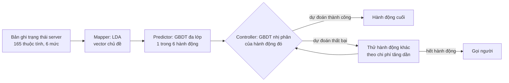

# Chương 2. Cơ sở lý thuyết và công trình liên quan

Chương này cung cấp nền tảng cho các chương sau. Mục 2.1 và 2.2 trình bày vận hành sự cố, các chỉ số thời gian, hệ thống giám sát và hạn chế của health-only. Mục 2.3 đến 2.5 giới thiệu AIOps, hệ thống tự chữa lành AIHS cùng hai kỹ thuật nền của nó là LDA và GBDT. Mục 2.6 và 2.7 bàn về LLM agent, rủi ro an toàn và các nguyên tắc thiết kế làm cơ sở cho Safety Gate, Safe Executor và Independent Verifier. Mục 2.8 nêu ngắn hạ tầng dưới dạng mã và CI/CD, mục 2.9 các nguyên tắc đánh giá. Mục 2.10 so sánh các công trình liên quan và chỉ ra khoảng trống nghiên cứu.

## 2.1. Vận hành sự cố và các chỉ số thời gian

### 2.1.1. Vòng đời sự cố

AIOpsLab chia quản lý sự cố thành bốn nhóm tác vụ với độ khó tăng dần: phát hiện, định vị, phân tích nguyên nhân gốc (RCA) và giảm thiểu (mitigation). Mỗi nhóm có chỉ số riêng; Time-to-Detect (TTD) là thời gian từ lúc lỗi xảy ra đến lúc được phát hiện, Time-to-Mitigate (TTM) là thời gian từ lúc phát hiện đến lúc giảm thiểu hoàn toàn [AIOpsLab2025]. Khoá luận nằm ở nhóm cuối và phần liền sau nó: chọn hành động giảm thiểu, thi hành có kiểm soát, rồi xác nhận hệ thống thực sự phục hồi. Phần xác nhận quan trọng vì AIOpsLab đánh giá trạng thái toàn hệ thống sau giảm thiểu, không chỉ tài nguyên bị cấy lỗi, do thành phần khác có thể bị ảnh hưởng ngoài ý muốn [AIOpsLab2025].

<!-- nguồn: PDF AIOpsLab, mục 2.1, 2.4.1, 3.2 -->

### 2.1.2. SLO, RTO, RPO, MTTR và các mốc thời gian

SRE thường định nghĩa chỉ báo và mục tiêu mức dịch vụ (SLI, SLO) rồi cấu hình cảnh báo theo chúng [GoogleSRE-AI]. Khoá luận không xây dựng bộ SLO mà dùng các luật cảnh báo dựa trên probe (Mục 2.2); điều giữ lại từ SRE là cảnh báo chỉ là tín hiệu để điều tra, và quy trình xử lý phải có vai trò, quyền hạn và vết kiểm toán rõ ràng [GoogleSRE-AI].

**RTO** (Recovery Time Objective) là thời gian tối đa chấp nhận được để khôi phục dịch vụ; **RPO** (Recovery Point Objective) là lượng dữ liệu tối đa chấp nhận được bị mất, tính bằng thời gian. **MTTR** là chữ viết tắt được dùng với nhiều nghĩa (khôi phục, sửa, phản hồi), nên khoá luận không dùng một con số MTTR duy nhất mà báo từng mốc và dùng **trung vị** thay cho trung bình, vì mẫu nhỏ và phân phối lệch mạnh: thời gian chờ Operator duyệt có lượt kéo dài 17 297 s (khoảng 4,8 giờ, do phiên tạm dừng qua đêm), trong khi bước thi hành của Executor chỉ mất vài giây (trung vị 2,0 s). "RTO đo được" trong khoá luận là khoảng thời gian từ lúc phát hiện đến lúc **phục hồi thật**, một giá trị quan sát chứ không phải mục tiêu đặt trước, gần với TTM của AIOpsLab. RPO chỉ có nghĩa với lỗi chạm vào đường ghi dữ liệu: khoá luận đo bằng luồng ghi "heartbeat", chỉ cho DB-01 và NET-01, đếm số ghi đã xác nhận và số ghi đã xác nhận nhưng bị mất. Một mô hình dự đoán hành động không cải thiện RPO; RPO cần diễn tập phục hồi dữ liệu riêng.

**Bảng 2.1.** Các mốc và khoảng thời gian dùng trong khoá luận

| Khoảng | Ý nghĩa | Ghi chú khi so sánh |
|---|---|---|
| `inject → detect` | Từ lúc cấy lỗi đến lúc alert quan sát được | Chỉ đo được khi cấy lỗi |
| `detect → proposal` | Đến lúc có đề xuất hành động | Gồm điều tra và mô hình |
| chờ duyệt | Thời gian chờ Operator duyệt hoặc từ chối | Dao động rất lớn; báo riêng |
| `execute` | Thời gian Executor thi hành | Vài giây |
| `detect → health_claim` | Đến lúc health-only tuyên bố đã khoẻ | Mốc của C2; không so trực tiếp với mốc Verifier |
| `detect → true_recovery` | Đến lúc phục hồi thật theo luồng probe độc lập | **Khoảng so sánh chính**; báo thêm giá trị bỏ thời gian chờ duyệt |
| `verify` | Thời gian Verifier đo cửa sổ ổn định | Mốc của C3 |
| `detect → resolved` | Đến lúc `RESOLVED` được ghi | Mốc của C3 |

<!-- nguồn: docs/BAO_CAO_KE_HOACH_CHAY_LIVE_C0_C3.md §4, §15 (seq 16: 17 297 s); docs/BAO_CAO_KET_QUA_C0_C3.md §3.1; docs/PLANNING_UNG_DUNG_LDA_GBDT.md §8, §10 -->

## 2.2. Giám sát, cảnh báo và hạn chế của health-only

### 2.2.1. Prometheus và Alertmanager

Prometheus thu thập metric theo kiểu kéo (scrape) từ các điểm cuối HTTP theo chu kỳ, lưu thành chuỗi thời gian và đánh giá các luật cảnh báo viết bằng PromQL; một luật có thể đòi điều kiện giữ trong khoảng `for` trước khi chuyển từ pending sang firing [Prometheus]. Alertmanager nhận cảnh báo, khử trùng lặp, nhóm và định tuyến tới các nơi nhận, trong đó có webhook [Alertmanager]. Trong môi trường của khoá luận, Alertmanager gửi cảnh báo tới `/webhook` của AI Agent (`group_wait` 5 s, `group_interval` 10 s, `repeat_interval` 4 giờ, `send_resolved` bật, xác thực bằng bearer token); Agent là ứng dụng FastAPI giao việc cho worker Celery [FastAPI] [Celery]. Thông báo "resolved" chỉ cho biết luật đã ngừng báo, chưa phải bằng chứng hệ thống đã phục hồi.

<!-- nguồn: docs/BAO_CAO_KIEN_TRUC_HA_TANG.md §8.3; AGENTS.md ("Alert flow") -->

### 2.2.2. Health check và giao dịch tổng hợp

Ba loại phép đo thường gặp trên đường vào của một dịch vụ web là: (i) health check mức cân bằng tải, ở đây là `healthz.php`, nhanh và được ALB dùng để quyết định target nào nhận lưu lượng [AWS]; (ii) probe hộp đen (Blackbox Exporter) kiểm tra trang công khai, trang đăng nhập và cổng TCP của cơ sở dữ liệu [Prometheus]; (iii) **giao dịch tổng hợp** (synthetic transaction), một kịch bản định kỳ đăng nhập quản trị và đọc/ghi một đối tượng thử qua ALB, nên đi qua ứng dụng, cơ sở dữ liệu và hệ thống tệp. Mỗi node Moodle còn có probe cục bộ đo container web, kết nối RDS từ node, DNS, EFS, cron và hàng đợi tác vụ nền.

<!-- nguồn: docs/BAO_CAO_KIEN_TRUC_HA_TANG.md §7, §8.1 -->

### 2.2.3. Hạn chế của health-only và ba nhóm probe

Khoá luận gọi **health-only** là cách kết luận phục hồi chỉ dựa trên ba điều: `healthz` trả 200, giao dịch tổng hợp thành công và alert đã hết. Cách này nhanh và rẻ, nhưng có bốn điểm yếu: (1) *phạm vi hẹp*, vì khi một node hỏng mà ALB vẫn phục vụ qua node còn lại thì cả `healthz` lẫn giao dịch tổng hợp có thể vẫn xanh; (2) *kết luận tại một thời điểm*, một lần đo xanh không cho biết hệ thống có ổn định; (3) *không thấy đường bị cấm*, ví dụ cổng cơ sở dữ liệu không được mở ra Internet; (4) *không thấy hư hại liên quan*, vì sửa một thành phần có thể làm hỏng thành phần khác.

Hai quan sát trong hệ thống của đề tài minh hoạ các điểm yếu này. Ở NET-01 (08/11/2026), HTTP 200 vẫn trả về trong khi DNS/kết nối cơ sở dữ liệu của node B và target liên quan của ALB hỏng. Ở lượt bổ sung seq 103 (17/11/2026), sau khi cấy lỗi phụ dừng container web ở node A, health-only vẫn hoàn toàn xanh sau 20 s (`healthz` 200, giao dịch tổng hợp đạt, không alert); chỉ probe `both_alb_targets_healthy` của Verifier phát hiện hư hại.

Để khắc phục, Independent Verifier dùng ba nhóm probe: **allowed** (dịch vụ cần hoạt động đã hoạt động chưa), **forbidden** (đường nguy hiểm vẫn bị chặn chưa) và **related** (thành phần liên quan và alert đã ổn chưa), cộng một cửa sổ ổn định với ít nhất ba mẫu trong khoảng không dưới 120 s. Chương 3 trình bày chi tiết.

<!-- nguồn: docs/BAO_CAO_KIEN_TRUC_AI_AGENT_VA_AN_TOAN.md §5, §6; docs/BAO_CAO_KET_QUA_C0_C3.md §3.2; docs/BAO_CAO_KE_HOACH_CHAY_LIVE_C0_C3.md §17 -->

## 2.3. AIOps và tự chữa lành

AIOps tự động hoá các tác vụ vận hành bằng thuật toán, từ phát hiện bất thường tới giảm thiểu [AIOpsLab2025]. Có thể phân biệt ba thế hệ cách quyết định sửa lỗi. Thế hệ đầu là **luật và runbook**: nhanh và dự đoán được nhưng cứng; Google khuyến nghị không thay những quy trình đã tự động hoá tốt bằng AI nếu giải pháp cổ điển còn đáp ứng nhu cầu [GoogleSRE-AI]. Thế hệ thứ hai là **học máy trên dữ liệu vận hành**, điển hình là AIHS, học từ hàng triệu bản ghi sửa lỗi để chọn hành động [AIHS2021]. Thế hệ thứ ba là **LLM agent** (AgentOps), có suy luận và gọi công cụ, được đánh giá bằng các khung như AIOpsLab [AIOpsLab2025].

Điểm chung cần lưu ý là mức tự chủ. Yang và cộng sự cho rằng agent tự chủ hoàn toàn vẫn là mục tiêu khó, trong khi agent trợ lý (co-pilot) hoặc bán tự chủ đã khả thi, và ở mọi mức tự chủ đều cần hàng rào kiểm soát và cơ chế chịu lỗi [CloudAgents2025]. Google cũng ghi nhận các hệ thống tự chủ dựa trên AI rất mạnh nhưng không phải lúc nào cũng tất định [GoogleSRE-AI]. Khoá luận chọn mức **bán tự chủ**: mô hình đề xuất, Gate kiểm tra, Operator ký, Executor chạy, Verifier xác nhận.

## 2.4. AIHS: hệ thống tự chữa lành dựa trên LDA và GBDT

### 2.4.1. Kiến trúc

AIHS (Rui Li và cộng sự, IEEE SRDS 2021, DOI 10.1109/SRDS53918.2021.00032) gồm ba tầng nối tiếp [AIHS2021]:

- **Mapper (LDA):** coi bản ghi giám sát của server (165 thuộc tính, mỗi thuộc tính có 6 mức) là một "văn bản" và biến thành vector chủ đề. Bài báo đã so với TF-IDF và BERT và chọn LDA.
- **Predictor (GBDT đa lớp):** học từ các ca sửa **thành công**, chọn một trong sáu hành động: NOP (chờ và kiểm tra lại), MSR (khởi động lại dịch vụ quản lý), ER, RB (khởi động lại), RI và RMA (sửa phần cứng thủ công).
- **Controller (sáu GBDT nhị phân):** mỗi hành động một bộ, học từ cả ca thành công lẫn thất bại. Nếu hành động do Predictor đề xuất bị dự đoán thất bại, hệ thống thử lần lượt các hành động theo chi phí tăng dần; hết hành động thì gọi người.



**Hình 2.1.** Kiến trúc ba tầng của AIHS theo bài báo

AIHS huấn luyện offline và cập nhật hằng tháng. Ở môi trường sản xuất, chỉ ba hành động (NOP, MSR, RB) được phép chạy tự động. Theo phân tích của đề tài, kiến trúc không có Safety Gate độc lập hay Verifier độc lập; "sửa thành công" dựa trên bản ghi sửa lỗi, trong đó bài báo coi một lần sửa là thành công khi server ổn định hơn 20 phút sau sửa.

<!-- nguồn: docs/PLANNING_UNG_DUNG_LDA_GBDT.md §2; docs/BAO_CAO_AIHS.md §3.1 -->

### 2.4.2. Dữ liệu và chỉ số đã công bố

Bài báo dùng 4,25 triệu bản ghi sửa lỗi (2,22 triệu thành công, 2,03 triệu thất bại) từ 5.100 cluster, chia 80/20 theo thời gian. Dữ liệu mất cân bằng mạnh: hơn 99 % là NOP hoặc MSR, và cùng một lỗi có thể sửa bằng nhiều hành động (lỗi Ping: 67,5 % MSR, 29,5 % NOP, 3 % RB). Vì vậy accuracy đơn thuần kém ý nghĩa: mô hình luôn đoán lớp đông nhất cũng đã đạt accuracy cao.

**Bảng 2.2.** Các chỉ số AIHS đã công bố (môi trường và định nghĩa của bài báo)

| Chỉ số | Giá trị | Vị trí trong bài báo |
|---|---|---|
| Predictor (LDA + GBDT): precision / recall / F1 | 0,97 / 0,97 / 0,97 | Bảng II, III |
| Controller (LDA + GBDT): precision / recall / F1 | 0,87 / 0,94 / 0,90 | Bảng II |
| HitRate (đoán trúng hành động của ca thành công) | 0,89 | Thí nghiệm B.2 |
| ReverseRate (tránh hành động của ca thất bại) | 0,98 | B.2 |
| OverallRate (trung bình điều hoà của hai chỉ số trên) | 0,93 | B.2 |
| Tỉ lệ sửa thành công ở sản xuất (7 tháng, 33,7 triệu lỗi) | 92,4 %, so với 65,3 % của bộ luật cũ | B.3 |
| Thời gian server không phục vụ (một nhóm cluster) | 20,1 giờ xuống 9,8 giờ (−51 %) so với baseline của họ | B.3 |
| Thời gian ra quyết định | 7 ms (bộ luật dưới 1 ms) | B.3 |
| Thời gian huấn luyện | LDA 6,65 giờ; GBDT dưới 3 phút | A.4 |

Các số này **không** được dùng làm đích hay đối chứng trực tiếp cho Moodle: 695 giây (một lượt DB-01 trên Moodle) và 9,8 giờ (server của Alibaba) khác đối tượng, loại lỗi, định nghĩa và cỡ mẫu, nên không thể suy ra "Moodle tốt hơn AIHS x %".

<!-- nguồn: docs/PLANNING_UNG_DUNG_LDA_GBDT.md §1, §2 -->

### 2.4.3. Prototype công khai và những sai khác

Mã production và trace của AIHS không công bố; chỉ có một prototype Python (commit `07314287`, giấy phép Apache-2.0) chạy trên 500 bản ghi tổng hợp, trong đó `action` và `final_state` được bốc ngẫu nhiên nên không có ý nghĩa về hiệu quả sửa lỗi [AIHS-proto]. Hai sai khác về Predictor và Controller (Bảng 2.3) là lý do khoá luận không dùng prototype nguyên trạng làm C0.

**Bảng 2.3.** Bài báo AIHS và prototype công khai

| Khía cạnh | Bài báo | Prototype tại commit `07314287` |
|---|---|---|
| LDA | 10 chủ đề, α = 0,1, β = 0,01; Gibbs sampling (1.024 vòng trong thí nghiệm) | `scikit-learn` `LatentDirichletAllocation`, `learning_method='batch'`, `max_iter=100`; variational Bayes, `random_state=None` |
| Dữ liệu huấn luyện của Predictor | Chỉ bản ghi sửa thành công | Toàn bộ dòng, kể cả `unsuccessful` |
| Nhánh dự phòng của Controller | Thử hành động khác theo chi phí tăng dần | So sánh đối tượng classifier với số `1`, không gọi classifier của hành động thay thế; thực tế rơi về `call human` (đề xuất `RB` bị từ chối, stub `NOP` tốt vẫn trả `call human`, số lần gọi `NOP` = 0) |
| Đầu ra | Một hành động | Một nhãn; không có xếp hạng hay xác suất hiệu chuẩn; không thi hành |
| Dữ liệu | Bản ghi production | 500 dòng tổng hợp, `random.seed(2020)` |
| Tái lập | Không áp dụng | Model huấn luyện lại không trùng từng byte (LDA không cố định seed); model dựng sẵn lưu bằng scikit-learn 0.24.1, đọc bằng 1.5.2 có cảnh báo phiên bản |

<!-- nguồn: docs/BAO_CAO_AIHS.md §1.2, §1.3, §2.3, §3.1, §3.3 -->

### 2.4.4. Cách khoá luận tái hiện AIHS và các chỉ số mô hình

Baseline C0 là `aihs-paper-repro-moodle-v1`: tái hiện **phương pháp** của bài báo trên dữ liệu Moodle, không phải các lỗi của prototype. Predictor chỉ học từ ca sửa thành công; Controller dự phòng thử hành động theo chi phí tăng dần rồi chuyển người; lớp của Predictor là các `action_id` an toàn trong danh mục hành động Moodle cộng `call_human`. LDA dùng `scikit-learn` (batch, α = 0,1, β = 0,01) nên khác bài báo về thuật toán suy diễn, và sai khác này được ghi rõ. Bản prototype nguyên trạng (`aihs-public-prototype-as-is-v1`) chỉ để đối chiếu pipeline. Dữ liệu đến từ lab Moodle cục bộ, được đóng băng và chia theo thời gian và theo nhóm sự cố/phiên thành train 277, validation 57 và test 59 dòng; từ vựng, bộ rời rạc hoá và LDA chỉ fit trên train, số chủ đề K = 20 được chọn trên validation từ {5, 10, 20}; tập test không được đọc khi huấn luyện (Chương 4).

Ba chỉ số mô hình được tính lại theo định nghĩa của protocol. Với mỗi dòng sự cố, gọi *y* là nhãn sau hành động, *e* là hành động đã chạy trong lab và *final* là hành động mô hình chọn:

$$\text{HitRate}=\frac{\#\{y=\text{success},\ \text{final}=e\}}{\#\{y=\text{success}\}},\qquad
\text{ReverseRate}=\frac{\#\{y=\text{failure},\ \text{final}\neq e\}}{\#\{y=\text{failure}\}}$$

$$\text{OverallRate}=\frac{2\cdot \text{HitRate}\cdot\text{ReverseRate}}{\text{HitRate}+\text{ReverseRate}}$$

`call_human` được tính là trượt ở dòng thành công và là "tránh được" ở dòng thất bại. Vì chỉ có kết quả của hành động đã chạy, các chỉ số này chỉ đo được trên hành động lab đã thi hành, không đo được trên phản thực tế.

<!-- nguồn: docs/PLANNING_UNG_DUNG_LDA_GBDT.md §11.1; docs/BAO_CAO_PROTOCOL_C0_C3_OFFLINE.md §1, §4; docs/BAO_CAO_KET_QUA_C0_C3.md §2; evaluation/aihs/.artifacts/phase2/paper/model-lock.json (k_grid) -->

## 2.5. LDA và GBDT

LDA nén bằng chứng thành một vector chủ đề ngắn; GBDT dùng vector đó để chọn hành động hoặc ước lượng khả năng thành công của hành động.

### 2.5.1. LDA (Latent Dirichlet Allocation)

Một sự cố sinh ra hàng trăm dòng log và hàng chục metric, mỗi dòng khác nhau đôi chút (địa chỉ, mã tiến trình, thời gian), nên đếm từng dòng cho số chiều quá lớn và quá thưa để học. LDA giả định mỗi "văn bản" là một hỗn hợp của vài **chủ đề**, và mỗi chủ đề là một phân phối trên các "từ" hay đi cùng nhau [Blei2003]; không cần nhãn. Với AIHS, văn bản là bản ghi trạng thái server và từ là tên thuộc tính giám sát. Prototype lặp tên thuộc tính theo mức nghiêm trọng (`info`=0, `good`=1, `warning`=2, `error`=3, `critical`=4, `fatal`=5): chuỗi `DiskHang=error$Ping=good$Load=info` thành văn bản gồm `DiskHang` ba lần, `Ping` một lần và không có `Load` [AIHS-proto]. Đầu ra là vector θ gồm K số không âm có tổng bằng 1.

**Mô hình sinh.** Với K chủ đề, từ vựng V từ và siêu tham số α, β: (1) mỗi chủ đề k có φ_k ~ Dirichlet(β), phân phối trên V từ; (2) mỗi văn bản d có θ_d ~ Dirichlet(α), phân phối trên K chủ đề; (3) mỗi vị trí từ n của văn bản d chọn chủ đề z_{d,n} ~ Categorical(θ_d), rồi chọn từ w_{d,n} ~ Categorical(φ_{z_{d,n}}). Huấn luyện là suy diễn ngược: từ văn bản quan sát được tìm θ_d và φ_k. Bài báo AIHS dùng **Gibbs sampling**; ở dạng collapsed (đã lấy tích phân θ và φ), chủ đề của từ tại vị trí i được lấy mẫu lại theo

$$p(z_i=k \mid z_{-i}, w) \;\propto\; \bigl(n_{d,k}^{-i}+\alpha\bigr)\cdot\frac{n_{k,w_i}^{-i}+\beta}{n_k^{-i}+V\beta}$$

trong đó n_{d,k} là số từ của văn bản d đang gán cho chủ đề k, n_{k,w} là số lần từ w gán cho chủ đề k, n_k là tổng số từ gán cho chủ đề k, và dấu "−i" nghĩa là bỏ từ đang xét. Sau nhiều vòng, θ̂_{d,k} = (n_{d,k} + α)/(n_d + Kα). Công thức cho thấy vai trò của siêu tham số: α nhỏ làm mỗi văn bản chỉ gồm ít chủ đề, β nhỏ làm mỗi chủ đề chỉ gồm ít từ; AIHS dùng α = 0,1 và β = 0,01. `scikit-learn` suy diễn bằng variational Bayes thay vì Gibbs [ScikitLearn], nên hai cách không cho cùng con số và sai khác này phải được ghi khi tái hiện. Tên chủ đề do người đọc đặt sau khi xem các từ nổi bật; LDA chỉ trả về con số.

**Giới hạn.** LDA bỏ qua thứ tự dòng log; từ vựng phụ thuộc hệ thống nên chủ đề học trên Moodle không dùng được cho hệ thống khác; và phải fit **chỉ trên tập train** rồi đóng băng, vì fit trên cả tập test là rò rỉ dữ liệu.

### 2.5.2. GBDT (Gradient Boosted Decision Trees)

Một **cây quyết định** là chuỗi câu hỏi có/không trên các đặc trưng và dễ học thuộc dữ liệu huấn luyện. **Boosting** xây nhiều cây nhỏ nối tiếp, mỗi cây mới học phần sai số mà các cây trước để lại [Friedman2001]. Mô hình cộng có dạng

$$F_M(x)=F_0(x)+\eta\sum_{m=1}^{M}h_m(x),$$

với F_0 là giá trị khởi tạo, h_m là cây thứ m và η là tốc độ học. Ở vòng m, "gradient" là phần cần sửa: với hàm mất mát L, phần dư giả của mẫu i là

$$r_{im}=-\left.\frac{\partial L\bigl(y_i,F(x_i)\bigr)}{\partial F(x_i)}\right|_{F=F_{m-1}},$$

cây h_m được huấn luyện để dự đoán r_{im} và F_m = F_{m−1} + η h_m. Với mất mát bình phương L = ½(y − F)², phần dư giả chính là y − F. Với phân loại nhiều lớp, mô hình giữ một điểm số F_k(x) cho mỗi lớp, xác suất là softmax p_k = exp(F_k)/Σ_j exp(F_j) và mỗi vòng huấn luyện một cây cho mỗi lớp; với phân loại nhị phân, xác suất là sigmoid p = 1/(1 + e^{−F}).

**Ví dụ số (minh hoạ, không phải dữ liệu của đề tài).** Ba mẫu có y = (2, 4, 9). Khởi tạo F_0 là trung bình, bằng 5, nên phần dư là (−3, −1, 4) và tổng bình phương sai số là 9 + 1 + 16 = 26. Một cây một lần tách đưa hai mẫu đầu vào một lá có giá trị −2 (trung bình phần dư) và mẫu thứ ba vào lá có giá trị 4. Với η = 0,5, F_1 = (5 − 1, 5 − 1, 5 + 2) = (4, 4, 7) và tổng bình phương sai số còn (2 − 4)² + (4 − 4)² + (9 − 7)² = 8; vòng sau học tiếp phần dư mới (−2, 0, 2).

**Vì sao hợp với bài toán.** Với dữ liệu dạng bảng (vector chủ đề, metric, loại alert) cỡ vài trăm đến vài nghìn mẫu, GBDT thường mạnh hơn mạng nơ-ron; không cần chuẩn hoá thang đo; xử lý được quan hệ phi tuyến như "CPU cao **và** web vẫn chạy"; huấn luyện nhanh (AIHS: dưới 3 phút với 4,25 triệu bản ghi); và giải thích được bằng độ quan trọng đặc trưng. Prototype dùng LightGBM [LightGBM] với 2.000 cây, `num_leaves=1024`, `learning_rate=0.2`; với 277 dòng train, C0 dùng cấu hình nhỏ hơn nhiều (200 cây, `num_leaves=8`, `learning_rate=0.05`), cả hai đặt `class_weight='balanced'`.

Trong AIHS, **Predictor** là GBDT đa lớp trả lời "nên làm hành động nào" (mỗi mẫu là một sự cố, nhãn là hành động đã sửa thành công); **Controller** là một GBDT nhị phân cho mỗi hành động, trả lời "hành động này có sửa được không" (mỗi mẫu là một cặp sự cố–hành động đã thử, nhãn là thành công hoặc thất bại).

```text
log + metric thô (hàng nghìn dòng)
   -> LDA  -> vector chủ đề θ, ví dụ [0,71 "mất kết nối DB"; 0,20 "tải bình thường"; 0,09 "DNS"]
   -> GBDT Predictor  -> xếp hạng hành động: remove_scoped_db_reject 0,82; recreate_web 0,11; chuyển người 0,07
   -> GBDT Controller -> P(remove_scoped_db_reject thành công) = 0,93 -> đủ ngưỡng -> chuyển sang Safety Gate
```

**Hình 2.2.** Ví dụ minh hoạ dự kiến cho Moodle, từ bằng chứng thô đến đề xuất (số liệu là giả định, không phải đầu ra thật)

### 2.5.3. Giới hạn của mô hình và vì sao đầu ra chỉ là đề xuất

GBDT chỉ chọn trong các lớp đã thấy lúc huấn luyện nên không tự sinh hành động ngoài danh mục. Xác suất của nó chưa chắc đúng thang (0,9 chưa hẳn là đúng 90 % số lần) nên phải kiểm tra hiệu chuẩn trước khi dùng làm ngưỡng. Dữ liệu trôi (đổi phiên bản Moodle, đổi tải) làm mô hình kém đi, nên AIHS cập nhật hằng tháng. Mô hình chỉ học được kết quả của hành động đã được thử (thiên lệch lựa chọn), và nếu mỗi lỗi chỉ ứng với một hành động thì GBDT chỉ chép lại bộ luật. Vì vậy trong khoá luận, đầu ra của LDA/GBDT, kể cả xác suất thành công, **không bao giờ** là quyền thi hành: theo quyết định D3 của protocol offline, độ tin cậy đưa vào Safety Gate là một hằng số cố định (0,9) và `p_success` của C0 không bao giờ là đầu vào cấp phép.

<!-- nguồn: docs/PLANNING_UNG_DUNG_LDA_GBDT.md §2.1, §6, §10; docs/BAO_CAO_AIHS.md §3.1; docs/BAO_CAO_PROTOCOL_C0_C3_OFFLINE.md §3 (D3); evaluation/aihs/.artifacts/phase2/paper/model-lock.json (tham số LightGBM của C0) -->

## 2.6. LLM agent cho vận hành và rủi ro an toàn

### 2.6.1. Cấu trúc của một agent vận hành

Một agent bổ sung cho LLM vòng lặp suy luận, khả năng dùng công cụ bên ngoài (API, dòng lệnh, thực thi mã) và quản lý bộ nhớ, có thể kèm tri thức tra cứu (RAG) [CloudAgents2025]. AIOpsLab đặt giữa agent và hệ thống một lớp **Agent-Cloud Interface** (ACI) xác định tập hành động hợp lệ và cách trả về trạng thái; lệnh shell chỉ chạy sau khi lọc theo chính sách bảo mật [AIOpsLab2025]. KubeLLM tách Knowledge Agent (RAG đưa khuyến nghị) và Tools Agent (chạy `kubectl`, sửa tệp) [KubeLLM2025]. Yang và cộng sự khảo sát bốn kênh quản trị hạ tầng: SDK, CLI, hạ tầng dưới dạng mã (IaC) và cổng web (ClickOps) [CloudAgents2025].

Trong khoá luận, LLM **không** nằm trên đường xử lý cảnh báo: Gemini chỉ dùng để xét phản hồi của quản trị viên, không để định tuyến, chẩn đoán hay khắc phục; nguồn đề xuất hành động là pipeline AIHS (học máy cổ điển). Nhánh đề xuất Gemini chế độ shadow trong một số diễn tập tháng 11/2026 là tuỳ chọn, mang tính lịch sử và không được tính là AIHS.

<!-- nguồn: PDF Cloud Infrastructure Management (mục 2, 3); PDF AIOpsLab (mục 2.2.1); PDF KubeLLM (mục I, III); AGENTS.md ("Gemini usage"); docs/PLANNING_UNG_DUNG_LDA_GBDT.md §3.3 -->

### 2.6.2. Bằng chứng về độ tin cậy

Trên 48 bài toán của AIOpsLab, độ chính xác tổng thể trải từ 15,25 % đến 59,32 % tuỳ agent; chỉ một agent trả lời đúng mọi bài toán phát hiện, và ở hai bài toán không có lỗi chỉ một agent nhận ra hệ thống bình thường, các agent còn lại báo dương tính giả [AIOpsLab2025]. Trong KubeLLM, một cấu hình (agent đơn dùng o3-mini có bộ nhớ) đạt độ chính xác trung bình 97,5 %, nhưng các mô hình nhanh hơn có thể đạt 0 % ở một số loại lỗi; bật tự đánh giá giảm khả năng thất bại hoàn toàn với cái giá là thời gian chạy tăng [KubeLLM2025]. Yang và cộng sự quan sát agent ClickOps nhiều lần mắc kẹt trong vòng lặp lỗi do một bước sai trước đó, và agent IaC sinh mã không phải IaC hoặc gọi phương thức lỗi thời [CloudAgents2025]. Độ chính xác trung bình vì thế che giấu điểm yếu nghiêm trọng, và cần cơ chế chặn trước thi hành chứ không chỉ cải thiện độ chính xác.

### 2.6.3. Phân loại rủi ro an toàn

**Bảng 2.4.** Rủi ro của agent vận hành và nguyên tắc đối ứng

| Rủi ro | Mô tả | Nguồn | Nguyên tắc đối ứng (Mục 2.7) |
|---|---|---|---|
| Hành động sai phạm vi | Lệch giữa ý định và hành động, hành động ngoài danh mục, sai đích | [CloudAgents2025] | Allowlist, least privilege, Safety Gate |
| Kết luận thành công quá hẹp | Coi "pod Running", "HTTP 200" hay bản ghi sửa là đã phục hồi | [KubeLLM2025] [AIHS2021] [AIOpsLab2025] | Xác minh độc lập, nhiều nhóm probe, cửa sổ ổn định |
| Thất bại ngẫu nhiên, lặp vòng | Không biết dừng khi liên tục lỗi hoặc trạng thái không nhất quán | [CloudAgents2025] | Leo thang cho người, quy tắc dừng, hoàn tác |
| Ảo giác, sinh lệnh sai | Sinh mã hoặc lệnh không tồn tại, phương thức lỗi thời | [CloudAgents2025] [KubeLLM2025] | Hành động có kiểu từ danh mục, không nhận lệnh tự do |
| Lệch trạng thái giữa các kênh quản trị | ClickOps sửa tài nguyên do IaC quản lý mà không cập nhật trạng thái IaC; hai kênh sửa cùng tài nguyên | [CloudAgents2025] | Phân chia kênh: Terraform cho cloud, Ansible cho host |
| Thiếu danh tính và vết kiểm toán | Không rõ ai (người hay agent) đã làm gì | [PlatformEng-Agentic] [GoogleSRE-AI] [CloudAgents2025] | Danh tính mạnh, quyền hẹp, audit trail |
| Tấn công nhắm vào agent | Điểm yếu bảo mật, tấn công đối kháng | [CloudAgents2025] | Least privilege, không có quyền thi hành tự do |

## 2.7. Các nguyên tắc an toàn liên quan

Các nguyên tắc dưới đây có gốc trong thiết kế hệ thống bảo mật kinh điển [Saltzer1975] và được các tài liệu về AI agent nhắc lại; khoá luận dùng chúng làm cơ sở cho từng thành phần của khung.

**Bảng 2.5.** Nguyên tắc an toàn và vị trí trong khung của khoá luận

| Nguyên tắc | Nội dung | Nguồn | Thể hiện trong khung (chi tiết ở Chương 3) |
|---|---|---|---|
| Quyền tối thiểu (least privilege) | Mỗi thành phần chỉ có quyền cần thiết | [Saltzer1975] [PlatformEng-Agentic] [CloudAgents2025] | Node đích chỉ nhận khoá SSH với forced command cho hành động đã review; Verifier chạy riêng, không dùng khoá của Executor |
| Allowlist, mặc định từ chối (fail-safe defaults) | Cái gì không được liệt kê rõ thì bị cấm | [Saltzer1975] [GoogleSRE-AI] | Danh mục hành động và allowlist của Executor; hành động lạ bị từ chối |
| Phê duyệt của người (human-in-the-loop) | Hành động rủi ro cao cần người đồng ý; agent trả quyền cho người khi bất định | [CloudAgents2025] [GoogleSRE-AI] | Operator duyệt qua Telegram và ký một chữ ký Ed25519 gắn đúng hành động và phạm vi |
| Tách quyền (separation of privilege), gần với quy tắc hai người | Hành động nhạy cảm cần đồng thuận của hai bên độc lập | [Saltzer1975] | Agent (máy) đề xuất, Operator (người) ký; chỉ **một** chữ ký của Operator, không phải hai người |
| Tách phê duyệt khỏi thi hành | Người ký và nơi chạy kiểm tra lẫn nhau | Nguyên tắc của đề tài | Safe Executor kiểm lại chữ ký, allowlist, idempotency và ghi receipt; tin Telegram `approve` tự nó không phải chữ ký |
| Xác minh độc lập | Bên thực hiện không tự chấm kết quả của mình | [AIOpsLab2025] (Evaluator tách khỏi agent); nguyên tắc của đề tài | Independent Verifier ký attestation; chỉ Verifier chuyển `RESOLVED` |
| Fail closed | Thiếu bằng chứng, sai phạm vi hoặc nghi ngờ thì mặc định không làm | [Saltzer1975] | Gate chuyển người khi hành động lạ, bằng chứng cũ, ngữ cảnh mơ hồ; công tắc live của Agent và Executor |
| Vết kiểm toán, minh bạch | Ghi lại để quy trách nhiệm và hỗ trợ hoàn tác | [CloudAgents2025] [GoogleSRE-AI] [PlatformEng-Agentic] | Kho audit có chuỗi băm; receipt gắn incident, request, hành động |
| Toàn vẹn đánh giá | Đáp án chỉ dùng chấm điểm sau quyết định | Nguyên tắc của đề tài | Ground truth không bao giờ là đầu vào cấp quyền |

Hai điểm cần làm rõ. Thứ nhất, "tách quyền" trong khoá luận là sự tách giữa đề xuất của máy và chữ ký của người, không phải quy tắc hai người theo nghĩa hai con người cùng ký. Thứ hai, trong thực nghiệm này Operator, người thiết kế và người gán nhãn là cùng một người, điều làm yếu tính độc lập của các phép đánh giá và được ghi là hạn chế (Chương 5). Google còn yêu cầu agent giải thích được vì sao và bằng cách nào đã hành động, kể cả các phương án đã loại bỏ, tức là ưu tiên minh bạch hơn tự động hoá hộp đen [GoogleSRE-AI].

<!-- nguồn: docs/BAO_CAO_KIEN_TRUC_AI_AGENT_VA_AN_TOAN.md §3–§5; docs/PLANNING_UNG_DUNG_LDA_GBDT.md §5; docs/BAO_CAO_KET_QUA_C0_C3.md §6; AGENTS.md ("Evidence and safety invariants") -->

## 2.8. Hạ tầng dưới dạng mã và CI/CD

**IaC.** Terraform mô tả trạng thái mong muốn của tài nguyên đám mây bằng cấu hình khai báo; công cụ so cấu hình với trạng thái đã lưu để lập kế hoạch thay đổi (`plan`) rồi mới áp dụng (`apply`) [Terraform]. Tệp trạng thái chứa thông tin nhạy cảm nên phải được bảo vệ. Ansible cấu hình bên trong máy bằng playbook khai báo chạy qua SSH, không cần agent cài sẵn [Ansible]. Quy ước trong repo là **Terraform sở hữu tài nguyên cloud (VPC, ALB, EC2, RDS, EFS, IAM), Ansible sở hữu cấu hình máy (Docker, giám sát, Executor)**, không trộn hai việc. Quy ước này có ý nghĩa an toàn: thay đổi hạ tầng đi qua mã được review, còn hành động tự động của Agent chỉ nằm trong tập sửa lỗi runtime hẹp. Yang và cộng sự nêu rõ nguy cơ khi nhiều kênh quản trị cùng sửa một tài nguyên [CloudAgents2025].

**Container và CI/CD.** Moodle và AI Agent được đóng thành image Docker bất biến, gắn thẻ theo commit và lưu ở GHCR; EC2 chỉ kéo image do CI tạo ra, không build tại chỗ và không nhận mã nguồn để phát hành [Docker]. GitHub Actions chạy CI gồm kiểm tra lỗi nghiêm trọng của mã (ruff), kiểm thử Agent, hợp đồng Terraform, script tự động hoá, phát lại offline đường điều khiển AI, build hai image kèm các kiểm tra (image AI Agent không chứa ground truth; image Moodle xử lý secret theo tệp và đúng cấu trúc thư mục web) và cấu hình Compose; CD staging chạy trên runner tự lưu trữ [GitHubActions]. GitHub Actions không chạy Terraform hay Ansible, và CI replay là mô phỏng offline, không chứng minh phục hồi live. Khảo sát CNCF coi GitOps là một chỉ báo của mức trưởng thành cloud native (58 % nhóm "innovators" chạy triển khai tương thích GitOps) [CNCF2025].

<!-- nguồn: docs/BAO_CAO_KIEN_TRUC_HA_TANG.md §1; AGENTS.md ("Conventions to preserve", "Verify before pushing"); .github/workflows/ci.yml; PDF CNCF Annual Cloud Native Survey (tóm tắt điều hành) -->

## 2.9. Nguyên tắc đánh giá liên quan

Khoá luận dựa trên sáu nguyên tắc, áp dụng cụ thể ở Chương 5. (1) **Chia dữ liệu theo thời gian và theo nhóm sự cố/phiên:** AIHS chia 80/20 theo thời gian [AIHS2021]; khoá luận thêm điều kiện không để mẫu của cùng một sự cố hay phiên rơi vào nhiều tập. (2) **Chống rò rỉ:** marker kịch bản, mã run chứa đáp án, ground truth và thông tin sau quyết định bị cấm khỏi đặc trưng; alert không mang mã kịch bản. (3) **Đăng ký trước và mở test một lần:** protocol được khoá bằng giá trị băm trước khi đo; thay đổi sau khi thấy kết quả là sai lệch phải công bố. (4) **Thiết kế cặp:** C2 và C3 được so sánh trên cùng một lần thi hành (C2 lấy từ `health_only_view` của lượt C3), nên khác biệt do cách kết luận chứ không do hoàn cảnh lượt chạy. (5) **Báo cáo tử số, mẫu số và độ bất định:** tỉ lệ k/n kèm khoảng Wilson 95 %, các tỉ lệ offline dùng bootstrap theo nhóm vì đơn vị độc lập là nhóm. (6) **Phân tích độ nhạy:** khi một quy tắc gán nhãn có thể đổi kết luận (nhãn "Một phần"), chạy lại toàn bộ pipeline với quy tắc thay thế và chỉ coi kết luận là vững nếu hai cách cùng chiều.

Khoảng Wilson 95 % cho tỉ lệ quan sát p̂ = k/n là

$$\frac{\hat p+\frac{z^{2}}{2n}\ \pm\ z\sqrt{\frac{\hat p(1-\hat p)}{n}+\frac{z^{2}}{4n^{2}}}}{1+\frac{z^{2}}{n}},\qquad z=1{,}96.$$

Khi k = 0, cận trên là z²/(n + z²): khoảng 0,30 với n = 9 và khoảng 0,26 với n = 11. Không quan sát được lỗi trong 9 hay 11 lượt vì thế chưa cho phép nói rủi ro bằng 0.

<!-- nguồn: docs/PLANNING_UNG_DUNG_LDA_GBDT.md §7, §11.2; docs/BAO_CAO_PROTOCOL_C0_C3_OFFLINE.md §3; docs/BAO_CAO_KET_QUA_C0_C3.md §3.1, §5; docs/BAO_CAO_KIEN_TRUC_HA_TANG.md §8.2 -->

## 2.10. So sánh công trình liên quan và khoảng trống nghiên cứu

**Bảng 2.6.** So sánh các công trình liên quan với khoá luận

| Công trình | Loại | Nguồn hành động | Kiểm soát trước khi chạy | Người duyệt | Xác nhận phục hồi | Bằng chứng đánh giá |
|---|---|---|---|---|---|---|
| AIHS [AIHS2021] | Hệ thống tự chữa lành, sản xuất | Pipeline LDA, GBDT, GBDT chọn 1 trong 6 hành động | Controller dự đoán thất bại; sản xuất chỉ tự chạy 3 hành động | Gọi người khi hết hành động (RMA là sửa tay) | Bản ghi sửa, ổn định hơn 20 phút sau sửa; không có bên xác minh độc lập | F1, HitRate, ReverseRate; sản xuất 7 tháng |
| AIOpsLab [AIOpsLab2025] | Khung đánh giá agent | Agent LLM bên ngoài qua ACI | ACI giới hạn API; `exec_shell` có lọc chính sách bảo mật | Không (môi trường đánh giá) | Evaluator chấm theo trạng thái toàn hệ thống (mitigation) | 48 bài toán; độ chính xác 15,25–59,32 % |
| KubeLLM [KubeLLM2025] | Agent LLM đa tác tử cho Kubernetes | Knowledge Agent (RAG), Tools Agent (`kubectl`, sửa tệp) | Không mô tả trong bản đã đọc | Không mô tả | Cấu hình cuối và pod Running | KubeLLMBench, khoảng 10 lượt mỗi tác vụ; tới 97,5 % |
| Cloud Infrastructure Management [CloudAgents2025] | Bài quan điểm, khảo sát sơ bộ | Agent qua SDK, CLI, IaC, web | **Đề xuất**: kiểm tra chính sách, kiểm soát truy cập, audit, hoàn tác | **Đề xuất**: giám sát người, leo thang | Không có | Nghiên cứu sơ bộ; lộ trình nghiên cứu |
| Google SRE AI [GoogleSRE-AI] | Bài viết thực hành | Agent điều tra và giảm thiểu | Nguyên tắc: danh tính mạnh, kiểm soát chống thay đổi trạng thái sản xuất ngoài ý muốn | Giữ người cho dịch vụ rủi ro cao | Không mô tả chi tiết | Không có số liệu trong bài |
| Platform engineering cho agentic enterprise [PlatformEng-Agentic] | Bài khái niệm | Agent là người dùng của nền tảng | Danh tính riêng, quyền hẹp, chính sách | Không mô tả | Không mô tả | Không có số liệu (ví dụ OpenChoreo) |
| **Khoá luận này** | Khung an toàn quanh AIHS, đánh giá thực nghiệm | AIHS LDA/GBDT tái hiện (đề xuất không đáng tin) | Safety Gate fail closed, Operator ký đúng hành động, Safe Executor allowlist | Operator ký một chữ ký gắn action | Independent Verifier: probe allowed/forbidden/related, cửa sổ ổn định, attestation ký | Offline (59 dòng test) và live (18 + 4 lượt), đăng ký trước, kèm mẫu số |

Các ô "không mô tả" nghĩa là nội dung không xuất hiện trong văn bản tác giả đã đọc, không phải khẳng định công trình không có tính năng đó. Với Google SRE AI, chỉ đọc bài blog tóm tắt, chưa đọc whitepaper đi kèm.

**Khoảng trống.** Trong phạm vi các tài liệu đã khảo sát (không phải khảo sát có hệ thống), khoá luận nhận thấy bốn khoảng trống. (1) *Thiếu đối chứng cùng mô hình trước và sau lớp bảo vệ:* các công trình đánh giá chất lượng mô hình hoặc agent, còn tác động riêng của lớp kiểm soát sau mô hình hầu như không được tách ra đo. (2) *Tiêu chí phục hồi hẹp, chưa được so sánh:* kết luận thành công dựa trên bản ghi sửa, trạng thái pod hay health check; chưa thấy so sánh trên cùng một lần thi hành giữa kết luận hẹp và xác minh độc lập nhiều probe. (3) *Cái giá của an toàn ít được báo cáo:* chặn nhầm, tăng chuyển người, độ trễ xác minh và thời gian chờ duyệt cần được báo cùng lợi ích. (4) *Bằng chứng live có đăng ký trước hiếm:* hàng rào kiểm soát phần lớn ở mức đề xuất hoặc nguyên tắc, ít có đánh giá trên hạ tầng thật với protocol khoá trước. Khoá luận đáp ứng các khoảng trống này trong phạm vi hẹp (Moodle, lỗi cấy có kiểm soát, mẫu nhỏ) bằng so sánh cặp C0–C3, xác minh độc lập, báo cáo cả chi phí và protocol đăng ký trước.

## 2.11. Tiểu kết chương

Từ góc nhìn SRE, khoá luận báo từng mốc thời gian, dùng trung vị và coi health-only là kết luận yếu vì bốn điểm yếu nêu ở Mục 2.2.3, nên cần xác minh độc lập với ba nhóm probe và cửa sổ ổn định. AIHS dùng LDA nén bằng chứng thành vector chủ đề và hai tầng GBDT chọn, kiểm tra hành động; số liệu công bố của nó thuộc môi trường khác nên không phải đích so sánh, và prototype công khai sai khác với bài báo nên khoá luận tái hiện phương pháp thành baseline C0 riêng. Các tài liệu về LLM agent cho thấy độ tin cậy còn hạn chế cùng các rủi ro chính (hành động sai phạm vi, kết luận thành công quá hẹp, thất bại ngẫu nhiên); các nguyên tắc quyền tối thiểu, allowlist, phê duyệt của người, tách phê duyệt khỏi thi hành, xác minh độc lập và fail closed là cơ sở cho khung ở Chương 3. So sánh công trình liên quan chỉ ra bốn khoảng trống mà khoá luận nhắm tới bằng so sánh C0–C3 có đăng ký trước.

## Tài liệu tham khảo của chương

- **[AIHS2021]** Rui Li và cộng sự. *Automated Intelligent Healing in Cloud-Scale Data Centers*. IEEE SRDS 2021. DOI: 10.1109/SRDS53918.2021.00032. Bản PDF của tác giả: https://www.cse.cuhk.edu.hk/~pclee/www/pubs/srds21aihs.pdf
- **[AIHS-proto]** alibaba-edu. *AIHS_prototype* (thư mục trong repository `dcbrain`), commit `07314287ca0858b9a7d8dba951c96394487e2be2`, giấy phép Apache-2.0. https://github.com/alibaba-edu/dcbrain/tree/07314287ca0858b9a7d8dba951c96394487e2be2/AIHS_prototype
- **[AIOpsLab2025]** Yinfang Chen, Manish Shetty, Gagan Somashekar, Minghua Ma, Yogesh Simmhan, Jonathan Mace, Chetan Bansal, Rujia Wang, Saravan Rajmohan. *AIOpsLab: A Holistic Framework to Evaluate AI Agents for Enabling Autonomous Clouds*. arXiv:2501.06706v1 [cs.AI], 12/01/2025.
- **[CloudAgents2025]** Zhenning Yang, Archit Bhatnagar, Yiming Qiu, Tongyuan Miao, Patrick Tser Jern Kon, Yunming Xiao, Yibo Huang, Martin Casado, Ang Chen. *Cloud Infrastructure Management in the Age of AI Agents*. arXiv:2506.12270v1 [cs.AI], 13/06/2025.
- **[KubeLLM2025]** Mario De Jesus, Perfect Sylvester, William Clifford, Aaron Perez, Palden Lama. *LLM-Based Multi-Agent Framework For Troubleshooting Distributed Systems* (KubeLLM). Bản của tác giả, dự kiến đăng trong Proc. of the 2025 IEEE Cloud Summit.
- **[GoogleSRE-AI]** Stevan Malesevic, Christopher Heiser. *AI in SRE: Where and how Google is deploying agentic AI to improve operations*. Google Cloud Blog, 29/05/2026. https://cloud.google.com/blog.
- **[PlatformEng-Agentic]** Lakmal Warusawithana (WSO2). *Platform engineering for the agentic enterprise: Managing applications, resources, and AI agents*. CNCF Blog (bài của thành viên), 21/07/2026. https://www.cncf.io/blog/.
- **[CNCF2025]** Adrienn Lawson, Jeffrey Sica. *CNCF Annual Cloud Native Survey: The infrastructure of AI's future*. The Linux Foundation / Cloud Native Computing Foundation, tháng 01/2026.
- **[Blei2003]** David M. Blei, Andrew Y. Ng, Michael I. Jordan. *Latent Dirichlet Allocation*. Journal of Machine Learning Research, 3, 993–1022, 2003. <!-- nguồn ngoài danh mục brief: tài liệu kinh điển từ kiến thức nền, cần tác giả kiểm tra -->
- **[Friedman2001]** Jerome H. Friedman. *Greedy function approximation: A gradient boosting machine*. The Annals of Statistics, 29(5), 1189–1232, 2001. <!-- nguồn ngoài danh mục brief: kiến thức nền, cần tác giả kiểm tra -->
- **[Saltzer1975]** Jerome H. Saltzer, Michael D. Schroeder. *The Protection of Information in Computer Systems*. Proceedings of the IEEE, 63(9), 1278–1308, 1975. <!-- nguồn ngoài danh mục brief: kiến thức nền, cần tác giả kiểm tra -->
- **[ScikitLearn]** scikit-learn 1.5. *sklearn.decomposition.LatentDirichletAllocation*. https://scikit-learn.org/1.5/modules/generated/sklearn.decomposition.LatentDirichletAllocation.html (URL có trong docs/BAO_CAO_AIHS.md của repo).
- **[LightGBM]** LightGBM documentation. https://lightgbm.readthedocs.io/
- **[Prometheus]** Prometheus documentation. https://prometheus.io/docs/
- **[Alertmanager]** Alertmanager documentation. https://prometheus.io/docs/alerting/latest/alertmanager/
- **[Terraform]** HashiCorp Terraform documentation. https://developer.hashicorp.com/terraform
- **[Ansible]** Ansible documentation. https://docs.ansible.com
- **[Docker]** Docker documentation. https://docs.docker.com
- **[GitHubActions]** GitHub Actions documentation. https://docs.github.com/actions
- **[FastAPI]** FastAPI documentation. https://fastapi.tiangolo.com
- **[Celery]** Celery documentation. https://docs.celeryq.dev
- **[AWS]** Amazon Web Services documentation. https://docs.aws.amazon.com
