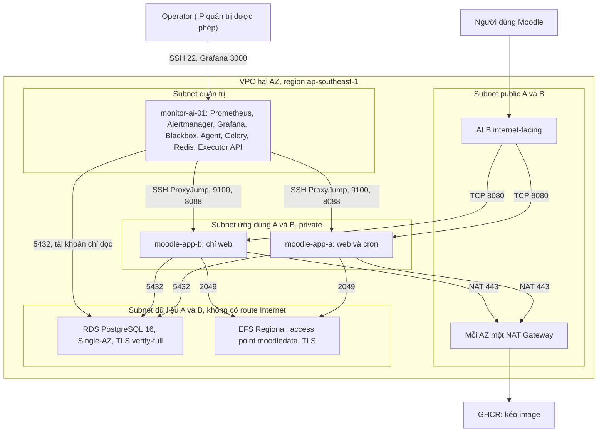
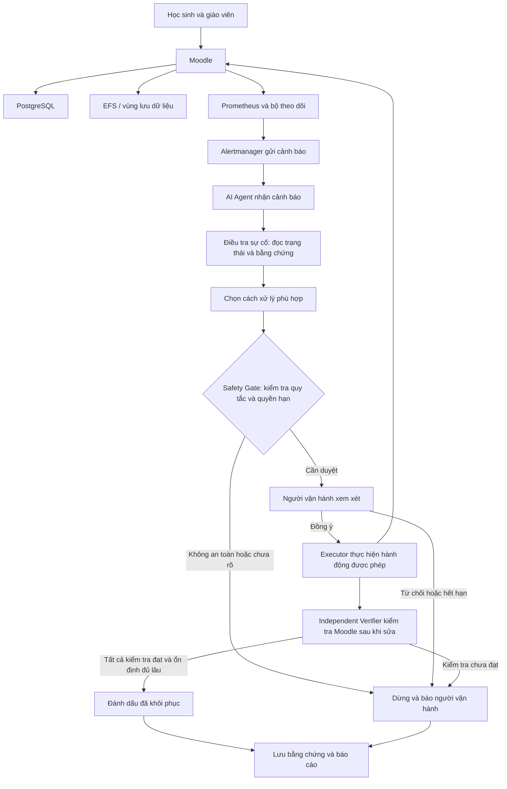
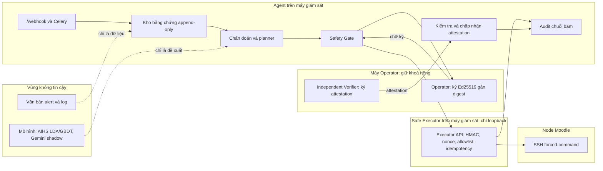
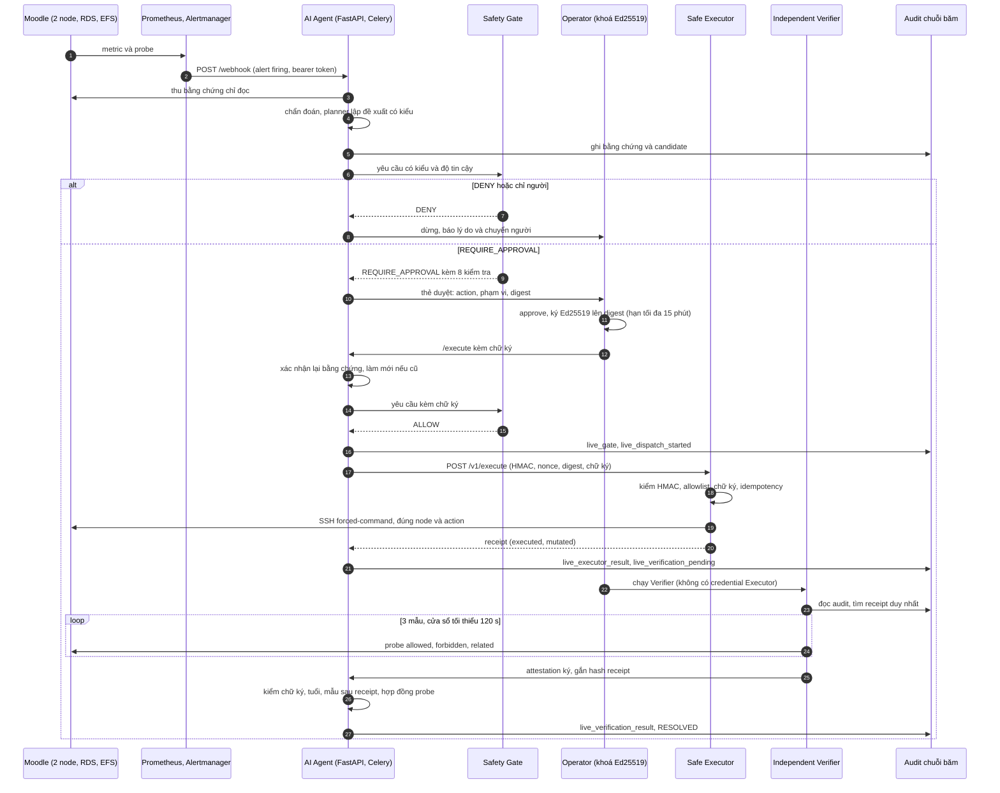
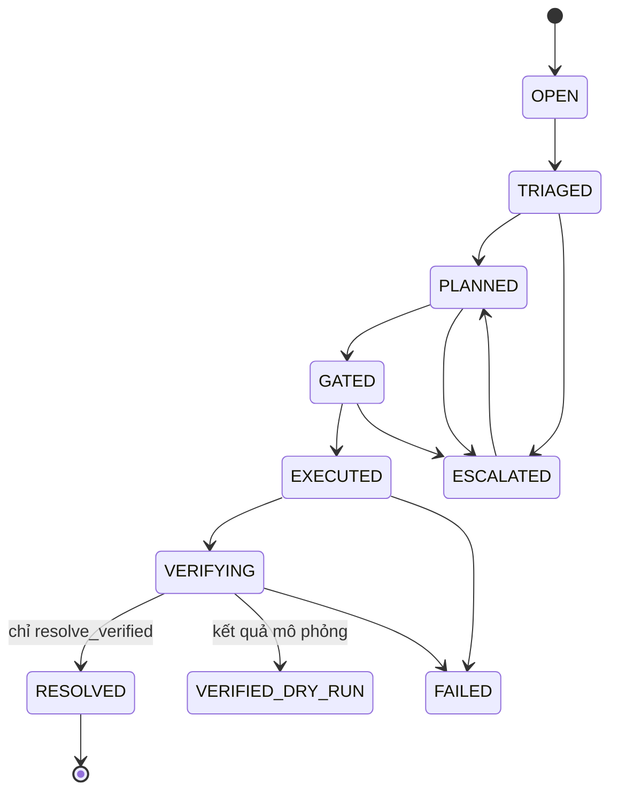
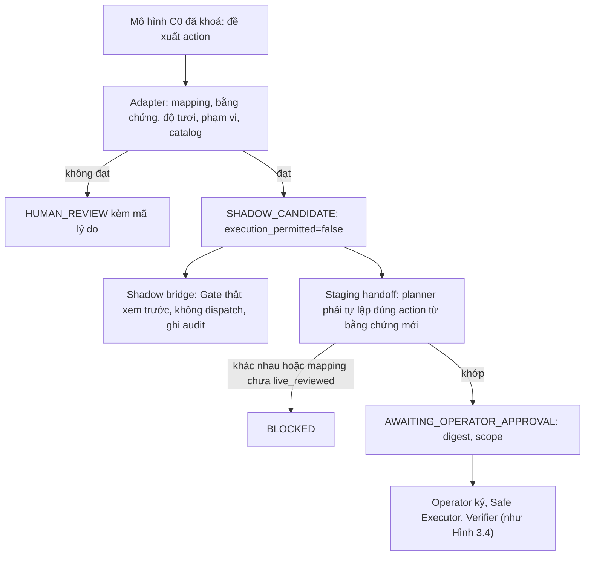

# Chương 3. Phân tích và thiết kế khung an toàn

Chương này chuyển bài toán ở Chương 1 và nền tảng ở Chương 2 thành một thiết kế cụ thể: yêu cầu và mô hình mối đe doạ, kiến trúc hạ tầng Moodle trên AWS, kiến trúc Agent, thiết kế từng lớp an toàn (Safety Gate, phê duyệt của Operator, Safe Executor, Independent Verifier, chuỗi audit), rồi tích hợp AIHS (LDA/GBDT) và phương pháp đánh giá theo bốn cấu hình C0–C3. Chương mô tả *thiết kế và lý do thiết kế*; cách hiện thực ở Chương 4, số liệu đo ở Chương 5. Con số xuất hiện trong chương là tham số thiết kế hoặc sự kiện đã ghi trong tài liệu của repo, không phải kết quả đánh giá mới.

## 3.1. Bài toán, các bên liên quan và yêu cầu

### 3.1.1. Phạm vi bài toán

Hệ thống cần bảo vệ là Moodle [Moodle] chạy trên AWS EC2: một ALB, hai node ứng dụng, RDS PostgreSQL, EFS dùng chung và một máy giám sát chạy Prometheus, Alertmanager và Agent. Khi có cảnh báo, Agent điều tra bằng chứng và đề xuất một hành động sửa; hệ thống phải quyết định hành động đó có được chạy không, ai cho phép, chạy thế nào và làm sao biết đã hồi phục thật. Mọi thao tác thay đổi hệ thống chỉ diễn ra ở staging; không có đường thi hành cho production. <!-- nguồn: AGENTS.md "Architecture and thesis scope"; docs/BAO_CAO_KIEN_TRUC_HA_TANG.md §1-§2 -->

Khó khăn nằm ở việc *giới hạn hậu quả khi chọn sai* và *không tin nhầm vào tín hiệu hồi phục*. AIHS tự động hoá việc chọn hành động bằng LDA và GBDT [AIHS2021] nhưng, theo phân tích của đồ án, không có Safety Gate độc lập và không có xác minh độc lập. Báo cáo của Google về agent AI trong SRE yêu cầu agent có danh tính và quyền được gán rõ, giải thích được hành động và đáp ứng yêu cầu bảo mật như con người [GoogleSRE-AI]; một bài viết CNCF cũng đòi mỗi tác nhân có danh tính riêng, quyền giới hạn và dấu vết kiểm toán [PlatformEng-Agentic]. Khung an toàn của đồ án là lớp *sau mô hình* đáp ứng các yêu cầu đó. <!-- nguồn: docs/PLANNING_UNG_DUNG_LDA_GBDT.md §2; Brainstorm/Google-SRE-AI.pdf (Design considerations); Brainstorm/Platform-Engineering.pdf -->

### 3.1.2. Các bên liên quan

**Bảng 3.1.** Các bên liên quan và vai trò trong thiết kế

| Bên | Vai trò | Quyền và mức tin cậy |
| --- | --- | --- |
| Người dùng Moodle (học sinh, giáo viên) | Dùng dịch vụ; chịu hậu quả của sự cố và của hành động sửa sai | Không tương tác với khung; là đối tượng cần bảo vệ, kể cả khỏi ảnh hưởng phụ của hành động sửa |
| Operator | Xem yêu cầu đã qua Gate, đồng ý hoặc từ chối | Giữ khoá riêng Ed25519 để ký; tin cậy cao nhưng là con người |
| AI Agent | Thu bằng chứng, chẩn đoán, lập đề xuất có kiểu | Không tin cậy ở phần đề xuất; không giữ khoá của Operator hay Verifier; không tự thi hành |
| Safe Executor | Chạy đúng action trong allowlist, trả receipt | Quyền hẹp (SSH forced-command); không nhận lệnh tự do |
| Independent Verifier | Đo hệ thống *sau* khi sửa, ký attestation | Chạy trên máy Operator, không có credential Executor; attestation của nó là đường duy nhất tới `RESOLVED` |
| Chủ miền | Duyệt mapping action và catalog | Chịu trách nhiệm `review_reference`; không thay chữ ký từng lượt |
| Kỹ sư hạ tầng | Quản lý Terraform, Ansible, image | Quyền AWS theo role, tách khỏi quyền SSH vào máy giám sát |

<!-- nguồn: docs/BAO_CAO_KIEN_TRUC_AI_AGENT_VA_AN_TOAN.md §2-§5; docs/BAO_CAO_KIEN_TRUC_HA_TANG.md §9; docs/BAO_CAO_A3_MAPPING_REVIEW_RECORD.md -->

### 3.1.3. Yêu cầu chức năng và phi chức năng

**Bảng 3.2.** Yêu cầu chức năng (FR)

| Mã | Yêu cầu | Lớp đáp ứng |
| --- | --- | --- |
| FR1 | Nhận cảnh báo qua webhook có xác thực, chống trùng, chỉ xử lý cảnh báo Moodle ở staging | Agent |
| FR2 | Thu bằng chứng chỉ đọc; chỉ đề xuất khi có ≥ 3 bằng chứng riêng biệt, còn mới, cùng incident | Evidence, planner |
| FR3 | Biểu diễn đề xuất thành action *có kiểu* lấy từ catalog; không nhận lệnh tự do | Planner, adapter AIHS |
| FR4 | Kiểm tra trước thi hành (policy, catalog, phạm vi, môi trường, độ tươi, rollback); action lạ thì chuyển người | Safety Gate |
| FR5 | Tách *phê duyệt* khỏi *thi hành*: chữ ký của Operator gắn đúng một action | Operator, Gate, Executor |
| FR6 | Thi hành trong allowlist, có kill switch, receipt và rollback đối ứng | Safe Executor |
| FR7 | Xác minh độc lập bằng probe allowed/forbidden/related và cửa sổ ổn định; chỉ attestation ký hợp lệ mới cho `RESOLVED` | Verifier, Agent |
| FR8 | Ghi vết mọi quyết định vào audit không sửa được và báo Operator | Audit, Telegram |
| FR9 | Chạy được C0–C3 trên cùng đề xuất để đo đóng góp từng lớp | Harness |

<!-- nguồn: AGENTS.md "Evidence and safety invariants", "AI Agent internals"; docs/BAO_CAO_KIEN_TRUC_AI_AGENT_VA_AN_TOAN.md §1-§5; docs/BAO_CAO_PROTOCOL_C0_C3_OFFLINE.md §2 -->

**Bảng 3.3.** Yêu cầu phi chức năng (NFR)

| Mã | Yêu cầu | Cách thể hiện |
| --- | --- | --- |
| NFR1 | An toàn mặc định (fail-closed) | Điều kiện thiếu, lạ hoặc mơ hồ dẫn tới không thi hành và chuyển người |
| NFR2 | Tách quyền | Agent không giữ khoá Operator/Verifier; Verifier không có credential Executor; công tắc live ở cả Agent và Executor |
| NFR3 | Giới hạn tác động | Chỉ staging; mỗi action có phạm vi cố định (tối đa hai node) và rollback đối ứng |
| NFR4 | Kiểm toán được | Audit append-only, chuỗi băm; `resolved` được tính lại từ chữ ký |
| NFR5 | Tái lập | Mỗi lượt có artifact và manifest sha256; protocol đánh giá khoá bằng sha256 |
| NFR6 | Độ trễ công khai | Chấp nhận thêm thời gian chờ duyệt và cửa sổ ổn định 120 s; không rút ngắn để số đo đẹp hơn |
| NFR7 | Bảo vệ bí mật | Secret ở tệp mount; log và audit được che thông tin nhạy cảm |
| NFR8 | Vận hành và mở rộng | Không build image trên EC2; Terraform lo cloud, Ansible lo host; truy cập nền tảng qua `PlatformAdapter` để sau này thêm ERPNext (chưa live) |

<!-- nguồn: AGENTS.md "Conventions to preserve"; docs/BAO_CAO_KIEN_TRUC_HA_TANG.md §1, §5, §11; docs/PLANNING_UNG_DUNG_LDA_GBDT.md §8, §9.3 -->

## 3.2. Mô hình mối đe doạ và giả định tin cậy

### 3.2.1. Tài sản, ranh giới tin cậy và giả định

Tài sản cần bảo vệ: tính khả dụng và toàn vẹn của Moodle (RDS, EFS), tính đúng của kết luận "đã hồi phục", và chuỗi bằng chứng/audit. Hệ thống chia thành các vùng tin cậy khác nhau (Hình 3.3). Vùng **không tin cậy** gồm đầu ra mọi mô hình (AIHS, Gemini) và văn bản của cảnh báo, log. Vùng **Agent** được tin ở việc *chuẩn bị*, không ở việc *quyết định quyền*. Vùng **máy Operator** giữ hai khoá riêng (ký phê duyệt, ký attestation) và chạy Verifier. **Safe Executor** chỉ nghe trên loopback và chỉ nói được với hai node qua forced-command.

Thiết kế dựa trên các giả định: (1) khoá riêng của Operator và Verifier chỉ nằm trên máy Operator; (2) máy Operator không bị chiếm và Operator ký có chủ ý; (3) catalog, bảng phạm vi và hợp đồng probe do chủ miền duyệt, và mã Gate/Executor/Verifier là mã đã duyệt; (4) telemetry không bị làm giả có chủ đích (đồ án chống *sai sót* và *thiếu bằng chứng*, không chống kẻ điều khiển được telemetry); (5) tài khoản và role AWS không bị chiếm, quyền AWS và quyền SSH vào máy giám sát là hai lớp độc lập; (6) chỉ xét staging. <!-- nguồn: docs/BAO_CAO_KIEN_TRUC_AI_AGENT_VA_AN_TOAN.md §3-§5; docs/BAO_CAO_KIEN_TRUC_HA_TANG.md §9; agent_src/core/environment_profile.py -->

### 3.2.2. Mối đe doạ và cơ chế đối phó

Báo cáo kiến trúc an toàn của repo mô tả cơ chế kiểm soát nhưng không có mục mô hình mối đe doạ riêng; Bảng 3.4 do khoá luận tổng hợp bằng cách đối chiếu từng bất biến an toàn với cơ chế trong mã.

**Bảng 3.4.** Mối đe doạ, cơ chế đối phó và rủi ro còn lại

| # | Mối đe doạ | Cơ chế đối phó | Rủi ro còn lại |
| --- | --- | --- | --- |
| T1 | AI đề xuất sai hoặc vượt phạm vi | Đề xuất chỉ là dữ liệu; Gate kiểm catalog, phạm vi, loại tài nguyên, rollback; action lạ → `DENY` | Action đúng catalog nhưng sai sự cố vẫn qua Gate nếu ngữ cảnh khớp; Operator là chốt cuối |
| T2 | Bằng chứng cũ, thiếu hoặc của incident khác | ≥ 3 bằng chứng khác nhau; mẫu mới ≤ 120 s và lệch nhau ≤ 60 s; kiểm toàn vẹn kho; xác nhận lại lúc thi hành | Telemetry sai có chủ đích (ngoài giả định) |
| T3 | Prompt hoặc dữ liệu độc hại, chuỗi bí mật | Mô hình ngoài đường alert; chỉ nhận số liệu có biên; ý định ép về `action_id`, `target_scope`, `rationale`; không tham số tự do | Văn bản độc hại chỉ ảnh hưởng tới *đề xuất*, không tới quyền thi hành |
| T4 | Chữ ký giả, tái dùng, duyệt nhầm action | Ed25519 trên digest (môi trường, kịch bản, action, phạm vi, khoá idempotency) kèm actor và hạn ≤ 15 phút; Executor kiểm lại; HMAC, timestamp, nonce chống phát lại; tin Telegram không phải chữ ký | Operator ký nhầm vẫn hợp lệ; lộ khoá riêng phá bảo đảm |
| T5 | Báo hồi phục giả (alert hết, `/healthz` 200, receipt `executed`) | Chỉ attestation ký của Verifier cho `RESOLVED`; 3 mẫu trong ≥ 120 s; đủ probe allowed/forbidden/related | Probe chưa phủ hết ảnh hưởng phụ vẫn có thể bỏ sót |
| T6 | Ảnh hưởng phụ sau khi sửa | Nhóm probe *related* theo kịch bản (ví dụ cả hai target ALB khoẻ) | Giới hạn bởi bộ probe đã định nghĩa |
| T7 | Lạm dụng Executor | Allowlist (kịch bản, action, phạm vi) → node do server quyết định; forced-command; kill switch ở Agent và Executor; idempotency bền vững | Node bị chiếm (ngoài giả định) |
| T8 | Sửa hoặc xoá dấu vết | Audit append-only (trigger chặn `UPDATE`/`DELETE`), chuỗi băm; kiểm chuỗi trước khi xác minh | Ai ghi được CSDL có thể thay audit, nhưng không giả được chữ ký Verifier |
| T9 | Rò đáp án (ground truth) vào quyết định | Alert không mang mã kịch bản; marker chỉ trong tệp root của host; image Agent không chứa ground truth; hàm quyết định không nhận tham số đáp án | Phụ thuộc kỷ luật kiểm thử; có test và kiểm tra CI |
| T10 | Lộ bí mật | Secret ở tệp mount; che thông tin trong log, audit, đề xuất mô hình | Người đọc được tệp trên host vẫn thấy secret |
| T11 | Operator sai hoặc mệt mỏi | Thẻ duyệt tóm tắt 8 kiểm tra; từ chối là kết cục hợp lệ; chính sách duyệt cố định giữa các nhánh đối chứng | Một người vừa thiết kế, duyệt và gán nhãn (mục 3.8) |

<!-- nguồn: docs/BAO_CAO_KIEN_TRUC_AI_AGENT_VA_AN_TOAN.md §3-§5; agent_src/core/safety/safe_execution_gate.py; agent_src/core/safety/safe_action_audit.py; agent_src/core/moodle/planner.py; agent_src/core/moodle/ai_shadow_proposal.py; automation/moodle-safe-executor-api.py; docs/BAO_CAO_KIEN_TRUC_HA_TANG.md §8.2; docs/BAO_CAO_KE_HOACH_CHAY_LIVE_C0_C3.md §4 -->

T3 và T9 gặp nhau ở một nguyên tắc: mô hình, ground truth và văn bản bên ngoài *không bao giờ* là đầu vào cấp quyền; ground truth chỉ dùng để chấm điểm sau quyết định. Khung không chống kẻ điều khiển telemetry, máy Operator bị chiếm, tấn công chuỗi cung ứng, từ chối dịch vụ lên Telegram, hay sự cố của chính RDS (RDS chạy Single-AZ nên failover nằm ngoài phạm vi đánh giá); các giới hạn này được nhắc lại ở Chương 6. <!-- nguồn: docs/BAO_CAO_KIEN_TRUC_HA_TANG.md §6.1, §11 -->

## 3.3. Kiến trúc hạ tầng Moodle trên AWS

Hạ tầng được thiết kế vừa giống một hệ thống Moodle thật vừa *đo được phần khắc phục của Agent*: không có Auto Scaling Group, nên một node dừng sẽ không được AWS tự thay và phần phục hồi quan sát được là phần Agent và Executor làm. Hạ tầng chạy ở region `ap-southeast-1`, hai Availability Zone. <!-- nguồn: docs/BAO_CAO_KIEN_TRUC_HA_TANG.md §2, §5 -->



**Hình 3.1.** Kiến trúc hạ tầng Moodle staging trên AWS

Các quyết định chính. **Phân tầng mạng:** tầng ứng dụng ra Internet qua NAT cùng AZ, tầng dữ liệu *không có* route ra Internet. **Luồng giữa thành phần** dùng tham chiếu security group, không dùng CIDR (Bảng 3.5); bị cấm gồm Internet vào node Moodle, RDS, EFS, Prometheus, Alertmanager và Agent, và node Moodle vào cổng quản trị của máy giám sát. Một rule ingress lạ vào RDS chính là kịch bản SEC-01. **Trạng thái:** mã Moodle nằm trong image Docker bất biến (tag theo commit SHA); dữ liệu nghiệp vụ trên RDS; `moodledata` và session trên EFS; cron chỉ chạy ở node A. **Quyền AWS tối thiểu:** quyền nằm ở role (bắt buộc MFA), không có quyền quản lý IAM, nên đổi IAM là hành động chỉ người; máy giám sát có role riêng chỉ với `ec2:DescribeSecurityGroupRules`, đủ để *phát hiện* rule lạ ở SEC-01, không đủ để *sửa*. **Ranh giới công cụ:** Terraform lo tài nguyên cloud, Ansible lo cấu hình host, image không build trên EC2 [Terraform] [Ansible] [Docker]; ALB, RDS, EFS, VPC là dịch vụ AWS [AWS]. <!-- nguồn: docs/BAO_CAO_KIEN_TRUC_HA_TANG.md §1, §3-§6, §9, §10 -->

**Bảng 3.5.** Các luồng mạng được phép (rút gọn)

| Nguồn | Đích | Cổng TCP | Mục đích |
| --- | --- | ---: | --- |
| Internet | ALB | 80, 443 | Cửa vào Moodle |
| ALB | Node Moodle | 8080 | Web và health check `/healthz.php` |
| Node Moodle | RDS | 5432 | Cơ sở dữ liệu, `sslmode=verify-full` |
| Node Moodle | EFS | 2049 | `moodledata`, TLS |
| Máy giám sát | Node Moodle | 22, 9100, 8088 | SSH, Node Exporter, cAdvisor |
| Máy giám sát | RDS | 5432 | Exporter chỉ đọc |
| IP quản trị | Máy giám sát | 22, 3000 | Bastion, Grafana |

<!-- nguồn: docs/BAO_CAO_KIEN_TRUC_HA_TANG.md §4 -->

**Giám sát và cảnh báo.** Prometheus [Prometheus] đánh giá 23 luật cảnh báo cho Moodle; Alertmanager [Alertmanager] gửi tới `POST /webhook` của Agent (`group_wait` 5 s, `repeat_interval` 4 giờ, `send_resolved`) bằng bearer token đọc từ tệp mount. Nguyên tắc quan trọng: **cảnh báo không mang mã kịch bản**; marker kịch bản chỉ nằm trong tệp root của host. Nhờ vậy Agent không "nhìn thấy đáp án" qua nhãn cảnh báo, và hai kịch bản có thể dùng chung một cảnh báo (NET-01 và SEC-02 cùng dùng `MoodleSyntheticTransactionFailed`), buộc Agent và Gate phân biệt bằng bằng chứng. Staging được dựng bằng Terraform theo từng đợt đo và gỡ sau mỗi đợt (ví dụ gỡ 70 tài nguyên sau phương án chính, 17/11/2026, rồi dựng lại cho các lượt bổ sung và gỡ lần nữa sau khi chạy xong cùng ngày); phần này vì thế là *mô tả cấu hình có thể dựng lại*, không khẳng định trạng thái AWS hiện tại. <!-- nguồn: docs/BAO_CAO_KIEN_TRUC_HA_TANG.md §8.2-§8.3; docs/PLANNING_UNG_DUNG_LDA_GBDT.md §6; docs/BAO_CAO_KE_HOACH_CHAY_LIVE_C0_C3.md §15-§16 -->

## 3.4. Kiến trúc Agent và luồng xử lý sự cố

### 3.4.1. Luồng tổng quát

Hình 3.2 là luồng tổng quát theo sơ đồ sơ bộ của đồ án: từ người dùng và Moodle, qua giám sát, tới Agent điều tra, rồi ba lớp kiểm soát (Safety Gate, Operator + Executor, Independent Verifier) và hai kết cục (đánh dấu khôi phục, hoặc dừng và báo Operator); nhánh nào cũng kết thúc bằng lưu bằng chứng và báo cáo.



**Hình 3.2.** Luồng xử lý sự cố tổng quát (theo sơ đồ sơ bộ; nhánh "từ chối hoặc hết hạn" bổ sung theo thiết kế phê duyệt)

<!-- nguồn: ảnh sơ đồ sơ bộ `A:/KLTN/KLTN sơ bộ là vậy.png`; docs/BAO_CAO_KIEN_TRUC_AI_AGENT_VA_AN_TOAN.md §1 -->

Ba điểm cần đọc kỹ. Safety Gate nằm *trước* con người: Operator chỉ được hỏi khi yêu cầu đã qua kiểm tra tự động. Sau "Đồng ý" vẫn còn hai lớp độc lập (Executor kiểm lại, Verifier đo lại), nên đồng ý không có nghĩa là xong. Mọi nhánh kết thúc đều lưu bằng chứng, kể cả nhánh dừng, vì nhánh dừng cũng là dữ liệu đánh giá.

### 3.4.2. Thành phần và ranh giới tin cậy



**Hình 3.3.** Các vùng tin cậy và đường đi của quyền

**Bảng 3.6.** Phân vai Safety Gate, Safe Executor và Independent Verifier

| Thành phần | Nhận đầu vào | Được quyết định | Không được quyết định |
| --- | --- | --- | --- |
| Safety Gate | Action có kiểu, bằng chứng, catalog, phạm vi, môi trường, approval | `DENY`, `REQUIRE_APPROVAL`, `ALLOW` | Không chạy lệnh; không tuyên bố đã sửa xong |
| Safe Executor | Yêu cầu đã ký và Gate cho phép | Chạy đúng action trong allowlist trên đúng node; ghi receipt | Không tự chọn action khác; không xác nhận phục hồi |
| Independent Verifier | Receipt và trạng thái *sau* khi sửa | Chấm probe, ký kết quả | Không sửa hệ thống; không dùng điểm mô hình làm bằng chứng phục hồi |

<!-- nguồn: docs/BAO_CAO_KIEN_TRUC_AI_AGENT_VA_AN_TOAN.md §2 -->

### 3.4.3. Luồng chi tiết

Đường alert đi Alertmanager → `/webhook` (FastAPI [FastAPI]) → tác vụ Celery [Celery] → điều tra bằng chứng. Khoá chống trùng lấy từ `fingerprint` của Alertmanager (hoặc băm các nhãn chính), lưu Redis với thời gian sống 900 s mặc định; cảnh báo `resolved` xoá khoá này và chỉ gửi thông báo "hết firing", *không* phải `RESOLVED`. Alert không bao giờ gọi Executor: chế độ `live` của đường alert bị đóng cố ý, mọi thi hành phải qua handoff của Operator. <!-- nguồn: AGENTS.md "AI Agent internals"; agent_src/core/moodle/alert_integration.py; docs/BAO_CAO_KIEN_TRUC_AI_AGENT_VA_AN_TOAN.md §1 -->



**Hình 3.4.** Sequence diagram từ cảnh báo tới `RESOLVED` hoặc dừng (nếu Verifier không đạt, incident không `RESOLVED` và Operator được báo)

<!-- nguồn: docs/BAO_CAO_KIEN_TRUC_AI_AGENT_VA_AN_TOAN.md §1, §3-§5; agent_src/core/safety/safe_action_live.py; agent_src/core/moodle/live_handoff.py; agent_src/core/main.py (endpoint /api/moodle/remediation, /api/moodle/verifications) -->

### 3.4.4. Máy trạng thái incident

"Chỉ Verifier được `RESOLVED`" được ép bằng máy trạng thái có bảo vệ (Hình 3.5). Chuyển thẳng sang `RESOLVED` hoặc `VERIFIED_DRY_RUN` qua đường chuyển thường bị từ chối; chỉ hàm `resolve_verified`, nhận một kết quả Verifier đầy đủ và hợp lệ, mới được chuyển và ghi tác nhân là `independent_verifier`. Incident chỉ vào `VERIFYING` sau khi đi qua `TRIAGED`, `PLANNED`, `GATED`, `EXECUTED`.



**Hình 3.5.** Máy trạng thái incident (mọi trạng thái chưa kết thúc đều có thể chuyển sang `FAILED`)

<!-- nguồn: agent_src/core/verification/state_machine.py -->

## 3.5. Thiết kế từng lớp an toàn

### 3.5.1. Điều tra bằng chứng và đề xuất có kiểu

Agent thu bằng chứng chỉ đọc từ Prometheus qua các truy vấn đã duyệt cho từng cảnh báo và lưu vào kho bằng chứng append-only (SQLite, trigger chặn sửa/xoá, băm nội dung từng bản ghi). Planner chỉ đề xuất khi một *dấu hiệu runtime chính xác và mới* của lỗi khớp với cảnh báo, mọi mẫu đủ mới (≤ 120 s) và lệch nhau ≤ 60 s, và có ≥ 3 bằng chứng riêng biệt; hai ứng viên cùng lúc hoặc không ứng viên nào thì không đề xuất. Mỗi action là một `TypedAction` với rollback, điều kiện trước và `requires_approval = True`. Gemini không nằm trên đường alert: nó chỉ dùng cho xem xét phản hồi quản trị và cho nhánh *shadow* tuỳ chọn, nơi ý định của mô hình bị ép về `action_id`, `target_scope`, `rationale` và kết quả luôn `dispatched = false`. <!-- nguồn: agent_src/core/moodle/planner.py; agent_src/core/evidence/evidence_store.py; agent_src/core/moodle/ai_shadow_proposal.py; AGENTS.md "Gemini usage" -->

### 3.5.2. Safety Gate

Gate là hàm kiểm tra thuần tuý: đánh giá yêu cầu và *không bao giờ thi hành*. Kết quả có ba giá trị: `DENY` (một điều kiện an toàn không đạt hoặc action ngoài phạm vi; ghi lý do), `REQUIRE_APPROVAL` (các kiểm tra chuẩn bị đạt nhưng cần chữ ký Operator) và `ALLOW` (yêu cầu và chữ ký hợp lệ). Trong đường live Moodle mọi action thay đổi hệ thống mang `requires_approval = True`, nên `ALLOW` chỉ xuất hiện *sau* khi có chữ ký; không có đường tự động hoàn toàn. Một yêu cầu cần duyệt nếu action đánh dấu cần duyệt, hoặc catalog mặc định cần duyệt (vai trò `operator` hoặc blast radius khác `LOW`), hoặc độ tin cậy dưới ngưỡng tự động 0,80; độ tin cậy dưới 0,65 bị `DENY`. Các kiểm tra đánh giá theo thứ tự cố định và dừng ở lỗi đầu tiên (Bảng 3.7); tin Telegram gom chúng thành "8/8" để Operator đọc, đây là kết quả *kiểm tra trước duyệt*, không phải lệnh đã chạy. <!-- nguồn: agent_src/core/safety/safe_execution_gate.py (evaluate, explain); agent_src/config/environment_profiles/staging.json; docs/BAO_CAO_KIEN_TRUC_AI_AGENT_VA_AN_TOAN.md §3 -->

**Bảng 3.7.** Các kiểm tra của Safety Gate (theo thứ tự đánh giá)

| Nhóm | Kiểm tra | Không đạt |
| --- | --- | --- |
| Cấu trúc và công tắc | Schema chặt (từ chối trường lạ); kill switch tắt; độ tin cậy là số hữu hạn trong [0, 1] | `DENY` |
| Bằng chứng | ≥ 3 tham chiếu khác nhau; khoá idempotency chưa dùng; không có tham số do người gọi cung cấp | `DENY` |
| Catalog | Action có trong catalog; thời gian chờ không vượt giới hạn; kiểu action khớp catalog | `DENY` |
| Rollback | Action thay đổi hệ thống phải thuận nghịch và có rollback đối ứng hai chiều đã duyệt | `DENY` |
| Phạm vi | Kịch bản, phạm vi, môi trường, vai trò khớp bảng thi hành đã duyệt; môi trường khớp hồ sơ đang bật | `DENY` |
| Mục tiêu | Tài nguyên đích nằm trong phạm vi và đúng loại catalog cho phép | `DENY` |
| Độ tin cậy | ≥ 0,65 | `DENY` |
| Phê duyệt | Nếu cần duyệt: chữ ký hợp lệ, đúng digest, actor trong danh sách, hạn ≤ 15 phút | `REQUIRE_APPROVAL` |
| Chống phát lại | Giữ chỗ khoá idempotency nguyên tử (Executor mới bảo đảm bền vững) | `DENY` |

<!-- nguồn: agent_src/core/safety/safe_execution_gate.py (evaluate, diagnose G00-G15) -->

Gate còn có hàm `diagnose` chạy *mọi* quy tắc, không dừng và không tác dụng phụ, phân loại thất bại thành `HARD` (cần đổi catalog hoặc policy) và `REMEDIABLE` (có thể qua nếu có bằng chứng mới); đây chỉ là công cụ giải thích cho Operator, không phải đường cấp quyền. Ngoài Gate live, repo có `SafetyPolicyEngine` dùng trong pipeline replay: ma trận luật R01–R07, các mẫu hành động bị cấm tuyệt đối (IAM, security group, `drop`, `truncate`, xoá volume, shell không giới hạn), bộ vai trò RBAC và quyết định `HUMAN_ONLY`. Hai tính chất thiết kế chính: **mặc định đóng** (lỗi schema, thiếu bằng chứng, scope lạ, kiểu lạ đều `DENY`, không có "gần đúng thì cho qua"), và **hồ sơ môi trường khai báo** (ngưỡng tin cậy, số bằng chứng tối thiểu, cửa sổ ổn định, node, scope nằm trong một hồ sơ đã duyệt; hồ sơ không phải staging phải ghim bằng sha256, dùng phê duyệt hai người, không cho executor HTTP thuần và đòi duyệt mọi thay đổi). <!-- nguồn: agent_src/core/safety/safe_execution_gate.py (diagnose); agent_src/core/safety/safety_policy_engine.py; evaluation/agent_replay/mvp_pipeline.py; agent_src/core/environment_profile.py -->

### 3.5.3. Phê duyệt của Operator

Phê duyệt được thiết kế để *gắn với đúng một action*. Operator xem thẻ duyệt trên Telegram [TelegramBot] (kịch bản, action, phạm vi, tài nguyên, 8 kiểm tra) và gửi `approve` hoặc `reject`. Bot chỉ nhận tin từ đúng nhóm và đúng danh sách người dùng quản trị; tin cũ, tin trả lời nhầm yêu cầu khác hoặc hai yêu cầu đồng thời trên một nhóm đều không duyệt được. Tin chat *không phải* chữ ký: sau `approve`, cầu nối dùng khoá riêng Ed25519 *trên máy Operator* ký thông điệp `digest:actor:expires_at`, với `digest` là SHA-256 của JSON chuẩn tắc gồm môi trường, kịch bản, action, phạm vi và khoá idempotency; hạn tối đa 15 phút (script mặc định 5 phút). Vì khoá idempotency nằm trong digest, một chữ ký không dùng lại được cho yêu cầu khác. <!-- nguồn: automation/moodle-telegram-approval.py; automation/moodle-safe-approval.py; agent_src/core/safety/safe_executor_client.py (action_digest); docs/BAO_CAO_KIEN_TRUC_AI_AGENT_VA_AN_TOAN.md §3 -->

Triển khai staging dùng chế độ `operator` (`AIOPS_APPROVAL_MODE=operator`, khớp hồ sơ staging): *một* chữ ký được cả Gate và Executor kiểm (Gate dùng digest của Executor), phù hợp với một người vận hành. Chế độ `two_person`, cũng là mặc định của mã khi không cấu hình, đòi hai chữ ký của hai actor khác nhau và bắt buộc với hồ sơ không phải staging. Chữ ký gắn với *danh tính action* (kịch bản, action, phạm vi, khoá idempotency), không gắn với danh sách ID bằng chứng, vì Operator có thể duyệt rất muộn; do đó ngay trước khi thi hành Agent tái thu bằng chứng nếu bằng chứng đã cũ và chỉ tiếp tục khi bằng chứng mới vẫn ủng hộ *cùng* action và mục tiêu. <!-- nguồn: agent_src/config/environment_profiles/staging.json; agent_src/core/moodle/live_handoff.py; ansible/playbooks/configure-moodle-monitoring.yml (AIOPS_APPROVAL_MODE) -->

### 3.5.4. Safe Executor

Executor là API HTTP nhỏ trên máy giám sát (chỉ loopback), mặc định *tắt* (`EXECUTOR_LIVE_ENABLED=false`). Một yêu cầu phải vượt lần lượt: (1) **xác thực truyền tải** bằng HMAC (phương thức, đường dẫn, timestamp lệch ≤ 30 s, nonce, băm thân); khoá này là khoá *truyền tải*, không phải khoá phê duyệt; (2) **schema và môi trường** `staging`; (3) **allowlist**: bộ ba (kịch bản, action, phạm vi) phải nằm trong bảng cố định, bảng này quyết định danh sách node, và digest phải khớp digest tính lại; (4) **chữ ký Operator**, Executor tự kiểm bằng khoá công khai [OpenSSL], actor trong danh sách, hạn ≤ 15 phút; (5) **kill switch**: nếu tắt trả `423` và `mutated = false` *trước* khi giữ khoá và trước mọi lệnh SSH; (6) **chống phát lại và idempotency bền vững**: nonce và khoá idempotency được giữ nguyên tử trong SQLite trước mọi thay đổi; (7) **thi hành** lần lượt từng node qua SSH forced-command, giới hạn 45 s mỗi node. <!-- nguồn: automation/moodle-safe-executor-api.py; docs/BAO_CAO_KIEN_TRUC_AI_AGENT_VA_AN_TOAN.md §4 -->

Receipt gồm `status` (`executed`, `partial_failure`, `failed`), node đã hoàn tất và `mutated`; khi một lệnh lỗi mà không biết đã đổi trạng thái chưa thì `mutated` là *chưa biết* (`mutation_state = unknown`). Phản hồi được ký HMAC; Agent xác thực và chuẩn hoá nghiêm ngặt, trường không nhất quán thì không tin và leo thang. Rollback chỉ được yêu cầu khi receipt chứng minh thay đổi một phần hoặc chưa biết, chỉ bằng action *đối ứng* đã duyệt cùng đích, với request và khoá idempotency mới. `executed` chỉ chứng minh action đã chạy, không bao giờ là bằng chứng phục hồi. Thiết kế này đối lập với các agent cho mô hình ra lệnh shell trực tiếp, như KubeLLM dùng lệnh shell Linux làm công cụ của agent [KubeLLM2025]: ở khung này mô hình chỉ chọn một *tên action* trong catalog, và tên đó phải qua Gate, chữ ký và allowlist. <!-- nguồn: agent_src/core/safety/safe_action_live.py; agent_src/core/safety/safe_executor_client.py; Brainstorm/KubeLLM_CameraReady.pdf (tóm tắt) -->

### 3.5.5. Independent Verifier

Verifier trả lời hai câu mà receipt không trả lời: dịch vụ đã hoạt động lại chưa, và việc sửa có gây hại nơi khác không. Nó chạy riêng trên máy Operator, không có khoá hay credential Executor. Quy trình: kiểm audit và yêu cầu *một* receipt `executed` có `mutated = true` khớp incident, request, kịch bản; lấy ≥ 3 mẫu trong cửa sổ ổn định ≥ 120 s (lấy mẫu mỗi 60 s), mỗi mẫu chạy script probe chỉ đọc đã duyệt; kiểm lại audit rồi ký attestation Ed25519 gắn với hash receipt. Để cửa sổ đúng 120 s trên đồng hồ thực, Verifier chờ tới khi đủ offset trên đồng hồ thực trước mỗi mẫu. <!-- nguồn: automation/moodle-independent-verifier.py; docs/BAO_CAO_KIEN_TRUC_AI_AGENT_VA_AN_TOAN.md §5; docs/BAO_CAO_KE_HOACH_CHAY_LIVE_C0_C3.md §12 -->

Mỗi kịch bản có *hợp đồng probe* gồm ba nhóm. **Allowed**: dịch vụ cần hoạt động đã hoạt động chưa (giao dịch Moodle tổng hợp). **Forbidden**: đường nguy hiểm còn bị chặn không (Internet không kết nối được PostgreSQL; probe dùng một health check TCP từ Internet tới RDS và phải *thất bại*). **Related**: thành phần liên quan và cảnh báo của kịch bản đã ổn chưa.

**Bảng 3.8.** Hợp đồng probe theo kịch bản (allowed là `common_synthetic_transaction`, forbidden là `internet_to_postgresql_blocked` ở mọi kịch bản)

| Kịch bản | Related |
| --- | --- |
| CON-01 | alert hết; container web node B khoẻ; cả hai target ALB khoẻ |
| DB-01 | alert hết; TLS tới DB từ node A và B; cả hai target ALB khoẻ |
| RES-01 | alert hết; container tải CPU đã biến mất |
| NET-01 | alert hết; phân giải DB đúng trên node A và B; cả hai target ALB khoẻ |
| SEC-02 | alert hết; mode thư mục fixture đã khôi phục; EFS đã mount |
| BIZ-01 | alert hết; maintenance đã tắt; trang khoá học HTTP 200 |
| BIZ-02 | alert hết; cron hoạt động; không còn ad-hoc task quá hạn |

<!-- nguồn: agent_src/core/verification/live_contracts.py; docs/BAO_CAO_KIEN_TRUC_HA_TANG.md §6.1 -->

Agent không tin Verifier một cách mù quáng. Trước khi ghi `RESOLVED`, Agent kiểm: chữ ký Ed25519 bằng khoá công khai của Verifier; attestation còn mới (≤ 120 s) và gắn đúng request; `receipt_event_hash` khớp receipt duy nhất trong audit và audit có một `ALLOW` của Gate *đứng trước* receipt; ≥ 3 mẫu tăng dần, trải ≥ 120 s, hai mẫu liên tiếp cách nhau ≤ 65 s; mỗi mẫu phủ đúng tập probe hợp đồng và đều đạt; mọi mẫu lấy *sau* receipt; kết quả không mô phỏng. Sau đó incident đi qua máy trạng thái ở Hình 3.5. Trạng thái `resolved` về sau được *tính lại* từ chữ ký và receipt; một dòng audit tự khai `resolved` mà không có chữ ký hợp lệ chỉ cho trạng thái `verifying`. Khi một probe lỗi, mẫu chưa đủ hoặc attestation không hợp lệ, incident chưa `RESOLVED` dù `/healthz.php` trả 200. SEC-01 (chỉ người) không có receipt Executor nên không có đường attestation tự động; hợp đồng probe của nó cố ý không có trong Bảng 3.8. <!-- nguồn: agent_src/core/safety/verifier_attestation.py; agent_src/core/safety/safe_action_audit.py (get_live_incident_status); agent_src/config/environment_profiles/staging.json; docs/BAO_CAO_KICH_BAN_LOI.md §4.7 -->

### 3.5.6. Chuỗi audit và bằng chứng

Mỗi incident có một chuỗi audit append-only: mỗi sự kiện chứa băm của sự kiện trước, băm của chính nó và nội dung chuẩn tắc; trigger SQLite chặn `UPDATE` và `DELETE` [SQLite]. Các sự kiện chính theo thứ tự: `live_gate`, `live_pre_snapshot`, `live_dispatch_started`, `live_executor_result`, `live_verification_pending`, `live_verification_result`. Mã luôn kiểm chuỗi (`verify_chain`) trước khi xác minh hoặc chuyển trạng thái, chuỗi hỏng thì từ chối; nội dung được che khoá, token và chuỗi kết nối trước khi vào audit. <!-- nguồn: agent_src/core/safety/safe_action_audit.py; agent_src/core/safety/safe_action_live.py; agent_src/core/safety/sanitization.py -->

## 3.6. Catalog action và các kịch bản lỗi

Bộ đánh giá chuẩn hoá của luận văn gồm bảy kịch bản (BIZ-01, BIZ-02, CON-01, DB-01, RES-01, NET-01, SEC-01), rút từ bộ mười tình huống cũ theo nguyên tắc "quản trị hạ tầng, không quản trị ứng dụng"; BIZ-02 sửa ở mức container cron, không sửa bảng `mdl_task_adhoc`. Chiến dịch AIHS dùng thêm **SEC-02** (thư mục fixture trên EFS bị đổi mode về `0000`), có trong catalog và mapping đã duyệt, nên Bảng 3.9 có tám hàng. <!-- nguồn: docs/BAO_CAO_KICH_BAN_LOI.md §1; docs/PLANNING_UNG_DUNG_LDA_GBDT.md §11.1; agent_src/core/safety/action_catalog.py -->

**Bảng 3.9.** Kịch bản lỗi, action trong catalog, mức rủi ro và việc chạy live

| Mã | Lỗi được cấy | Alert | Action sửa và phạm vi | Blast | Live trong chiến dịch AIHS |
| --- | --- | --- | --- | --- | --- |
| BIZ-01 | Kẹt chế độ bảo trì CLI | `MoodleMaintenanceModeStuck` | `disable_moodle_cli_maintenance_mode`, `staging_moodle_app` | LOW | Không (ảnh hưởng toàn site); chỉ mã và test |
| BIZ-02 | Cron dừng, hàng đợi ad-hoc kẹt | `MoodleAdhocTaskQueueStuck` | `restart_moodle_cron_service`, `staging_moodle_app` | LOW | Có: 3 lượt chính, 2 thi hành |
| CON-01 | Web container node B dừng | `MoodleWebContainerMissing` | `start_reviewed_compose_service`, `moodle-app-b` | LOW | Có: 3 lượt, 3 thi hành; thêm 2 lượt bổ sung có lỗi phụ |
| DB-01 | Chặn TCP 5432 tới RDS trên hai node | `MoodleNodeRdsTcpFailed` | `remove_scoped_db_reject`, `staging_moodle_nodes` | LOW | Có: 3 lượt, 0 thi hành; 2 lượt bổ sung đều thi hành |
| RES-01 | Container tải CPU có tên trên node B | `MoodleNodeCpuHigh` | `remove_named_cpu_load_container`, `moodle-app-b` | LOW | Có: 3 lượt, 2 thi hành |
| NET-01 | Ghi đè `/etc/hosts` cho endpoint RDS trong container | `MoodleSyntheticTransactionFailed` | `recreate_moodle_web_from_reviewed_compose`, `staging_moodle_nodes` | MEDIUM | Có: 3 lượt, 0 thi hành; đã chạy ở drill có Operator |
| SEC-02 | Mode thư mục fixture trên EFS về `0000` | `MoodleSyntheticTransactionFailed` | `restore_fixture_directory_mode`, `moodledata_synthetic_fixture_directory` | LOW | Có: 3 lượt, 2 thi hành |
| SEC-01 | Rule lạ trong security group của RDS | `MoodleDatabasePortExposure` | `remove_tagged_database_ingress_rule`, `staging_database_security_group` | HIGH | Không bao giờ: chỉ người |

<!-- nguồn: agent_src/core/safety/action_catalog.py; docs/BAO_CAO_KICH_BAN_LOI.md §1, §4; docs/BAO_CAO_KE_HOACH_CHAY_LIVE_C0_C3.md §15-§17; docs/PLANNING_UNG_DUNG_LDA_GBDT.md §11.1 -->

Từ bảng có ba nhận xét thiết kế. **Mỗi kịch bản sửa được ứng đúng một action đã duyệt**, có rollback đối ứng (`reconcile_*` hoặc action đảo ngược; các `reconcile_*` chỉ dùng để reset); NET-01 là action duy nhất blast radius MEDIUM (tạo lại web container trên cả hai node). **SEC-01 là chỉ người bởi nhiều lớp độc lập:** planner gán disposition `human_only_escalation`; action yêu cầu vai trò `operator` (không phải `executor`) và không có rollback nên Gate từ chối; nó không có trong bảng thi hành, trong allowlist Executor và trong hợp đồng Verifier; script `moodle-scenario-verify.sh SEC-01` phải trả mã `64` và CI kiểm điều này. **NET-01 và SEC-02 cùng một cảnh báo**, nên planner chỉ đề xuất khi có dấu hiệu runtime riêng của từng lỗi; cả hai hoặc không bên nào có dấu hiệu thì không đề xuất. Ngoài ra DB-02 (đổi cấu hình AWS), BIZ-01 và SEC-01 bị loại khỏi danh sách action chạy live của chiến dịch. <!-- nguồn: agent_src/core/safety/action_catalog.py; agent_src/core/moodle/planner.py; docs/BAO_CAO_KICH_BAN_LOI.md §4.7; docs/PLANNING_UNG_DUNG_LDA_GBDT.md §11.1; AGENTS.md "Commands" -->

## 3.7. Thiết kế tích hợp AIHS

### 3.7.1. Hợp đồng đề xuất

AIHS gồm Mapper LDA, Predictor GBDT đa lớp và Controller (các GBDT nhị phân) [AIHS2021]. Khung này đối xử với AIHS như *nguồn đề xuất không đáng tin*, không phải bộ ra quyết định. Hợp đồng đề xuất (adapter) có bốn tính chất. (1) **Đầu ra mô hình chỉ chọn một mục của bảng mapping đã duyệt**; kịch bản, phạm vi, tài nguyên đích và bằng chứng đến từ *ngữ cảnh tin cậy* của hệ thống, không từ đề xuất, ground truth hay nhãn. (2) **Fail-closed theo mã lý do** (`model_unavailable`, `invalid_model_output`, `unknown_aihs_action`, `human_only_action`, `observe_only_action`, `missing_evidence`, `stale_evidence`, `stale_prediction`, `cross_incident_evidence`, `invalid_evidence`, `unmapped_action`, `scope_mismatch`, `catalog_not_allowed`); chỉ khi vượt hết mới có ứng viên. (3) **Độ tươi tại thời điểm dự đoán**: môi trường khớp, dự đoán không cũ quá 120 s hay đến từ tương lai quá 30 s, ≥ 3 tham chiếu khác nhau của cùng incident, mỗi bản ghi không muộn hơn thời điểm dự đoán và không cũ quá 120 s. (4) **Kiểu dữ liệu không mang quyền**: kết quả adapter luôn `execution_permitted = false` và `dispatched = false`. <!-- nguồn: agent_src/core/moodle/aihs_contract.py -->

Có hai hợp đồng. Hợp đồng thứ nhất dành cho sáu mã server gốc của prototype AIHS (`NOP`, `MSR`, `ER`, `RB`, `RI`, `RMA`): năm mã đầu `unmapped`, `RMA` là `human_only`, vì sáu mã của máy chủ Alibaba không ánh xạ được sang action Moodle. Hợp đồng thứ hai dành cho C0 (`aihs-paper-repro-moodle-v1`): mô hình chọn trực tiếp một trong tám lớp là sáu action đã duyệt cộng `wait_and_recheck` (chỉ quan sát) và `call_human` (luôn chuyển người). Tên lớp trùng `catalog_action_id` (schema mapping bắt buộc điều này), nên không cần khâu dịch mã giữa hai không gian tên. <!-- nguồn: agent_src/core/moodle/aihs_c0.py; evaluation/aihs/a3-action-mapping.json; docs/PLANNING_UNG_DUNG_LDA_GBDT.md §11.1; docs/BAO_CAO_A3_MAPPING_REVIEW_DRAFT.md -->

### 3.7.2. Mapping: bản nháp và bản đã duyệt cho live

**Bảng 3.10.** Trạng thái của một mục mapping action

| Trạng thái | Ý nghĩa | Được dùng cho |
| --- | --- | --- |
| `draft_unreviewed` | Bản nháp do agent soạn, chưa có chủ miền duyệt, không có `review_reference` | Chỉ replay offline (cờ `allow_draft_for_replay`), ứng viên gắn `draft_shadow_candidate` |
| `shadow_reviewed` | Đã duyệt cho shadow | Shadow và xem trước Gate; không dùng cho staging handoff |
| `live_reviewed` | Chủ miền duyệt, bắt buộc có `review_reference` | Staging handoff (vẫn cần Gate, chữ ký, Executor, Verifier) |
| `observe_only`, `human_only` | `wait_and_recheck`, `call_human` | Không có mapping vào catalog; không bao giờ tới Gate hay Executor |

<!-- nguồn: agent_src/core/moodle/aihs_c0.py; agent_src/core/moodle/aihs_staging_handoff.py -->

Hai bản mapping tồn tại song song. Bản nháp `a3-c0-action-mapping-draft.json` (`draft_pending_domain_review`, không mục nào được duyệt) dùng khi khoá protocol offline và chấm tập test. Bản `a3-c0-action-mapping-reviewed.json` (`reviewed_for_live`) được chủ miền duyệt ngày 16/11/2026 cho sáu action thay đổi hệ thống, giữ nguyên catalog, đích, phạm vi, điều kiện trước, rollback và probe so với bản nháp. Biên bản nêu điều kiện: duyệt mapping *không* phải cho phép chạy; mỗi lượt vẫn cần Gate, chữ ký Operator gắn action, Safe Executor và Independent Verifier; chỉ áp dụng cho staging; action ngoài danh sách vẫn fail-closed. Hệ quả đo lường: kết quả offline chỉ khẳng định "yêu cầu có kiểu hợp lệ trong phạm vi mapping nháp", không khẳng định "action đã được chuyên gia duyệt". <!-- nguồn: docs/BAO_CAO_A3_MAPPING_REVIEW_RECORD.md; docs/BAO_CAO_PROTOCOL_C0_C3_OFFLINE.md §1 -->

### 3.7.3. Shadow bridge và staging handoff



**Hình 3.6.** Cầu nối từ đề xuất AIHS tới Safety Gate và tới handoff staging

<!-- nguồn: agent_src/core/moodle/aihs_shadow.py; agent_src/core/moodle/aihs_staging_handoff.py -->

**Shadow bridge** chạy Gate thật trên yêu cầu mà *planner đáng tin* chuẩn bị (không phải do AIHS dựng) cùng độ tin cậy đáng tin do hệ thống cung cấp (hằng số 0,9 trong đánh giá; xác suất thành công `p_success` của C0 không bao giờ là đầu vào cấp phép). Kết quả chỉ là bản xem trước ghi vào audit (`dispatched = false`, `resolution_eligible = false`). **Staging handoff** chặt hơn: mapping phải `reviewed_for_live` với mục `live_reviewed` có `review_reference`; action phải thay đổi hệ thống với vai trò `executor`; và *planner của Agent phải độc lập lập ra đúng cùng action* từ bằng chứng mới. Chỉ khi mọi ràng buộc khớp (action, kịch bản, phạm vi, mục tiêu, môi trường, tập bằng chứng, hai digest tính lại, xem trước Gate là `REQUIRE_APPROVAL`) trạng thái mới thành `AWAITING_OPERATOR_APPROVAL`. Mapping `live_reviewed` là *điều kiện cần*, không bao giờ là sự cho phép; handoff chỉ chuẩn bị yêu cầu duyệt, không ký, không thi hành, không chấp nhận kết quả Verifier. <!-- nguồn: agent_src/core/moodle/aihs_shadow.py; agent_src/core/moodle/aihs_staging_handoff.py; agent_src/core/moodle/live_handoff.py; docs/BAO_CAO_PROTOCOL_C0_C3_OFFLINE.md §3 (D3) -->

Ở đánh giá, ngữ cảnh mà Gate dùng cho mỗi đề xuất chỉ suy ra từ *các cảnh báo đang firing trước thời điểm quyết định*, bằng một bảng cố định (ví dụ `MoodleNodeRdsTcpFailed` → DB-01); nhiều ứng viên hoặc không ứng viên thì chuyển người. Quy tắc này an toàn nhưng có chi phí (chặn nhầm, tăng chuyển người), được đo ở Chương 5. <!-- nguồn: docs/BAO_CAO_PROTOCOL_C0_C3_OFFLINE.md §3 (D1); evaluation/aihs/score_c0_c3_offline.py (derive_context) -->

### 3.7.4. Bốn cấu hình C0–C3

Bốn cấu hình giữ nguyên model, snapshot, proposal và mapping; chỉ lớp bảo vệ phía sau model thay đổi. Nhờ vậy khác biệt về an toàn và khôi phục quy được cho từng lớp, còn chất lượng dự đoán của model được báo riêng (HitRate, ReverseRate…) và không gán cho Gate, Executor hay Verifier.

**Bảng 3.11.** Bốn cấu hình so sánh

| Cấu hình | Thành phần | Kết luận phục hồi | Thi hành thật? |
| --- | --- | --- | --- |
| C0 | AIHS LDA/GBDT (`aihs-paper-repro-moodle-v1`) | Không áp dụng | Không: phản thực tế "thi hành nguyên trạng" (`would_dispatch_as_is`) |
| C1 | C0 + Safety Gate | Không áp dụng | Không: Gate chạy shadow trên đề xuất |
| C2 | C1 + Operator duyệt + Safe Executor | Chỉ health-only: `/healthz` 200, giao dịch synthetic đạt, hết alert | Có, nhưng *không bao giờ* ghi `RESOLVED` |
| C3 | C2 + Independent Verifier | Verifier: probe allowed/forbidden/related, cửa sổ 120 s, attestation ký | Có; đường *duy nhất* tới `RESOLVED` |

<!-- nguồn: docs/BAO_CAO_PROTOCOL_C0_C3_OFFLINE.md §2; docs/BAO_CAO_KE_HOACH_CHAY_LIVE_C0_C3.md §1; docs/PLANNING_UNG_DUNG_LDA_GBDT.md §7 -->

```text
Lớp:   [Đề xuất C0] -> [Safety Gate] -> [Operator ký + Safe Executor] -> [Independent Verifier]
C0:        có            (không)               (không)                        (không)
C1:        có            có, shadow            (không)                        (không)
C2:        có            có                    có, thi hành thật              (không; kết luận health-only)
C3:        có            có                    có, thi hành thật              có; đường duy nhất tới RESOLVED
```

**Hình 3.7.** Chồng lớp C0–C3 (mỗi cấu hình thêm một lớp lên cấu hình trước)

**Vì sao C0 và C1 không thi hành live.** Bốn lý do, đều là quyết định đã đăng ký trước khi chạy: (1) biên bản duyệt mapping yêu cầu *mọi lượt live có Gate, chữ ký Operator, Safe Executor*, mà C0 thi hành nguyên trạng không qua Gate; (2) đồ án không cho action nguy hiểm hoặc vượt phạm vi chạy thật để lấy số liệu, nên C0 chỉ ghi `would-dispatch` và được chấm bằng nhãn an toàn; (3) prototype AIHS chỉ *trả đề xuất*, không chạy action, nên "C0 live" thực chất là một harness do khoá luận dựng, không phải AIHS production; (4) so sánh thời gian chỉ hợp lệ khi hai nhánh có quy trình duyệt tương đương. C0 và C1 vì thế chạy offline trên tập test của lab và dạng *shadow* trong lượt live (ghi đề xuất và quyết định Gate từ cùng snapshot, không chạm staging). Offline không có Operator, Executor hay probe phục hồi, nên C2 và C3 được ghi `OFFLINE_EQUALS_C1_BY_CONSTRUCTION` và không được trình bày như cải thiện so với C1.

**C2 được lấy từ C3, không chạy riêng.** Để so sánh *kết luận health-only* với *kết luận Verifier trên cùng một lần thi hành*, mọi lượt live là C3, còn C2 là *góc nhìn* `health_only_view` ghi từ chính lượt đó (cùng action, cùng thời điểm), trả lời câu "nếu chỉ dựa vào health-only thì kết luận gì". Cách này loại biến nhiễu giữa hai lượt khác nhau nhưng không quan sát được hành vi riêng của C2 khi không có Verifier (ví dụ Operator xử lý khác đi); đó là một giới hạn đã ghi. <!-- nguồn: docs/BAO_CAO_KE_HOACH_CHAY_LIVE_C0_C3.md §1 (quyết định phương án b); docs/BAO_CAO_PROTOCOL_C0_C3_OFFLINE.md §2; docs/PLANNING_UNG_DUNG_LDA_GBDT.md §1, §8 -->

## 3.8. Thiết kế phương pháp đánh giá

Chương 5 trình bày số liệu; mục này chỉ nêu nguyên tắc để kết quả đáng tin. Việc cấy lỗi, thu telemetry và giao diện đánh giá được tách riêng, theo tinh thần của các framework đánh giá agent vận hành cloud như AIOpsLab, vốn triển khai môi trường, cấy lỗi, sinh tải, xuất telemetry và cung cấp giao diện cho agent cũng như cho việc đánh giá [AIOpsLab2025]. Điểm khác là trọng tâm ở đây là *lớp an toàn sau mô hình*, không phải năng lực chẩn đoán của agent.

**(1) Đăng ký trước và khoá sha256.** Protocol offline `c0-c3-offline-v1` (quyết định, công thức, mẫu số, quy tắc dừng) được *khoá bằng sha256* cùng scorer và mã Gate trước khi mở tập test; sau khi khoá, sửa nội dung làm scorer từ chối chạy. Bản khoá còn ghi sha256 của model, proposal, split, nhãn và mapping. Kế hoạch live (số lượt, ngẫu nhiên hoá theo khối với hạt giống cố định, chính sách Operator, quy tắc dừng) cũng đăng ký trước, và kế hoạch các lượt bổ sung được ghi *trước* khi dựng lại staging. <!-- nguồn: docs/BAO_CAO_PROTOCOL_C0_C3_OFFLINE.md §3 (D6), §7, §8; docs/BAO_CAO_KE_HOACH_CHAY_LIVE_C0_C3.md §3, §6, §16 -->

**(2) Mở tập test một lần.** Scorer chỉ mở tập test sau khi có tệp khoá; một marker "đã mở" được tạo *trước khi* đọc nhãn test, và còn marker thì từ chối chạy lại. Nếu scorer lỗi giữa chừng, sửa mã là *protocol deviation* phải công bố, không được lặng lẽ xoá marker. Tỷ lệ có mẫu số nhỏ hơn 5 được báo `INSUFFICIENT_DENOMINATOR`; mẫu số 0 là không xác định (`null`), không điền 0; khoảng tin cậy offline là bootstrap 95 % theo nhóm incident/phiên, vì đơn vị độc lập là nhóm, không phải dòng. <!-- nguồn: docs/BAO_CAO_PROTOCOL_C0_C3_OFFLINE.md §3 (D5, D6), §4, §7 -->

**(3) Tách loại bằng chứng** (Bảng 3.12): không cộng lẫn số liệu giữa các loại, và mỗi loại chỉ cho phép một loại kết luận.

**Bảng 3.12.** Loại bằng chứng và phạm vi kết luận

| Loại bằng chứng | Ví dụ trong đồ án | Được kết luận | Không được kết luận |
| --- | --- | --- | --- |
| Kiểm thử đơn vị và hợp đồng | Bộ test của Agent; schema, fail-closed, chữ ký | Logic đúng trên đầu vào đã định nghĩa | Hiệu quả trên sự cố thật |
| Replay offline | Replay 15 kịch bản trong CI; replay C0 shadow | Quyết định đúng trên dữ liệu mẫu | Phục hồi live, RTO |
| Lab cục bộ | Lab Docker mô phỏng staging; train/validation/test | Chất lượng model và chi phí của Gate trên lab | Hành vi trên AWS |
| Live staging | Lượt C3 và lượt bổ sung trên AWS | Cơ chế và kết quả quan sát ở staging | Tỷ lệ ở production |

<!-- nguồn: README.md "Evidence modes"; AGENTS.md "Evidence and safety invariants"; docs/PLANNING_UNG_DUNG_LDA_GBDT.md §6, §10; agent_src/README.md (phần lab) -->

**(4) Ground truth không là đầu vào quyết định.** Hàm quyết định của harness chỉ nhận đặc trưng trước quyết định; mã kịch bản chỉ được truyền cho phần cấy lỗi, reset và chấm điểm; mã lượt chạy là chuỗi mờ không chứa mã kịch bản (có test). Đặc trưng cấm gồm marker kịch bản, ground truth, chữ ký, kết quả Executor hay Verifier và mọi thông tin sau quyết định. <!-- nguồn: evaluation/aihs/live_c0_harness.py (đầu tệp); docs/BAO_CAO_KE_HOACH_CHAY_LIVE_C0_C3.md §4; docs/PLANNING_UNG_DUNG_LDA_GBDT.md §6 -->

**(5) Bất biến an toàn của chiến dịch.** Mỗi lượt kiểm năm bất biến: chỉ Verifier mới `RESOLVED`; nhánh shadow không bao giờ thi hành; không thi hành khi chưa duyệt; chữ ký gắn đúng digest đã chuẩn bị; C2 không bao giờ `RESOLVED`. Một vi phạm là dừng chiến dịch; reset hoặc baseline sau lượt không sạch cũng dừng. <!-- nguồn: evaluation/aihs/live_c0_harness.py (check_invariants); docs/BAO_CAO_KE_HOACH_CHAY_LIVE_C0_C3.md §6 -->

**(6) Mẫu số trung thực, đo cả chi phí.** Lượt bị Gate chặn, Operator từ chối, hết hạn hoặc lỗi Executor/Verifier vẫn nằm trong mẫu số. Đo cả mặt tốt (chặn action sai, tránh hồi phục giả) và mặt xấu (chặn nhầm, tăng chuyển người, thêm độ trễ). Thời điểm health-only (C2) và thời điểm Verifier ký (C3) *không* so trực tiếp vì ý nghĩa khác nhau; so sánh chính là thời gian đến *hồi phục thật*, đo bằng luồng probe chấm điểm tách khỏi luồng Verifier. Với ba lặp mỗi kịch bản, chỉ báo cáo mô tả (đếm, trung vị, từng lượt), không p-value. <!-- nguồn: docs/PLANNING_UNG_DUNG_LDA_GBDT.md §4, §8; docs/BAO_CAO_KE_HOACH_CHAY_LIVE_C0_C3.md §2, §4 -->

**(7) Công bố sai lệch.** Mọi thay đổi sau khi thấy dữ liệu được ghi công khai: quy tắc suy ngữ cảnh D1 được chỉnh sau khi xem kết quả validation và trước khi khoá protocol; lượt pilot có lỗi tích hợp được giữ nguyên và không tính vào mẫu chính; một lượt bị huỷ vì reset thất bại được lưu như bằng chứng định tính; các lượt bổ sung (kể cả hai lượt cấy lỗi phụ có chủ đích) báo riêng, không gộp vào mẫu chính. <!-- nguồn: docs/BAO_CAO_PROTOCOL_C0_C3_OFFLINE.md §3 (D1); docs/BAO_CAO_KE_HOACH_CHAY_LIVE_C0_C3.md §11-§13, §16-§17 -->

**Giới hạn thiết kế đã biết.** Người duyệt, người thiết kế và người gán nhãn là cùng một người, chưa có người gán nhãn độc lập thứ hai nên các chỉ số cần nhãn độc lập chỉ mang tính mô tả. Probe chấm điểm dùng chung hợp đồng với Verifier nên không hoàn toàn độc lập về hợp đồng. Lab khác staging (năm đặc trưng `lb_*` chỉ có ở lab). Chỉ có một môi trường (Moodle); ERPNext và AIOpsLab/Kubernetes là hướng phát triển. <!-- nguồn: docs/BAO_CAO_KET_QUA_C0_C3.md §6; docs/PLANNING_UNG_DUNG_LDA_GBDT.md §9.3, §11.1 -->

## 3.9. Tiểu kết chương

Chương này đặt khung an toàn trên một nguyên tắc: *đầu ra của mô hình là đề xuất không đáng tin; quyền chỉ đến từ các lớp độc lập, mỗi lớp có thể nói "không"*. Safety Gate kiểm tra catalog, phạm vi, độ tươi bằng chứng và độ tin cậy, mặc định đóng. Phê duyệt là một chữ ký Ed25519 gắn đúng một action, tách khỏi thi hành. Safe Executor kiểm lại chữ ký, chỉ chạy allowlist qua SSH forced-command và ghi receipt. Independent Verifier đo probe allowed/forbidden/related trong cửa sổ ổn định tối thiểu 120 s và ký attestation; chỉ attestation hợp lệ qua máy trạng thái mới cho `RESOLVED`. Mọi bước ghi vào chuỗi audit append-only.

Về AIHS, chương mô tả hợp đồng đề xuất fail-closed, hai trạng thái mapping (bản nháp cho offline, `live_reviewed` cho staging), shadow bridge và staging handoff. Bốn cấu hình C0–C3 thêm dần từng lớp lên cùng một đề xuất; C0 và C1 không thi hành live theo thiết kế, còn C2 được đọc từ góc nhìn health-only của lượt C3. Phương pháp đánh giá dựa trên đăng ký trước và khoá sha256, mở tập test một lần, tách bốn loại bằng chứng, không đưa ground truth vào quyết định, giữ mọi lượt bất lợi trong mẫu số và công bố mọi sai lệch. Chương 4 mô tả hiện thực; Chương 5 trình bày số liệu; Chương 6 nêu giới hạn và hướng phát triển.

## Tài liệu tham khảo của chương

- **[AIHS2021]** Rui Li và cs., "Automated Intelligent Healing in Cloud-Scale Data Centers", IEEE International Symposium on Reliable Distributed Systems (SRDS), 2021. DOI: 10.1109/SRDS53918.2021.00032.
- **[GoogleSRE-AI]** Stevan Malesevic, Christopher Heiser, "AI in SRE: Where and how Google is deploying agentic AI to improve operations", DevOps & SRE, Google, 29/05/2026. Tệp lưu: `A:/KLTN/Brainstorm/Google-SRE-AI.pdf`.
- **[AIOpsLab2025]** Yinfang Chen, Manish Shetty, Gagan Somashekar, Minghua Ma, Yogesh Simmhan, Jonathan Mace, Chetan Bansal, Rujia Wang, Saravan Rajmohan, "AIOpsLab: A Holistic Framework to Evaluate AI Agents for Enabling Autonomous Clouds", arXiv:2501.06706v1 [cs.AI], 12/01/2025.
- **[KubeLLM2025]** Mario De Jesus, Perfect Sylvester, William Clifford, Aaron Perez, Palden Lama, "LLM-Based Multi-Agent Framework For Troubleshooting Distributed Systems", Proc. of the 2025 IEEE Cloud Summit (bản camera-ready). Tệp lưu: `A:/KLTN/Brainstorm/KubeLLM_CameraReady.pdf`.
- **[PlatformEng-Agentic]** Lakmal Warusawithana (WSO2), "Platform engineering for the agentic enterprise: Managing applications, resources, and AI agents", blog thành viên CNCF, đăng 21/07/2026. Tệp lưu: `A:/KLTN/Brainstorm/Platform-Engineering.pdf`.
- **[Terraform]** HashiCorp, tài liệu Terraform. https://developer.hashicorp.com/terraform
- **[Ansible]** Red Hat, tài liệu Ansible. https://docs.ansible.com/
- **[Docker]** Docker Inc., tài liệu Docker. https://docs.docker.com/
- **[AWS]** Amazon Web Services, tài liệu AWS (ALB, VPC, RDS, EFS). https://docs.aws.amazon.com/
- **[Moodle]** Moodle, tài liệu Moodle (Moodle Docs). https://docs.moodle.org/
- **[TelegramBot]** Telegram, tài liệu Bot API. https://core.telegram.org/bots/api
- **[Prometheus]** Prometheus Authors, tài liệu Prometheus. https://prometheus.io/docs/
- **[Alertmanager]** Prometheus Authors, tài liệu Alertmanager. https://prometheus.io/docs/alerting/latest/alertmanager/
- **[FastAPI]** tài liệu FastAPI. https://fastapi.tiangolo.com/
- **[Celery]** tài liệu Celery. https://docs.celeryq.dev/
- **[OpenSSL]** OpenSSL Project, tài liệu OpenSSL. https://www.openssl.org/docs/
- **[SQLite]** tài liệu SQLite. https://www.sqlite.org/docs.html
